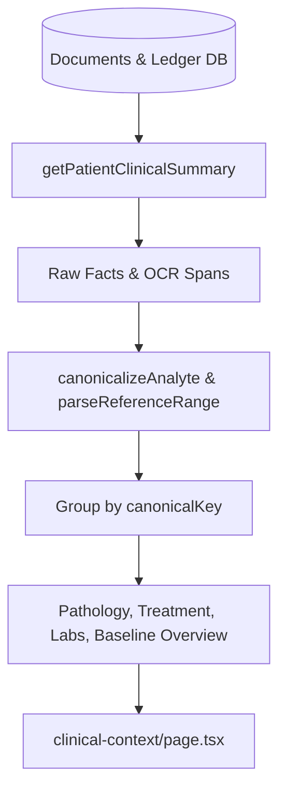

# Evidence Provenance Contracts & Data Flows

This document details the data contracts, query services, and URL routing specifications for maintaining evidence provenance in OncoBrief.

---

## 1. Source Inspector URL Routing Specification

All source inspection links must conform to this URL pattern:

```text
/patients/[patientId]/sources/[documentId]?fact=[factId]&page=[pageNumber]
```

### URL Search Parameters:
- `fact` (`string`, required): The UUID of the ledger fact or observation to highlight.
- `page` (`number`, optional): The 1-based page number containing the evidence text span. Defaults to `1` if omitted.

### Component Implementation Pattern:
```tsx
import Link from 'next/link';

export function SourceLink({
  patientId,
  documentId,
  documentName,
  factId,
  pageNumber,
}: {
  patientId: string;
  documentId: string;
  documentName: string;
  factId: string;
  pageNumber?: number | null;
}) {
  const href = `/patients/${patientId}/sources/${documentId}?fact=${factId}${
    pageNumber ? `&page=${pageNumber}` : ''
  }`;

  return (
    <Link
      href={href}
      className="mono truncate text-[11px] text-[var(--color-accent)] underline decoration-dotted hover:text-[var(--color-accent-strong)]"
      title={`Open source report: ${documentName}`}
    >
      {documentName}
      {pageNumber ? ` · p${pageNumber}` : ''}
    </Link>
  );
}
```

---

## 2. Clinical Summary Query Data Flow

The `getPatientClinicalSummary` function in `@oncobrief/db` (`packages/db/src/services/documents.ts`) constructs the complete view over the Evidence Ledger:



### Key Return Types:
- `summary.overview`: Structured patient anthropometrics (Height, Weight, Blood Group, ECOG, Allergies) + derived BSA/BMI.
- `summary.cards`: Collapsible categories for Pathology, Treatment, Recent Labs, and Quick Insights.
- `summary.analyteGroups`: Canonical analyte buckets containing full chronological observations for chart trending.
- `summary.allObservations`: Flat array of all observations for global counts and filtering.

---

## 3. Mathematical Derivations & Explicit Transparency

When computing derived clinical values (e.g., Body Surface Area via Mosteller or Du Bois formula, Body Mass Index):
- Derivation must be deterministic and pure.
- Derivations must **never** be presented as raw extracted facts.
- The UI must explicitly badge the value as `Derived` and state:
  1. The exact mathematical formula used (`Math.sqrt((height * weight) / 3600)`).
  2. The exact source input observations and their respective observation dates.
  3. Any temporal disparity warning (e.g., if height and weight were documented on different dates).
