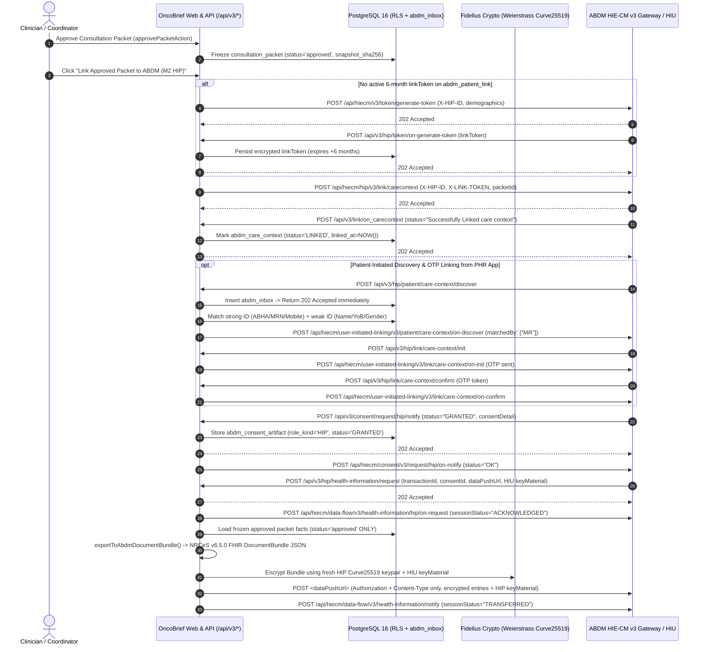
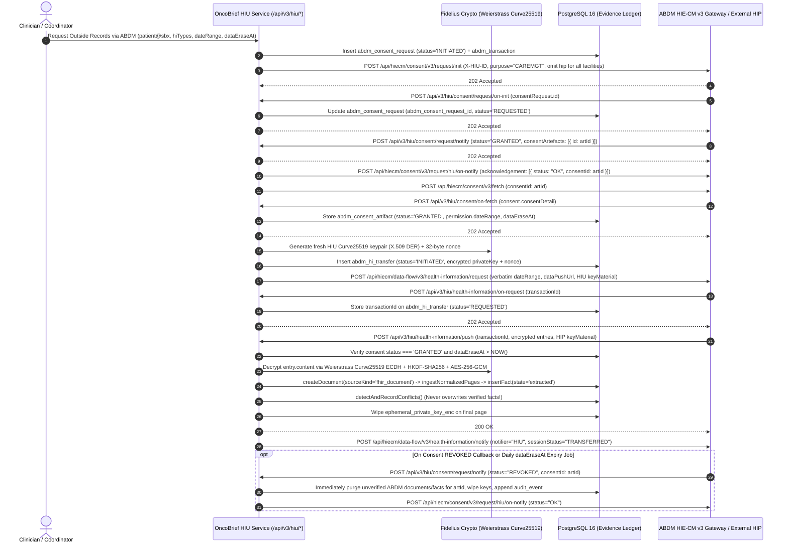

# OncoBrief ABDM V3 (M2 HIP + M3 HIU) Validated Architecture & Implementation Plan

- **Document Status:** Awaiting Stakeholder Approval (No Existing Codebase Files Modified)
- **Target Architecture:** ABDM HIE-CM V3 (`https://dev.abdm.gov.in/api/hiecm` Sandbox / `https://apis.abdm.gov.in/api/hiecm` Production)
- **Clinical Profile Standard:** [NRCeS FHIR R4 Implementation Guide for ABDM v6.5.0](https://nrces.in/ndhm/fhir/r4/6.5.0/)
- **Selected Scope:** Full **Milestone 2 (HIP)** + **Milestone 3 (HIU)** with Dual-Driver Execution (`ABDM_DRIVER=simulated | sandbox`)

## 1. Executive Summary & Resolution of Scope Decisions

### 1.1 Decision 1 — Full M2 HIP + M3 HIU Role Scope
OncoBrief will operate as both a **Health Information Provider (M2 HIP)** and a **Health Information User (M3 HIU)** while strictly preserving its core Evidence Ledger and non-clinical boundary invariants ([`CLAUDE.md`](../CLAUDE.md), [`packages/domain/src/policy/clinical-boundary.ts`](../packages/domain/src/policy/clinical-boundary.ts)):
- **As an M3 HIU (Record Consumer):** Clinicians and coordinators request patient consent (`CAREMGT`) via the patient's ABHA Address (`@sbx` / `@abdm`), receive asynchronous consent notifications and artifacts, generate ephemeral Fidelius ECDH keys, receive and decrypt inbound NRCeS FHIR `DocumentBundle` payloads pushed by external hospitals, and ingest them into `document` (`source_kind = 'fhir_document'`) -> `document_page` -> `text_span` -> `evidence_fact` (`state = 'extracted'`). Imported facts **never bypass human verification** and **never silently overwrite existing `verified` facts** (disagreements route through `detectAndRecordConflicts` into `conflict_set`). When a patient revokes consent (`REVOKED`) or `permission.dataEraseAt` passes, OncoBrief immediately purges the unverified raw ABDM bundle and ephemeral keys.
- **As an M2 HIP (Approved Packet Publisher):** When a clinician approves and freezes a consultation packet (`consultation_packet.status = 'approved'`), OncoBrief can register that frozen packet as an ABDM Care Context (`hiType: 'OPConsultation'`, `careContextReference: packet.id`), respond to HIP-initiated and user-initiated discovery/linking callbacks, receive HIP consent notifications, and—upon receiving an HIU health-information request—export the frozen human-verified facts via [`exportToAbdmDocumentBundle`](../packages/domain/src/fhir/abdm-bundle-mapper.ts), encrypt the bundle with Fidelius ECDH (`Curve25519` short Weierstrass + `HKDF-SHA256` + `AES-256-GCM`), push it to the requesting HIU's `dataPushUrl`, and notify the ABDM Gateway (`TRANSFERRED`). **Draft packets and unverified (`extracted`, `conflicting`, `rejected`) facts are never exposed to discovery or data transfer.**

### 1.2 Decision 2 — Is Basic ABHA Capture or Full M1 Enrolment Required?
Per the [Official NHA ABDM Milestone Guidelines (`docs.abdm.gov.in/docs/hiecm/v3/milestones`)](https://docs.abdm.gov.in/docs/hiecm/v3/milestones) and [NHA Go-Live / Sandbox Exit Criteria (`docs.abdm.gov.in/docs/hiecm/v3/getting-started/going-live`)](https://docs.abdm.gov.in/docs/hiecm/v3/getting-started/going-live):

1. **NHA Sandbox Exit Two-Milestone Rule:** NHA requires **at least two completed milestones** to exit the Sandbox and receive production credentials (`apis.abdm.gov.in`). Completing **M2 (HIP) + M3 (HIU)** provides two full milestones.
2. **Technical Dependency for M2 HIP & M3 HIU (What M2 & M3 Actually Require):**
   - **Full M1 Aadhaar Enrolment (`/abha/api/v3/enrollment/enrol/byAadhaar`) is NOT technically required** to execute or test M2 or M3 in the Sandbox or in deployments where patients already hold an ABHA (created via the ABHA mobile app or hospital registration desk).
   - **Structured ABHA Demographic Capture + M2 Link Token Generation IS Strictly Required:**
     - **For M3 (HIU):** You only need the patient's **ABHA Address** (`name@sbx` in Sandbox, `name@abdm` in Production) to initiate `POST /api/hiecm/consent/v3/request/init`.
     - **For M2 (HIP) & NRCeS v6.5.0 Certification:** You must capture and store on the patient record:
       1. **ABHA Address** (`name@sbx` / `name@abdm`, emitted in FHIR `Patient.identifier` under `https://healthid.ndhm.gov.in`),
       2. **14-Digit ABHA Number** (`91-XXXX-XXXX-XXXX`, emitted in FHIR `Patient.identifier` under `https://healthid.abdm.gov.in`),
       3. **Exact Aadhaar-Matching Demographics:** Full Name (including middle name), Gender (`M` / `F` / `O`), Year of Birth (`YYYY`), and 10-digit Mobile Number.
       4. **M2 Link Token Generation (`POST /api/hiecm/v3/token/generate-token` -> callback `/api/v3/hip/token/on-generate-token`):** Before calling `POST /api/hiecm/hip/v3/link/carecontext`, the HIP must exchange those captured demographics for a 6-month `X-LINK-TOKEN` header.
3. **When NHA Requires M1 Certification:**
   - In the NHA milestone matrix ([`docs.abdm.gov.in/docs/hiecm/v3/milestones`](https://docs.abdm.gov.in/docs/hiecm/v3/milestones)), if an application registers as a primary **Health Facility / HMIS Software** (rather than a specialty clinical workspace integrating alongside an existing HIS), NHA's intake team can require M1 alongside M2/M3 at Stage 4 review.
   - **Recommended Architecture in This Plan:**
     - **Core Build (Mandatory for M2 + M3):** Implement full **Dual-ABHA & Demographic Capture** (`abha_number`, `abha_address`, `name`, `gender`, `year_of_birth`, `mobile`), automatic promotion of verified `identifier.abha` facts into `patient_identifier`, **M2 Link Token Generation** (`/v3/token/generate-token`), and **Scan-and-Share Desk Profile Receiver** (`/api/v3/hip/patient/share` -> `/patient-share/v3/on-share`).
     - **Modular M1 Verification Adapter (Ready if NHA Requests M1):** Provide the two-step V3 ABHA Login/Verify client (`/abha/api/v3/profile/login/request/otp` -> `/login/verify` returning `T-token` -> `/login/verify/user` returning `X-token` -> `/profile/account/abha-card`) behind `AbdmAbhaPort`, while keeping Aadhaar KYC creation (`/enrollment/enrol/byAadhaar`) out of the core clinical UI unless explicitly requested by NHA during your sandbox ticket review.

### 1.3 Decision 3 — Simulated Implementation Now + Sandbox Onboarding Playbook
Because your NHA Sandbox registration is pending approval, OncoBrief will implement a **loopback-capable `SimulatedAbdmGatewayAdapter` (`ABDM_DRIVER=simulated`)** that exercises the **exact same database tables, webhook route handlers, Fidelius Curve25519 encryption/decryption math, and NRCeS v6.5.0 FHIR bundle mappers** as `HttpAbdmGatewayAdapter` (`ABDM_DRIVER=sandbox`).
- In `simulated` mode, when OncoBrief (as HIU) requests consent and health information, the simulated gateway dispatches real asynchronous loopback HTTP/service callbacks into OncoBrief's M2 HIP and M3 HIU handlers—encrypting a realistic multi-entry oncology `DocumentBundle` (Tata Memorial / ACTREC fixture or another approved OncoBrief packet) with Fidelius ECDH on the HIP side and decrypting + ingesting it on the HIU side.
- Switching to the live NHA Sandbox once your credentials arrive requires **zero code changes**—only setting `ABDM_DRIVER=sandbox` and populating the environment variables in Section 9.

## 2. Authoritative Validation of ABDM V3 API Paths, Headers & Callbacks

> **Documentation Provenance Note:** All endpoints, headers, and payload contracts below were cross-validated against the [NHA ABDM Developer Portal (`docs.abdm.gov.in/docs/hiecm/v3/milestones`)](https://docs.abdm.gov.in/docs/hiecm/v3/milestones), [NHA ABDM Going Live Guide (`docs.abdm.gov.in/docs/hiecm/v3/getting-started/going-live`)](https://docs.abdm.gov.in/docs/hiecm/v3/getting-started/going-live), [NRCeS FHIR R4 IG v6.5.0 (`nrces.in/ndhm/fhir/r4/6.5.0`)](https://nrces.in/ndhm/fhir/r4/6.5.0/), and verified V3 reference guides ([ABDM V3 API Migration Guide](https://nirmitee.io/blog/abdm-v3-api-migration-guide-everything-that-changed/), [ABDM M2 HIP Reference Architecture](https://nirmitee.io/blog/building-abdm-hip-from-scratch-m2-flow-reference-architecture/), [ABDM M3 HIU Reference Architecture](https://nirmitee.io/blog/building-abdm-hiu-from-scratch-m3-flow-reference-architecture/), and [ABDM Fidelius Node.js Guide](https://nirmitee.io/blog/abdm-fidelius-encryption-nodejs-implementation-guide/)). Note that `abdm-docs.dev.eka.care` and `docs.coronasafe.network` block automated crawlers and were therefore corroborated via the primary NHA/NRCeS sources above.

### 2.1 Base URLs & Mandatory V3 HTTP Headers

| Environment | HIE-CM V3 Gateway Base URL | ABHA V3 Base URL | `X-CM-ID` Header |
| :--- | :--- | :--- | :--- |
| **Sandbox** | `https://dev.abdm.gov.in/api/hiecm` | `https://abhasbx.abdm.gov.in/abha/api/v3` | `sbx` |
| **Production** | `https://apis.abdm.gov.in/api/hiecm` | `https://abha.abdm.gov.in/abha/api/v3` | `abdm` |

**Mandatory Headers on Every Outbound Gateway Call:**
1. `Authorization: Bearer <accessToken>` (obtained from Gateway Session API)
2. `Content-Type: application/json`
3. `REQUEST-ID: <UUID v4>` — **Must be a fresh UUID v4 per call; if the request JSON body also includes a top-level `requestId`, it MUST equal the `REQUEST-ID` header byte-for-byte.**
4. `TIMESTAMP: <ISO-8601 UTC>` — e.g. `2026-10-23T07:10:10.000Z` (server clock must be NTP-synced within `< 5 minutes` skew).
5. `X-CM-ID: sbx` (or `abdm` in production).
6. **Role-Specific Header (Never Mix):**
   - Send `X-HIP-ID: <registered_hip_facility_id>` **only** on M2 HIP calls.
   - Send `X-HIU-ID: <registered_hiu_facility_id>` **only** on M3 HIU calls.
   - Send `X-LINK-TOKEN: <patient_link_token>` **only** on `POST /api/hiecm/hip/v3/link/carecontext`.

**Mandatory Correlation Rule on Every `on-*` Reply:**
When ABDM calls an OncoBrief webhook, it sends its request identifier in the `REQUEST-ID` HTTP header. When OncoBrief sends the asynchronous `on-*` response to the Gateway:
- Outbound `REQUEST-ID` header = fresh UUID v4 (`replyRequestId`).
- Outbound body `requestId` (if present in V3 schema) = `replyRequestId`.
- Outbound body `response.requestId` = **the exact `REQUEST-ID` header value received on the inbound webhook**.

### 2.2 Validated Gateway & Bridge Management Endpoints

| Direction | Method & Path (Relative to Host) | Headers Required | Purpose & Contract |
| :--- | :--- | :--- | :--- |
| **Outbound** | `POST /api/hiecm/gateway/v3/sessions` *(Configurable fallback: `POST /gateway/v0.5/sessions`)* | `REQUEST-ID`, `TIMESTAMP`, `X-CM-ID`, `Content-Type` | Body: `{ "clientId": "...", "clientSecret": "...", "grantType": "client_credentials" }`. Returns `{ "accessToken": "...", "expiresIn": 900, "tokenType": "Bearer" }`. Cache until `expiresIn - 60s`. |
| **Outbound** | `PATCH /api/hiecm/gateway/v3/bridge/url` | `Authorization`, `REQUEST-ID`, `TIMESTAMP`, `X-CM-ID` | Body: `{ "url": "https://<public-domain>/api/v3" }`. Registers the global callback base URL for this `clientId` (takes 5–15 min to propagate). |
| **Outbound** | `GET /api/hiecm/gateway/v3/bridge-services` | `Authorization`, `REQUEST-ID`, `TIMESTAMP`, `X-CM-ID` | Reads back registered bridge URL and linked HIP/HIU service IDs. |
| **Outbound** | `GET /api/hiecm/gateway/v3/certs` | `Authorization`, `REQUEST-ID`, `TIMESTAMP`, `X-CM-ID` | Fetches Gateway public JWKS / RSA certificates for webhook JWT verification and M1 RSA encryption. |

### 2.3 Validated M2 (Health Information Provider — HIP) V3 Endpoints & Callbacks

| Sub-Flow | Direction | Method & V3 Path | Key Headers | Payload & Behavioral Contract |
| :--- | :--- | :--- | :--- | :--- |
| **A1. Generate Link Token** | **HIP -> GW** | `POST /api/hiecm/v3/token/generate-token` | `Authorization`, `REQUEST-ID`, `TIMESTAMP`, `X-CM-ID`, `X-HIP-ID` | Body: `{ "abhaNumber": 91000000000000, "abhaAddress": "patient@sbx", "name": "Exact Aadhaar Name", "gender": "M", "yearOfBirth": 1980 }`. Returns `202 Accepted`. |
| **A2. Receive Link Token** | **GW -> HIP** | `POST /api/v3/hip/token/on-generate-token` *(Alias supported: `/hip/v3/links/link/token`)* | Inbound `REQUEST-ID`, `X-HIP-ID` | Delivers `{ "abhaAddress": "patient@sbx", "linkToken": "<jwt>", "response": { "requestId": "..." } }`. Valid for 6 months; store encrypted in `abdm_patient_link`. Return `202 Accepted` in `< 2s`. |
| **A3. Link Care Context** | **HIP -> GW** | `POST /api/hiecm/hip/v3/link/carecontext` | `Authorization`, `REQUEST-ID`, `TIMESTAMP`, `X-CM-ID`, `X-HIP-ID`, `X-LINK-TOKEN` | Body: `{ "abhaNumber": ..., "abhaAddress": "patient@sbx", "patient": [{ "referenceNumber": "<patientId>", "display": "<Patient Name>", "hiType": "OPConsultation", "count": 1, "careContexts": [{ "referenceNumber": "<approvedPacketId>", "display": "Oncology Consult Packet - <date>" }] }] }`. **Send 1 care context per call.** |
| **A4. Link Care Context ACK** | **GW -> HIP** | `POST /api/v3/link/on_carecontext` *(Alias: `/api/v3/hip/link/on-add-contexts`)* | Inbound `REQUEST-ID`, `X-HIP-ID` | Body: `{ "abhaAddress": "...", "status": "Successfully Linked care context", "response": { "requestId": "..." } }`. Marks `abdm_care_context.status = 'LINKED'` and sets `linked_at = NOW()`. |
| **A5. Context Update Notify** | **HIP -> GW** | `POST /api/hiecm/hip/v3/link/context/notify` | `Authorization`, `REQUEST-ID`, `TIMESTAMP`, `X-CM-ID`, `X-HIP-ID`, `X-LINK-TOKEN` | Notifies Gateway when an existing linked care context has updated records; callback arrives at `POST /api/v3/links/context/on-notify`. |
| **A6. SMS Notify** | **HIP -> GW** | `POST /api/hiecm/hip/v3/link/patient/links/sms/notify2` | `Authorization`, `REQUEST-ID`, `TIMESTAMP`, `X-CM-ID`, `X-HIP-ID` | Sends SMS notification to patient's phone when care contexts are available. |
| **B1. User-Initiated Discovery** | **GW -> HIP** | `POST /api/v3/hip/patient/care-context/discover` *(Alias: `/user-initiated-linking/v3/patient/care-context/discover`)* | Inbound `REQUEST-ID`, `X-HIP-ID` | **Asynchronous in V3:** Immediately persist to `abdm_inbox` and return `202 Accepted`. Match patient by strong ID (`abhaNumber`, `abhaAddress`, `mrn`, or 10-digit `mobile`) + weak ID (`name`, `gender`, `yearOfBirth`). Never guess across multiple matches. |
| **B2. Discovery Response** | **HIP -> GW** | `POST /api/hiecm/user-initiated-linking/v3/patient/care-context/on-discover` | `Authorization`, `REQUEST-ID`, `TIMESTAMP`, `X-CM-ID`, `X-HIP-ID` | Body includes `transactionId`, `patient: [{ referenceNumber, display, careContexts, hiType, count }]`, `matchedBy: ["MR"]` (or `["MOBILE"]`), `response: { requestId: inboundRequestId }`. If no match, send `error: { code: 1000, message: "No matching patient found" }`. Return **only unlinked `approved` packets**. |
| **B3. User Link Init** | **GW -> HIP** | `POST /api/v3/hip/link/care-context/init` *(Alias: `/user-initiated-linking/v3/link/care-context/init`)* | Inbound `REQUEST-ID`, `X-HIP-ID` | Return `202 Accepted`. Generate 6-digit OTP for the requested `transactionId` and `careContexts`, send OTP via `DeliveryPort`, and call `on-init`. |
| **B4. User Link On-Init** | **HIP -> GW** | `POST /api/hiecm/user-initiated-linking/v3/link/care-context/on-init` | `Authorization`, `REQUEST-ID`, `TIMESTAMP`, `X-CM-ID`, `X-HIP-ID` | Body: `{ "transactionId": "...", "link": { "referenceNumber": "<linkRef>", "authenticationType": "DIRECT", "meta": { "communicationMedium": "MOBILE", "communicationHint": "******1234", "communicationExpiry": "<ISO>" } }, "response": { "requestId": inboundRequestId } }`. |
| **B5. User Link Confirm** | **GW -> HIP** | `POST /api/v3/hip/link/care-context/confirm` *(Alias: `/user-initiated-linking/v3/link/care-context/confirm`)* | Inbound `REQUEST-ID`, `X-HIP-ID` | Return `202 Accepted`. Verify OTP against `confirmation.linkRefNumber` and `confirmation.token`. |
| **B6. User Link On-Confirm** | **HIP -> GW** | `POST /api/hiecm/user-initiated-linking/v3/link/care-context/on-confirm` | `Authorization`, `REQUEST-ID`, `TIMESTAMP`, `X-CM-ID`, `X-HIP-ID` | Body returns linked `patient: [{ referenceNumber, display, careContexts, hiType, count }]` and `response: { requestId }`. Updates `abdm_care_context.status = 'LINKED'`. |
| **C1. HIP Consent Notify** | **GW -> HIP** | `POST /api/v3/consent/request/hip/notify` | Inbound `REQUEST-ID`, `X-HIP-ID` | Return `202 Accepted`. Persist `notification.consentDetail` (`GRANTED`) or mark `REVOKED` / `EXPIRED` in `abdm_consent_artifact` (`role_kind = 'HIP'`). |
| **C2. HIP Consent On-Notify** | **HIP -> GW** | `POST /api/hiecm/consent/v3/request/hip/on-notify` | `Authorization`, `REQUEST-ID`, `TIMESTAMP`, `X-CM-ID`, `X-HIP-ID` | Body: `{ "acknowledgement": { "status": "OK", "consentId": "<consentId>" }, "response": { "requestId": inboundRequestId } }`. |
| **D1. HIP Data Request** | **GW -> HIP** | `POST /api/v3/hip/health-information/request` | Inbound `REQUEST-ID`, `X-HIP-ID` | Return `202 Accepted`. Note: read `transactionId` from **top-level body** (or `hiRequest.transactionId` fallback). Validate `hiRequest.consent.id` is `GRANTED` and not expired, and validate `hiRequest.keyMaterial`. |
| **D2. HIP Data On-Request** | **HIP -> GW** | `POST /api/hiecm/data-flow/v3/health-information/hip/on-request` | `Authorization`, `REQUEST-ID`, `TIMESTAMP`, `X-CM-ID`, `X-HIP-ID` | Body: `{ "hiRequest": { "transactionId": "...", "sessionStatus": "ACKNOWLEDGED" }, "response": { "requestId": inboundRequestId } }`. |
| **D3. Direct Encrypted Push** | **HIP -> HIU** | `POST <hiRequest.dataPushUrl>` | `Authorization: Bearer <token>`, `Content-Type: application/json` *(NO Gateway headers!)* | Build NRCeS v6.5.0 `DocumentBundle` for each consented `approved` packet, encrypt with fresh HIP Fidelius keypair + HIU `keyMaterial`, compute checksum, POST `{ pageNumber: 0, pageCount: 1, transactionId, entries: [{ content, media: "application/fhir+json", checksum, careContextReference }], keyMaterial: <HIP keyMaterial> }`. |
| **D4. HIP Transfer Notify** | **HIP -> GW** | `POST /api/hiecm/data-flow/v3/health-information/notify` | `Authorization`, `REQUEST-ID`, `TIMESTAMP`, `X-CM-ID`, `X-HIP-ID` | Body reports `notifier: { type: "HIP", id: hipId }`, `statusNotification: { sessionStatus: "TRANSFERRED", hipId, statusResponses: [{ careContextReference, hiStatus: "DELIVERED", description: "Delivered" }] }`. |
| **E1. Scan & Share (Optional)**| **GW -> HIP** | `POST /api/v3/hip/patient/share` -> `POST /api/hiecm/patient-share/v3/on-share` | `X-HIP-ID` | Receives shared patient ABHA profile at desk and replies with a queue token number. |

### 2.4 Validated M3 (Health Information User — HIU) V3 Endpoints & Callbacks

| Sub-Flow | Direction | Method & V3 Path | Key Headers | Payload & Behavioral Contract |
| :--- | :--- | :--- | :--- | :--- |
| **1. Initiate Consent** | **HIU -> GW** | `POST /api/hiecm/consent/v3/request/init` | `Authorization`, `REQUEST-ID`, `TIMESTAMP`, `X-CM-ID`, `X-HIU-ID` | Body: `{ "requestId": "<uuid>", "timestamp": "<ISO>", "consent": { "purpose": { "text": "Care Management", "code": "CAREMGT", "refUri": "http://terminology.hl7.org/ValueSet/v3-PurposeOfUse" }, "patient": { "id": "patient@sbx" }, "hiu": { "id": "<hiuId>" }, "requester": { "name": "...", "identifier": { "type": "REGNO", "value": "...", "system": "https://doctor.ndhm.gov.in" } }, "hiTypes": ["OPConsultation","DiagnosticReport","DischargeSummary","Prescription"], "permission": { "accessMode": "VIEW", "dateRange": { "from": "<ISO>", "to": "<ISO <= now>" }, "dataEraseAt": "<ISO>", "frequency": { "unit": "HOUR", "value": 1, "repeats": 0 } } } }`. **Omit `hip` key entirely when requesting from all facilities (never send `"hip": null`).** |
| **2. Consent On-Init** | **GW -> HIU** | `POST /api/v3/hiu/consent/request/on-init` | Inbound `REQUEST-ID`, `X-HIU-ID` | Return `202 Accepted`. Correlate `response.requestId`, store `consentRequest.id` on `abdm_consent_request`, transition status `INITIATED -> REQUESTED`. |
| **3. Check Consent Status** | **HIU -> GW** | `POST /api/hiecm/consent/v3/request/status` -> `POST /api/v3/hiu/consent/request/on-status` | `X-HIU-ID` | Recovery mechanism if `on-init` or `notify` callback was missed during network interruption. |
| **4. HIU Consent Notify** | **GW -> HIU** | `POST /api/v3/hiu/consent/request/notify` | Inbound `REQUEST-ID`, `X-HIU-ID` | Return `202 Accepted`. Handles `notification.status`: • `GRANTED`: store `consentArtefacts[].id`, send `hiu/on-notify`, trigger `/consent/v3/fetch`. • `DENIED`: mark `DENIED`. • `REVOKED` / `EXPIRED`: **immediately purge** received ABDM FHIR bundles and Fidelius keys for those consent IDs. |
| **5. HIU Consent On-Notify**| **HIU -> GW** | `POST /api/hiecm/consent/v3/request/hiu/on-notify` | `Authorization`, `REQUEST-ID`, `TIMESTAMP`, `X-CM-ID`, `X-HIU-ID` | Body: `{ "acknowledgement": [{ "status": "OK", "consentId": "<artId>" }], "response": { "requestId": inboundRequestId } }`. |
| **6. Fetch Consent Artifact**| **HIU -> GW** | `POST /api/hiecm/consent/v3/fetch` | `Authorization`, `REQUEST-ID`, `TIMESTAMP`, `X-CM-ID`, `X-HIU-ID` | Body: `{ "requestId": "<uuid>", "timestamp": "<ISO>", "consentId": "<artId>" }`. Returns `202 Accepted`. |
| **7. Consent On-Fetch** | **GW -> HIU** | `POST /api/v3/hiu/consent/on-fetch` | Inbound `REQUEST-ID`, `X-HIU-ID` | Return `202 Accepted`. Persist full `consent.consentDetail` (`hip`, `careContexts`, `hiTypes`, `permission.dateRange`, `permission.dataEraseAt`) in `abdm_consent_artifact`. |
| **8. Request Health Info** | **HIU -> GW** | `POST /api/hiecm/data-flow/v3/health-information/request` *(Alias: `.../cm/request`)* | `Authorization`, `REQUEST-ID`, `TIMESTAMP`, `X-CM-ID`, `X-HIU-ID` | Generate fresh Fidelius Curve25519 keypair + 32-byte nonce. **Copy `permission.dateRange` verbatim from the fetched consent artifact (prevents `ABDM-1063`).** Body: `{ "requestId": "<uuid>", "timestamp": "<ISO>", "hiRequest": { "consent": { "id": "<artId>" }, "dateRange": { "from": "...", "to": "..." }, "dataPushUrl": "https://<public-domain>/api/v3/hiu/health-information/push", "keyMaterial": { "cryptoAlg": "ECDH", "curve": "Curve25519", "dhPublicKey": { "expiry": "<ISO>", "parameters": "Curve25519/32byte random key", "keyValue": "<X.509 DER base64>" }, "nonce": "<32-byte base64>" } } }`. |
| **9. HI On-Request** | **GW -> HIU** | `POST /api/v3/hiu/health-information/on-request` | Inbound `REQUEST-ID`, `X-HIU-ID` | Return `202 Accepted`. Guard against `error: null` before reading fields; store `hiRequest.transactionId` on `abdm_hi_transfer` (`status = 'REQUESTED'`). |
| **10. Receive Data Push** | **HIP -> HIU** | `POST /api/v3/hiu/health-information/push` (`dataPushUrl`) | `Authorization` (optional/bearer), `Content-Type` | Return `200 OK` / `202 Accepted`. Look up `abdm_hi_transfer` by top-level `transactionId`. Verify consent is `GRANTED` and `dataEraseAt > NOW()`. Decrypt each `entries[].content` using HIU private key + HIP `keyMaterial`, verify checksum, ingest FHIR bundle into `document` (`source_kind = 'fhir_document'`) -> `text_span` -> `evidence_fact` (`state = 'extracted'`). When `pageNumber + 1 >= pageCount`, wipe ephemeral private key and send `health-information/notify`. |
| **11. HIU Transfer Notify** | **HIU -> GW** | `POST /api/hiecm/data-flow/v3/health-information/notify` | `Authorization`, `REQUEST-ID`, `TIMESTAMP`, `X-CM-ID`, `X-HIU-ID` | Body reports `notifier: { type: "HIU", id: hiuId }`, `statusNotification: { sessionStatus: "TRANSFERRED", hipId, statusResponses: [{ careContextReference, hiStatus: "OK", description: "Delivered and ingested" }] }`. |

### 2.5 Path Routing Strategy in Next.js (`apps/web`)
Because the ABDM Bridge URL is registered once per `clientId` (e.g., `https://<domain>`), ABDM invokes paths starting with `/api/v3/...` (and on some older sandbox wrapper handlers `/hip/v3/...` or `/user-initiated-linking/v3/...`).
To guarantee zero missed callbacks:
1. We will mount a unified Next.js catch-all route handler at `apps/web/src/app/api/v3/[...abdmPath]/route.ts` **and** `apps/web/src/app/api/v1/abdm/[...abdmPath]/route.ts` (plus `next.config.mjs` rewrites for any root-level `/hip/v3/*` or `/user-initiated-linking/v3/*` paths if the Bridge URL is registered at root `/`).
2. Every inbound POST is **immediately persisted** into `abdm_inbox` (`status = 'RECEIVED'`) with its `REQUEST-ID`, `X-HIP-ID` / `X-HIU-ID`, path, and JSON body, answered with `202 Accepted` within `< 500ms`, and processed asynchronously so slow FHIR bundle builds or OCR/extraction never time out an ABDM webhook.

## 3. Authoritative Cryptographic Specification (Fidelius ECDH)

Per the [Official Fidelius Specification (`mgrmtech/fidelius-cli`)](https://github.com/mgrmtech/fidelius-cli/blob/main/abdm/Encryption%20and%20Decryption%20Implementation%20Guidelines%20for%20FHIR%20data%20in%20ABDM.md) and the [Validated Node.js Fidelius Reference (`nirmitee.io`)](https://nirmitee.io/blog/abdm-fidelius-encryption-nodejs-implementation-guide/), ABDM mandates Fidelius encryption for every health record transfer in both Sandbox and Production.

### 3.1 The BouncyCastle `Curve25519` Short Weierstrass Requirement
Standard Node.js `crypto.generateKeyPairSync('x25519')` uses **Montgomery form** (`X25519`) and **will fail in the ABDM Sandbox with `ABDM-9999: Could not read encrypted content`**. ABDM's Java reference (`Fidelius`) uses BouncyCastle's `Curve25519.java` in **short Weierstrass form** ($y^2 \equiv x^3 + ax + b \pmod p$) with these exact hex parameters:

| Parameter | Exact Hex Value (from BouncyCastle `Curve25519.java`) |
| :--- | :--- |
| **`p` (Prime Modulus)** | `7fffffffffffffffffffffffffffffffffffffffffffffffffffffffffffffed` ($2^{255} - 19$) |
| **`a` (Coefficient $a$)** | `2AAAAAAAAAAAAAAAAAAAAAAAAAAAAAAAAAAAAAAAAAAAAAAAAAAAAA984914A144` |
| **`b` (Coefficient $b$)** | `7B425ED097B425ED097B425ED097B425ED097B425ED097B4260B5E9C7710C864` |
| **`n` (Subgroup Order)** | `1000000000000000000000000000000014def9dea2f79cd65812631a5cf5d3ed` |
| **`G.x` (Generator $x$)** | `2aaaaaaaaaaaaaaaaaaaaaaaaaaaaaaaaaaaaaaaaaaaaaaaaaaaaaaaaaad245a` |
| **`G.y` (Generator $y$)** | `20ae19a1b8a086b4e01edd2c7748d14c923d4d7e6d7c61b229e9c5a27eced3d9` |
| **`h` (Cofactor)** | `08` |

> **Self-Test Invariant (`ABDM-008`):** Unit test `abdm-crypto.test.ts` will assert at startup and in CI that $(G_y^2 - (G_x^3 + a \cdot G_x + b)) \bmod p \equiv 0$ using native JavaScript `BigInt` arithmetic (requiring **zero native C++ addons or JVM subprocesses**—implemented in pure TypeScript using `BigInt` modular Weierstrass point multiplication + Node `node:crypto` `hkdfSync` and `aes-256-gcm`).

### 3.2 Key Material, X.509 DER Framing & Nonce/HKDF/AES-GCM Pipeline
1. **Ephemeral Key Generation (Per Transfer / Per Page):**
   - Generate a 32-byte random private scalar $d \in [1, n-1]$ and compute public point $Q = d \cdot G = (Q_x, Q_y)$ on the short Weierstrass curve above.
   - Encode $Q$ as an uncompressed EC point (`0x04 || Qx (32 bytes) || Qy (32 bytes)` = 65 bytes) wrapped in the standard X.509 `SubjectPublicKeyInfo` ASN.1 DER header for `id-ecPublicKey` (`1.2.840.10045.2.1`) with explicit curve parameters matching BouncyCastle's `ECPublicKey` encoding, then base64-encode as `keyMaterial.dhPublicKey.keyValue`.
   - Generate a 32-byte cryptographically random nonce (`crypto.randomBytes(32).toString('base64')`).
2. **Shared Secret & Key Derivation (`HKDF-SHA256`):**
   - Decode peer's X.509 DER public key to extract $(P_x, P_y)$ and verify the point lies on the Weierstrass curve.
   - Compute shared point $S = d_{\text{own}} \cdot P_{\text{peer}}$ and take its 32-byte big-endian $x$-coordinate (`sharedSecret`).
   - Decode both 32-byte nonces (`senderNonce` and `requesterNonce`) and compute `xorNonce[i] = senderNonce[i] ^ requesterNonce[i]` for $i \in [0..31]$.
   - Split `xorNonce`:
     - **`salt`** = `xorNonce.subarray(0, 20)` (first 20 bytes)
     - **`iv`** = `xorNonce.subarray(20, 32)` (last 12 bytes)
   - Derive the 32-byte AES key via `crypto.hkdfSync('sha256', sharedSecret, salt, Buffer.alloc(0), 32)`.
3. **Authenticated Encryption & Decryption (`AES-256-GCM`):**
   - Encrypt UTF-8 FHIR `DocumentBundle` JSON string with `aes-256-gcm`, key = `aesKey`, IV = `iv`.
   - Output `content = Buffer.concat([ciphertext, authTag16Bytes]).toString('base64')`.
   - Compute `checksum` (MD5 hex digest of `content`, with receiver accepting either MD5 or SHA-256 hex digest on inbound pushes for maximum interoperability).
4. **Key Lifecycle & Mandatory Erasure:**
   - Ephemeral private keys are encrypted at rest using AES-256-GCM derived from `SESSION_COOKIE_SECRET` before saving to `abdm_hi_transfer.ephemeral_private_key_enc`.
   - Immediately set `ephemeral_private_key_enc = NULL` once all pages of a transfer are decrypted, or immediately when a consent is `REVOKED` or `EXPIRED`.

## 4. NRCeS FHIR R4 v6.5.0 Certification Audit of `abdm-bundle-mapper.ts`

Our audit of [`packages/domain/src/fhir/abdm-bundle-mapper.ts`](../packages/domain/src/fhir/abdm-bundle-mapper.ts) against the [NRCeS FHIR R4 v6.5.0 IG (`nrces.in/ndhm/fhir/r4/6.5.0`)](https://nrces.in/ndhm/fhir/r4/6.5.0/) and NHA certification rules identified **four mandatory profile fixes** required before M2 HIP certification:

1. **Dual `Patient.identifier` Emission (`abhaNumber` + `abhaAddress`):**
   - *Current code ([`abdm-bundle-mapper.ts:204-215`](../packages/domain/src/fhir/abdm-bundle-mapper.ts)):* Only emits `system: 'https://healthid.abdm.gov.in'` (`abhaNumber`).
   - *NRCeS / PHR Requirement:* Certified PHR apps read `Patient.identifier` to render the patient banner and require **both** the 14-digit ABHA number (`system: 'https://healthid.abdm.gov.in'`) **and** the `@sbx`/`@abdm` ABHA Address (`system: 'https://healthid.ndhm.gov.in'`). We will add `abhaAddress?: string` to `AbdmPatientMeta` and emit both identifiers when present.
2. **`Practitioner.identifier` Medical Registration Number Required:**
   - *Current code ([`abdm-bundle-mapper.ts:222-231`](../packages/domain/src/fhir/abdm-bundle-mapper.ts)):* Emits `Practitioner` with only `name` and **no `identifier`**.
   - *NRCeS Requirement:* `Practitioner.identifier` is mandatory (0..* in R4, 1..* in NRCeS NDHM Practitioner profile) with `system: 'https://doctor.ndhm.gov.in'` (HPR ID) or `system: 'https://www.mciindia.org'` (NMC/MCI registration number). We will add `practitionerId?: string` and `practitionerSystem?: string` to `AbdmExportOptions` (defaulting to the approving clinician's `app_user.hpr_id` or `'HPR-DEMO-1001'`).
3. **Configurable Custodian `Organization.identifier`:**
   - *Current code ([`abdm-bundle-mapper.ts:238-243`](../packages/domain/src/fhir/abdm-bundle-mapper.ts)):* Hardcodes `value: 'IN-HOSP-001'`.
   - *Fix:* Read `organization.hfr_facility_id` (or `ABDM_HFR_FACILITY_ID`) via `options.facilityId`.
4. **Closed-Slice Section Rules per HI Type:**
   - `PrescriptionRecord` only allows `MedicationRequest` and `Binary` in its closed section slice (`DocumentReference` is rejected by the NRCeS validator).
   - `DiagnosticReportRecord` allows `DiagnosticReport` (`0..1`) and `DocumentReference` (`0..1`).
   - `OPConsultRecord` and `DischargeSummaryRecord` (OncoBrief's primary consultation packet exports) allow `Condition`, `Observation`, `Procedure`, `MedicationStatement`/`MedicationRequest`, `Appointment`, and `DocumentReference`. We will enforce profile-aware section slicing in `exportToAbdmDocumentBundle` so every HI type passes the official NRCeS validator.

## 5. End-to-End Architecture & Workflow Diagrams

### 5.1 M2 HIP Workflows (HIP-Initiated Linking, Discovery, Consent & Encrypted Push)

### 5.2 M3 HIU Workflows (Consent Request, Artifact Fetch, Encrypted Pull, Ledger Ingest & Purge)

## 6. Database Schema & Forced RLS Callback Strategy (`0009_abdm_integration.sql`)

All tenant tables in OncoBrief enforce `FORCE ROW LEVEL SECURITY` using `current_setting('app.org_id', true)::uuid` ([`0003_policies_grants.sql`](../packages/db/migrations/0003_policies_grants.sql)). Because inbound ABDM Gateway webhooks arrive without an OncoBrief browser session cookie, migration `0009_abdm_integration.sql` adds:

1. **Tenant Facility & Practitioner Columns:**
   - `ALTER TABLE organization ADD COLUMN hfr_facility_id text, ADD COLUMN abdm_hip_id text, ADD COLUMN abdm_hiu_id text;`
   - `ALTER TABLE app_user ADD COLUMN hpr_id text;`
2. **`abdm_inbox` (Durable Webhook Inbox for `< 500ms` `202 Accepted` ACKs):**
   - Columns: `id uuid PRIMARY KEY`, `org_id uuid NOT NULL REFERENCES organization(id)`, `request_id text NOT NULL`, `endpoint text NOT NULL`, `headers_json jsonb NOT NULL`, `payload_json jsonb NOT NULL`, `status text NOT NULL CHECK (status IN ('RECEIVED','PROCESSED','FAILED'))`, `error_message text`, `received_at timestamptz NOT NULL DEFAULT now()`, `processed_at timestamptz`, `UNIQUE (org_id, request_id, endpoint)`.
3. **`abdm_transaction` (Outbound Call & Correlation Tracker):**
   - Columns: `request_id uuid PRIMARY KEY`, `org_id uuid NOT NULL REFERENCES organization(id)`, `patient_id uuid REFERENCES patient(id)`, `role_kind text NOT NULL CHECK (role_kind IN ('HIP','HIU','GATEWAY'))`, `flow_kind text NOT NULL`, `abdm_transaction_id text`, `status text NOT NULL DEFAULT 'PENDING'`, `request_payload jsonb`, `response_payload jsonb`, `error_code text`, `error_message text`, `created_at timestamptz NOT NULL DEFAULT now()`, `completed_at timestamptz`.
4. **`abdm_patient_link` (Patient ABHA Demographics & 6-Month M2 Link Token Store):**
   - Columns: `id uuid PRIMARY KEY`, `org_id uuid NOT NULL REFERENCES organization(id)`, `patient_id uuid NOT NULL REFERENCES patient(id) ON DELETE CASCADE`, `abha_address text NOT NULL`, `abha_number text`, `aadhaar_name text`, `gender text CHECK (gender IN ('M','F','O','U'))`, `year_of_birth int`, `mobile_last10 text`, `link_token_enc text`, `link_token_expires_at timestamptz`, `verification_source text NOT NULL DEFAULT 'MANUAL'`, `created_at timestamptz NOT NULL DEFAULT now()`, `updated_at timestamptz NOT NULL DEFAULT now()`, `UNIQUE (org_id, patient_id)`.
5. **`abdm_care_context` (M2 HIP Linked Approved Consultation Packets):**
   - Columns: `id uuid PRIMARY KEY`, `org_id uuid NOT NULL REFERENCES organization(id)`, `patient_id uuid NOT NULL REFERENCES patient(id) ON DELETE CASCADE`, `packet_id uuid NOT NULL REFERENCES consultation_packet(id) ON DELETE CASCADE`, `care_context_reference text NOT NULL`, `display_label text NOT NULL`, `hi_type text NOT NULL DEFAULT 'OPConsultation'`, `abha_address text NOT NULL`, `link_reference_number text`, `otp_hash text`, `otp_expires_at timestamptz`, `status text NOT NULL CHECK (status IN ('PENDING_TOKEN','LINK_INITIATED','OTP_SENT','LINKED','FAILED'))`, `linked_at timestamptz`, `created_at timestamptz NOT NULL DEFAULT now()`, `UNIQUE (org_id, care_context_reference)`.
6. **`abdm_consent_request` & `abdm_consent_artifact` (M2 HIP & M3 HIU Consents):**
   - Tracks `INITIATED -> REQUESTED -> GRANTED | DENIED | REVOKED | EXPIRED | FAILED`, `permission_from`, `permission_to`, `data_erase_at`, `hi_types text[]`, `care_contexts_json jsonb`, and `raw_artifact_json jsonb`.
7. **`abdm_hi_transfer` (M2 Push & M3 Pull Transfer + Ephemeral Fidelius Key Store):**
   - Columns: `id uuid PRIMARY KEY`, `org_id uuid NOT NULL REFERENCES organization(id)`, `patient_id uuid NOT NULL REFERENCES patient(id)`, `consent_artifact_id uuid NOT NULL REFERENCES abdm_consent_artifact(id)`, `direction text NOT NULL CHECK (direction IN ('HIP_PUSH','HIU_PULL'))`, `abdm_transaction_id text UNIQUE`, `data_push_url text`, `peer_public_key text`, `peer_nonce text`, `ephemeral_private_key_enc text`, `ephemeral_public_key text`, `ephemeral_nonce text`, `page_count int DEFAULT 1`, `received_pages int DEFAULT 0`, `ingested_document_ids uuid[] DEFAULT '{}'`, `status text NOT NULL CHECK (status IN ('INITIATED','REQUESTED','ACKNOWLEDGED','TRANSFERRED','FAILED','PURGED'))`, `created_at timestamptz NOT NULL DEFAULT now()`, `completed_at timestamptz`.
8. **`SECURITY DEFINER` Callback Tenant Resolver (`abdm_resolve_callback_tenant`):**
   - Owned by `oncobrief_migrator`, resolves `(org_id, patient_id)` from `(p_response_request_id uuid, p_consent_request_id text, p_consent_id text, p_transaction_id text, p_hip_id text, p_hiu_id text)` so webhook routes can safely enter `withTenant({ orgId, userId: null, role: null }, ...)` while keeping `FORCE ROW LEVEL SECURITY` intact on every table.

## 7. Ordered Implementation Backlog (Phases 0–7)

| Task ID | Phase | Task Title & Target Files | Dependencies | Effort | Acceptance Criteria & Verification |
| :--- | :--- | :--- | :--- | :--- | :--- |
| **`ABDM-001`** | Phase 0 | **Author ADR `docs/decisions/0017-abdm-m2-m3-integration.md`** Create `docs/decisions/0017-abdm-m2-m3-integration.md` | Approval of this plan | 0.25d | Documents M2 HIP + M3 HIU scope, dual-driver (`simulated` vs `sandbox`) loopback design, Weierstrass `Curve25519` Fidelius choice, and non-clinical ledger boundaries. |
| **`ABDM-002`** | Phase 1 | **Database Migration `0009_abdm_integration.sql` & RLS Bootstrap** Create `packages/db/migrations/0009_abdm_integration.sql`; update `packages/db/src/seed.ts` & `apps/worker/src/bundled-migrations.ts` | `ABDM-001` | 0.75d | All 7 ABDM tables created with `FORCE ROW LEVEL SECURITY`; `abdm_resolve_callback_tenant` resolves tenant accurately; cross-tenant RLS test returns 0 rows. |
| **`ABDM-003`** | Phase 1 | **ABDM Env Config, Secrets Manager & Logger Redaction** Modify `.env.example`, `packages/db/src/env.ts`, `apps/worker/src/config.ts`, `apps/worker/src/logger.ts` | `ABDM-001` | 0.5d | `env.abdm` validated; startup fails fast if `ABDM_DRIVER=sandbox` without credentials; `JsonLogger` redacts `clientSecret`, `accessToken`, `linkToken`, `abhaNumber`, `abhaAddress`, `privateKey`, `ephemeral_private_key_enc`. |
| **`ABDM-004`** | Phase 1 | **`AbdmGatewayPort`, Session Token Manager & Loopback Simulator** Modify `packages/ports/src/index.ts`; create `packages/adapters/src/abdm-gateway.ts` & `simulated-abdm-gateway.ts` | `ABDM-003` | 0.75d | Single-flight token caching (`expiresIn - 60s`), `401` auto-retry, V3 header builder (`REQUEST-ID`, `TIMESTAMP`, `X-CM-ID`, strict separation of `X-HIP-ID` vs `X-HIU-ID`), and Bridge URL registration (`PATCH /gateway/v3/bridge/url`). |
| **`ABDM-005`** | Phase 2 | **Fidelius Cryptographic Engine (`Curve25519` Short Weierstrass)** Create `packages/adapters/src/abdm-crypto.ts` & `packages/adapters/test/abdm-crypto.test.ts` | `ABDM-001` | 1.0d | Pure TypeScript `BigInt` short Weierstrass `Curve25519` + X.509 DER SubjectPublicKeyInfo framing + 32-byte nonce XOR (`20B salt` / `12B IV`) + `HKDF-SHA256` + `AES-256-GCM`. Passes curve equation check and `mgrmtech/fidelius-cli` test vectors. |
| **`ABDM-006`** | Phase 2 | **NRCeS v6.5.0 Certification Fixes in `abdm-bundle-mapper.ts` & Packet Export API** Modify `packages/domain/src/fhir/abdm-bundle-mapper.ts`, `packages/db/src/services/packets.ts`, `apps/web/src/app/api/v1/packets/[packetId]/export/route.ts`, `apps/web/src/app/(app)/patients/[id]/packet/page.tsx` | `ABDM-002` | 0.75d | Emits both `https://healthid.abdm.gov.in` (`abhaNumber`) and `https://healthid.ndhm.gov.in` (`abhaAddress`) on `Patient`, `Practitioner.identifier` (`hpr_id`), dynamic `Organization.identifier` (`hfr_facility_id`), and closed-slice rules. Wires `?format=abdm` & `?format=mcode` to export route and packet UI buttons. |
| **`ABDM-007`** | Phase 2 | **Deep Inbound FHIR `DocumentBundle` Ingestion & Serial-Lab Conflict Fix** Modify `packages/adapters/src/local-multimodal-ocr.ts`, `packages/adapters/src/rule-based-extractor.ts`, `packages/domain/src/conflict/comparators.ts` | `ABDM-006` | 1.0d | Removes 10-entry truncation in `extractFhirOrJson`; extracts all `Observation`, `Procedure`, `MedicationStatement`, `Condition`, `Composition`, `Patient`, and `Organization` entries into `text_span` and `evidence_fact` (`state='extracted'`); handles both `DocumentReference` and `Binary` PDF attachments; fixes serial-lab comparator so multi-date labs do not falsely flag `conflicting`. |
| **`ABDM-008`** | Phase 2 | **Dual-ABHA & Demographic Capture + Automatic `identifier.abha` Sync** Modify `packages/db/src/services/ledger.ts`, `packages/db/src/services/patients.ts`, `apps/web/src/lib/actions.ts` | `ABDM-002` | 0.5d | Verifying an `identifier.abha` fact automatically syncs to `patient_identifier` (`system='abha'`) and `abdm_patient_link`; UI/action allows capturing `abha_address` (`@sbx`), `14-digit` `abha_number`, Aadhaar name, gender, YoB, and mobile. |
| **`ABDM-009`** | Phase 3 | **M2 HIP Service: Link Token, Care-Context Linking, Discovery & OTP Confirm** Create `packages/db/src/services/abdm-hip.ts` & `packages/db/test/abdm-hip.test.ts` | `ABDM-004`, `ABDM-006`, `ABDM-008` | 1.25d | Implements `generateLinkToken`, `linkApprovedPacketCareContext` (1 CC per call, `status='approved'` only), async patient discovery matching (`matchedBy: ["MR" | "MOBILE"]`, error `1000` on no match), OTP `link/init` and `link/confirm`, and `consent/request/hip/notify`. |
| **`ABDM-010`** | Phase 3 | **M2 HIP Service: Health Information Request & Fidelius Encrypted Push** Modify `packages/db/src/services/abdm-hip.ts` | `ABDM-005`, `ABDM-009` | 0.75d | Handles `/api/v3/hip/health-information/request`: validates granted HIP consent & date range, replies `hip/on-request`, generates NRCeS v6.5.0 `DocumentBundle` for consented `approved` packet, encrypts with Fidelius, POSTs to `dataPushUrl` (without Gateway headers), and calls `/data-flow/v3/health-information/notify` (`TRANSFERRED`). |
| **`ABDM-011`** | Phase 4 | **M3 HIU Service: Consent Initiation, Notification, Artifact Fetch & Purge** Create `packages/db/src/services/abdm-hiu.ts` & `packages/db/test/abdm-hiu.test.ts` | `ABDM-004`, `ABDM-007` | 1.0d | Implements `initiateHiuConsent` (omits `hip` when querying all facilities, caps `dateRange.to <= now`), `on-init`, `hiu/consent/request/notify`, `hiu/on-notify`, `consent/v3/fetch`, `on-fetch`, immediate `REVOKED` data/key purge, and daily `dataEraseAt` expiry sweep. |
| **`ABDM-012`** | Phase 4 | **M3 HIU Service: Health Info Request, Fidelius Decryption & Ledger Ingestion** Modify `packages/db/src/services/abdm-hiu.ts` | `ABDM-005`, `ABDM-007`, `ABDM-011` | 1.0d | Copies granted `permission.dateRange` verbatim (preventing `ABDM-1063`), generates ephemeral Curve25519 keypair, handles `hiu/health-information/on-request`, receives encrypted bundles at `/api/v3/hiu/health-information/push`, decrypts, verifies checksum, ingests into Evidence Ledger (`state='extracted'`), wipes private key, and sends HIU `notify`. |
| **`ABDM-013`** | Phase 5 | **Next.js V3 Webhook Catch-All Router (`abdm_inbox`) & Patient ABDM API Routes** Create `apps/web/src/app/api/v3/[...abdmPath]/route.ts`, `apps/web/src/app/api/v1/patients/[id]/abdm/route.ts` | `ABDM-009`, `ABDM-010`, `ABDM-011`, `ABDM-012` | 1.0d | Persists every inbound `/api/v3/*` webhook into `abdm_inbox`, echoes `REQUEST-ID` as `response.requestId`, returns `202 Accepted` in `< 500ms`, and dispatches to M2 HIP / M3 HIU handlers under `withTenant`. |
| **`ABDM-014`** | Phase 5 | **Replace Fake `alert()` Stubs in `DocumentUploadForm.tsx` & Add Packet HIP Link UI** Modify `apps/web/src/components/DocumentUploadForm.tsx`, `apps/web/src/app/(app)/patients/[id]/packet/page.tsx`, `apps/web/src/lib/actions.ts` | `ABDM-013` | 1.0d | Removes all `alert()` calls; adds working **M3 HIU Consent & Record Pull** panel in `/patients/[id]/sources` (with live status badges & revoke/purge support), **Link to Existing** search/dedup tab, and **M2 HIP Link Care Context + Export ABDM/mCODE FHIR** actions on `/patients/[id]/packet`. |
| **`ABDM-015`** | Phase 6 | **Terraform Cloud Routing (`infra/`) & End-to-End Automated Test Suite** Modify `infra/modules/web/main.tf`, `infra/modules/api_gateway/main.tf`, `tools/api-smoke.ts`; create `apps/web/e2e/abdm-flow.spec.ts` | `ABDM-014` | 1.0d | Exempts `/api/v3/*` webhooks from Cognito JWT authorizer so ABDM Gateway callbacks reach the app; adds full M2 HIP -> M3 HIU encrypted loopback E2E test; `pnpm verify`, `pnpm smoke:api`, and `pnpm --filter @oncobrief/web test:e2e` pass 100%. |

## 8. Comprehensive Test Matrix (Deliverable G)

| Workflow / Component | Positive Verification Tests | Negative, Tamper & Boundary Tests | Idempotency & Failure-Recovery Tests | Sandbox Certification Evidence |
| :--- | :--- | :--- | :--- | :--- |
| **1. Fidelius Curve25519 Crypto (`abdm-crypto.test.ts`)** | Generator point satisfies $y^2 \equiv x^3 + ax + b \pmod p$; passes all `mgrmtech/fidelius-cli` test vectors; HIP encrypt -> HIU decrypt round-trip preserves 100% of NRCeS FHIR bundle fields | Rejects Montgomery `X25519` keys, off-curve points, tampered ciphertext, bit-flipped GCM auth tags, or mismatched checksums with `abdm_decryption_failed` | Fresh keypair + 32-byte nonce generated per transfer page; private key wiped immediately upon completion or consent revocation | Unit test log showing `mgrmtech/fidelius-cli` vector match + decrypted sandbox bundle |
| **2. Gateway Auth & Bridge (`abdm-gateway.test.ts`)** | Acquires token from `/api/hiecm/gateway/v3/sessions`; attaches `REQUEST-ID`, `TIMESTAMP`, `X-CM-ID`; strictly separates `X-HIP-ID` vs `X-HIU-ID` | Missing credentials fail fast when `ABDM_DRIVER=sandbox`; logger redacts `clientSecret`, `accessToken`, `linkToken`, and private keys | Single-flight mutex deduplicates concurrent token refreshes; `401` evicts cached token and retries once automatically | Redacted curl/trace of `/gateway/v3/sessions` (`200 OK`) and `/gateway/v3/bridge-services` |
| **3. M2 HIP Linking & Discovery (`abdm-hip.test.ts`)** | Approving a `consultation_packet` generates link token (`generate-token` -> `on-generate-token`) and links care context (`link/carecontext` -> `on_carecontext`); answers `discover` with `matchedBy: ["MR"]`, sends OTP on `link/init`, confirms on `link/confirm` | **Never exposes `draft` packets or unverified facts** in `on-discover` or `link/carecontext`; returns error code `1000` when patient does not match; refuses ambiguous multi-patient match | Duplicate `discover` or `on_carecontext` callbacks with same `REQUEST-ID` are deduplicated via `abdm_inbox`; links 1 care context per call | NHA M2 test sheet traces for Journey 1 (HIP-initiated linking) and Journey 2 (User-initiated discovery & OTP link) |
| **4. M2 HIP Consent & Encrypted Data Push (`abdm-hip.test.ts`)** | Processes `/api/v3/consent/request/hip/notify` (`GRANTED`) -> `hip/on-notify`; handles `/api/v3/hip/health-information/request` -> `hip/on-request` -> builds NRCeS v6.5.0 `DocumentBundle` -> encrypts with Fidelius -> pushes to `dataPushUrl` -> sends `notify` (`TRANSFERRED`) | Refuses data push if consent is `REVOKED`, `EXPIRED`, or does not cover the requested `careContextReference`; strips Gateway headers (`X-CM-ID`, `REQUEST-ID`) on direct `dataPushUrl` POST | Retries `dataPushUrl` on transient `5xx`; scopes exported facts strictly to the approved packet snapshot (`snapshot_sha256`) | NRCeS FHIR Validator pass report + M2 data push & `notify` logs |
| **5. M3 HIU Consent, Encrypted Pull & Ledger Ingest (`abdm-hiu.test.ts`)** | Initiates consent (`CAREMGT`, omits `hip` for all-facility query); processes `on-init`, `notify` (`GRANTED`), `fetch`, `on-fetch`; copies `permission.dateRange` verbatim; decrypts pushed FHIR bundle into `document` (`fhir_document`) -> `text_span` -> `evidence_fact` (`state='extracted'`) | Rejects `dateRange.to` in the future; **imported ABDM facts never overwrite existing `verified` facts** (disagreements create `conflict_set` rows); serial labs across different dates do not trigger false conflicts | Handles multi-page pushes (`pageNumber` / `pageCount`), marking complete only on final page; deduplicates identical pushed bundles via `content_sha256` | NHA M3 test sheet traces + OncoBrief `/patients/[id]/sources` & `/evidence` screenshots showing imported facts in `extracted` state |
| **6. Mandatory M3 Revocation & `dataEraseAt` Purge (`abdm-hiu.test.ts`)** | Receiving `REVOKED` on `/api/v3/hiu/consent/request/notify` or running the daily `dataEraseAt < NOW()` job immediately deletes/redacts the unverified ABDM bundle and wipes Fidelius keys, recording an immutable `audit_event` (`abdm.consent_purged`) | Any subsequent attempt to view or pull under a `REVOKED` or `EXPIRED` consent returns `403 abdm_consent_revoked` | Duplicate `REVOKED` notifications are idempotent and return `202 Accepted` + `hiu/on-notify` | Audit log & DB state proving immediate purge upon `REVOKED` and `dataEraseAt` expiry |

## 9. Environment & Deployment Checklist (Deliverable H)

### 9.1 Environment Variable Names (No Secret Values Committed)

| Variable Name | Description | Local / Offline Demo (`simulated`) | NHA Sandbox (`sandbox`) | NHA Production (`production`) |
| :--- | :--- | :--- | :--- | :--- |
| `ABDM_DRIVER` | Execution mode (`simulated` loopback vs live HTTP) | `simulated` | `sandbox` | `sandbox` (uses live HTTP adapter) |
| `ABDM_CM_ID` | Consent Manager ID (`X-CM-ID` header) | `sbx` | `sbx` | `abdm` |
| `ABDM_BASE_URL` | HIE-CM V3 Gateway base URL | `https://dev.abdm.gov.in/api/hiecm` | `https://dev.abdm.gov.in/api/hiecm` | `https://apis.abdm.gov.in/api/hiecm` |
| `ABDM_SESSION_URL` | Gateway Session URL (supports V3 or v0.5 path) | `https://dev.abdm.gov.in/api/hiecm/gateway/v3/sessions` | `https://dev.abdm.gov.in/api/hiecm/gateway/v3/sessions` | `https://apis.abdm.gov.in/api/hiecm/gateway/v3/sessions` |
| `ABDM_ABHA_BASE_URL` | ABHA V3 API base URL | `https://abhasbx.abdm.gov.in/abha/api/v3` | `https://abhasbx.abdm.gov.in/abha/api/v3` | `https://abha.abdm.gov.in/abha/api/v3` |
| `ABDM_CLIENT_ID` | NHA-issued Client ID | *(empty in `.env.example`)* | AWS Secrets Manager | AWS Secrets Manager |
| `ABDM_CLIENT_SECRET` | NHA-issued Client Secret | *(empty in `.env.example`)* | AWS Secrets Manager | AWS Secrets Manager |
| `ABDM_HIP_ID` | Registered HIP Facility ID (`X-HIP-ID` header) | `ONCOBRIEF-HIP-SBX` | Registered Sandbox HIP ID | Registered Prod HFR Facility ID |
| `ABDM_HIU_ID` | Registered HIU Facility ID (`X-HIU-ID` header) | `ONCOBRIEF-HIU-SBX` | Registered Sandbox HIU ID | Registered Prod HIU ID |
| `ABDM_HFR_FACILITY_ID` | Default HFR ID in FHIR `Organization.identifier` | `IN-HOSP-001` | Registered Sandbox HFR ID | Registered Prod HFR ID |
| `ABDM_CALLBACK_BASE_URL` | Public HTTPS base URL registered on Bridge | `http://localhost:3000` | `https://<cloudfront-or-custom-domain>` | `https://<production-domain>` |

## 10. Sandbox Onboarding to Production Go-Live Playbook (Deliverable I)

Because you have already submitted your initial Sandbox registration and are waiting for access, here is the exact sequence from receiving your Sandbox approval email through Production Go-Live ([`docs.abdm.gov.in/docs/hiecm/v3/getting-started/going-live`](https://docs.abdm.gov.in/docs/hiecm/v3/getting-started/going-live)):

1. **Stage 1 — Receive Sandbox Credentials & Register Bridge URL (As Soon As Access Arrives):**
   - Receive `clientId` and `clientSecret` from NHA (`sandbox.abdm.gov.in`).
   - Store `ABDM_CLIENT_ID` and `ABDM_CLIENT_SECRET` in AWS Secrets Manager (`oncobrief-dev-web`).
   - Register your Sandbox Facility / Bridge IDs (`ABDM_HIP_ID` with role `HIP`, `ABDM_HIU_ID` with role `HIU`) on the Sandbox portal or via the INP/HFR sandbox utility.
   - Call `PATCH /api/hiecm/gateway/v3/bridge/url` with your public HTTPS URL (`https://dsc1vmsr4q09g.cloudfront.net` or custom domain), wait 15 minutes for propagation, and verify registration via `GET /api/hiecm/gateway/v3/bridge-services`.
2. **Stage 2 & 3 — Run Live Sandbox Verification Against NHA PHR App (`ABDM_DRIVER=sandbox`):**
   - Create two test patients in the **ABHA Sandbox PHR mobile app** (`@sbx`).
   - Run the M2 HIP flows (HIP-initiated link token + care-context link of an approved OncoBrief consultation packet; user-initiated discovery + OTP link; consent grant + encrypted push) and M3 HIU flows (consent request + grant in PHR app + encrypted pull + ledger ingestion + consent revocation purge).
   - Validate exported consultation packet JSON bundles using the official **NRCeS FHIR Validator** (`inferno` / CLI) to confirm zero profile errors.
3. **Stage 4 — Functional Testing, NHA Internal Demo & WASA Security Audit:**
   - **Step 1 (Empanelled Functional Testing):** Engage an NHA-empanelled functional testing agency to run the official M2 and M3 functional test sheets and issue the **Functional Testing Report** (logging all `REQUEST-ID` headers).
   - **Step 2 (NHA Internal Review & Demo):** Submit the functional testing report to NHA Integration Support and complete the live internal demonstration of M2 and M3 workflows.
   - **Step 3 (WASA Security Audit):** Complete a Web Application Security Assessment (WASA) with a **CERT-In empanelled or STQC-approved security auditor** on your deployed HTTPS URL to obtain the **Safe-to-Host Certificate**.
   - **Step 4 (Sandbox Exit Form Submission):** Log into `sandbox.abdm.gov.in`, select M2 and M3 (and M1 if included), and upload:
     1. Functional Testing Report,
     2. Safe-to-Host WASA Certificate,
     3. Organisation GSTIN Certificate, and
     4. Signed Undertaking (also mailed via Speed Post/courier to NHA New Delhi).
4. **Stage 5 — Health Tech Committee (HTC) Demonstration:**
   - Present the end-to-end OncoBrief M2 HIP + M3 HIU integration to the NHA Health Tech Committee (evaluated across four gates: ABDM Guideline Compliance, Milestone Implementation, Functional Readiness, and Security Compliance).
5. **Stage 6 — Production Credentials & Go-Live (`X-CM-ID: abdm`):**
   - Receive production `clientId` and `clientSecret` at your registered email address.
   - Register real hospital HFR Facility IDs (`https://facility.abdm.gov.in`) and clinician HPR IDs (`https://doctor.ndhm.gov.in`), switch `ABDM_BASE_URL=https://apis.abdm.gov.in/api/hiecm` and `ABDM_CM_ID=abdm`, and register the production Bridge URL.

## 11. Recommended Execution Order (First Five Tasks — Deliverable J)

Upon your approval of this plan, implementation will start with these five tasks in strict sequence:
1. **`ABDM-001` & `ABDM-002` — ADR `0017` + Migration `0009_abdm_integration.sql` & RLS Callback Resolver:** Establishes `abdm_inbox`, `abdm_transaction`, `abdm_patient_link`, `abdm_care_context`, `abdm_consent_request`, `abdm_consent_artifact`, `abdm_hi_transfer`, and the `SECURITY DEFINER` function `abdm_resolve_callback_tenant` so all asynchronous HIP and HIU webhooks work cleanly under PostgreSQL `FORCE ROW LEVEL SECURITY`.
2. **`ABDM-003` & `ABDM-004` — ABDM Config, Logger Redaction, `AbdmGatewayPort` & Loopback Simulator:** Implements the Gateway V3 session manager (`/api/hiecm/gateway/v3/sessions`) and the loopback `SimulatedAbdmGatewayAdapter` so full M2 HIP and M3 HIU flows can be tested offline immediately while you await NHA Sandbox credentials.
3. **`ABDM-005` — Pure-TypeScript Fidelius Cryptographic Engine (`Curve25519` Short Weierstrass):** Implements and proves BouncyCastle `Curve25519.java` short Weierstrass ECDH + X.509 DER public key framing + 32-byte nonce XOR + `HKDF-SHA256` + `AES-256-GCM` against the published `mgrmtech/fidelius-cli` test vectors.
4. **`ABDM-006`, `ABDM-007` & `ABDM-008` — NRCeS v6.5.0 FHIR Mapper Fixes, Deep Bundle Ingestion & Dual-ABHA Sync:** Fixes `abdm-bundle-mapper.ts` for certification (dual `Patient.identifier`, `Practitioner.identifier`, configurable `Organization.identifier`, closed slices), wires `?format=abdm|mcode` to `/api/v1/packets/[packetId]/export`, and upgrades `extractFhirOrJson` so inbound ABDM bundles extract all clinical facts into `evidence_fact` (`state='extracted'`) without false serial-lab conflicts.
5. **`ABDM-009` through `ABDM-015` — M2 HIP Service, M3 HIU Service (with Mandatory Revocation/`dataEraseAt` Purge), `/api/v3/[...abdmPath]` Webhook Router, UI Wiring & E2E Tests:** Completes the M2 and M3 services, replaces the fake `alert()` stubs in `DocumentUploadForm.tsx`, adds packet linking/export buttons on `/patients/[id]/packet`, and verifies the full encrypted HIP-to-HIU loopback flow in Playwright E2E and `pnpm verify`.
