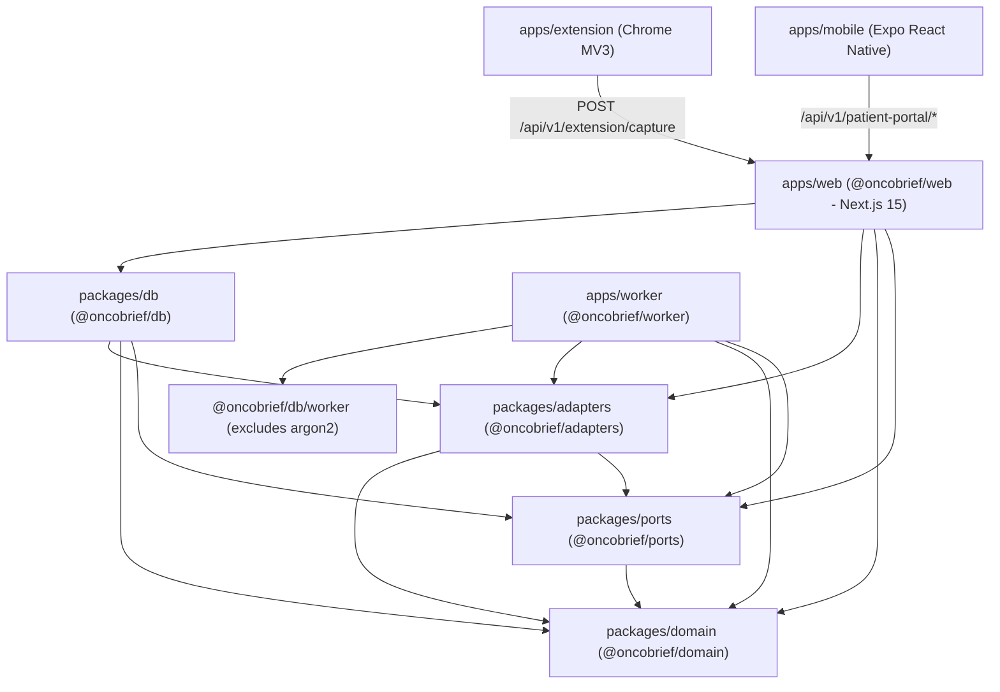

# AGENT 1 — CODEBASE ARCHITECTURE AUDIT

**Document ID:** `01-codebase-architecture-audit.md`  
**Repository Root:** `/Users/dhaanish/Documents/OncoBrief`  
**Audit Date:** November 5, 2026  
**Role:** Agent 1 — Codebase Architecture Specialist  

---

## 1. Executive Summary & Epistemic Classification

OncoBrief is a 8-workspace TypeScript monorepo (`pnpm@9.15.4`, Node.js `>=22`) implementing a source-verified oncology consultation-readiness, OPD clinic-flow, clinician productivity studio, and multilingual caregiver continuity platform backed by a PostgreSQL 16 append-only Evidence Ledger (`66` RLS-enabled tables, `63` `FORCE ROW LEVEL SECURITY` tenant tables across `23` SQL migrations).

### Epistemic Status Legend
- **`[VERIFIED]`**: Confirmed directly from repository source files, SQL migrations, build scripts, or Terraform definitions.
- **`[INFERRED]`**: Logically deduced from verified code behaviors, package dependencies, or memory allocation profiles.
- **`[UNKNOWN]`**: Runtime characteristics requiring live multi-hospital telemetry.
- **`[RECOMMENDED]`**: Concrete architectural decision or remediation step supported by codebase evidence.

---

## 2. Monorepo Structure & Workspace Inventory (`[VERIFIED]`)

Defined in `pnpm-workspace.yaml` (`packages/*`, `apps/*`), root `package.json`, and `tsconfig.base.json`:

```text
/Users/dhaanish/Documents/OncoBrief
├── package.json                  # Root scripts, pnpm@9.15.4, engines.node >= 22
├── pnpm-workspace.yaml           # Workspaces: apps/*, packages/*
├── tsconfig.base.json            # ES2022, Bundler resolution, strict: true
├── Dockerfile                    # Node 22-bookworm-slim production web container
├── docker-compose.yml            # Local Postgres 16 + optional MinIO & LocalStack
├── infra/                        # Terraform >= 1.10 IaC (bootstrap, environments/dev, 9 modules)
├── packages/
│   ├── domain/                   # @oncobrief/domain — Pure zero-I/O oncology & provenance rules
│   ├── ports/                    # @oncobrief/ports — Hexagonal TypeScript interfaces
│   ├── adapters/                 # @oncobrief/adapters — AWS SigV4 (S3, SQS, Textract, Bedrock), Sarvam, ABDM
│   └── db/                       # @oncobrief/db — pg Pool, withTenant RLS wrapper, 23 SQL migrations, services
└── apps/
    ├── web/                      # @oncobrief/web — Next.js 15.1.3 / React 19 full-stack server
    ├── worker/                   # @oncobrief/worker — SQS poller + AWS Lambda (index.js, admin.js)
    ├── extension/                # Chrome Manifest V3 EHR launch & context capture extension
    └── mobile/                   # @oncobrief/mobile — Expo SDK 58 / React Native patient companion app
```

### Verified Package Dependency Graph



---

## 3. Next.js 15 Application Architecture (`apps/web`) (`[VERIFIED]`)

### 3.1 Configuration & Bundling (`apps/web/next.config.ts`)
- **Workspace Transpilation (`lines 13–18`):** `transpilePackages: ['@oncobrief/domain', '@oncobrief/ports', '@oncobrief/adapters', '@oncobrief/db']` compiles workspace TypeScript source directly during `next build`.
- **Externalized Server Packages (`lines 20, 39–48`):** `serverExternalPackages: ['pg', '@node-rs/argon2', 'dotenv', 'pdf-lib']` and explicit Webpack server externals ensure the native Rust N-API addon `@node-rs/argon2` and `node-postgres` (`pg`) are loaded via Node.js `commonjs` at runtime rather than bundled.
- **Auth Interrupts (`lines 9–11`):** `experimental: { authInterrupts: true }` enables Next.js 15 `unauthorized()` / `forbidden()` boundaries.
- **CORS Headers (`lines 24–35`):** Configures `/api/v1/patient-portal/:path*` headers for mobile companion access (`Access-Control-Allow-Origin: '*'`, flagged for production restriction to explicit allowed origins).

### 3.2 Rendering Strategy: Dynamic SSR vs. Client Components (`[VERIFIED]`)
- **100% Dynamic Authenticated Routes:** Every clinical route under `apps/web/src/app/(app)/` (`/workspace`, `/opd`, `/appointments`, `/tumor-board`, `/patients/[id]/evidence`, `/patients/[id]/sources/[docId]`, `/patients/[id]/conflicts/[conflictId]`, `/patients/[id]/record-map`, `/patients/[id]/tasks`, `/patients/[id]/packet`, `/patients/[id]/continuity`, `/patients/[id]/audit`, `/patients/[id]/encounters/[encounterId]`) reads session cookies via `requireSession()` and executes tenant-scoped SQL inside `withTenant()`. **Zero PHI routes use Static Site Generation (SSG) or Incremental Static Regeneration (ISR).**
- **Server Actions (`apps/web/src/lib/`):** Mutations are implemented as React 19 Server Actions in `apps/web/src/lib/actions.ts`, `opd-actions.ts`, `task-ownership-actions.ts`, and `studio-validation.ts`, calling `@oncobrief/db` services directly in-process and triggering `revalidatePath()`.
- **API Route Handlers (`apps/web/src/app/api/v1/`):**
  - Document Presigned Upload & Viewing: `POST /api/v1/patients/[id]/documents/upload-url`, `GET /api/v1/documents/[documentId]/blob`, `GET /api/v1/storage/local`
  - Evidence & Exports: `GET /api/v1/evidence/[id]`, `GET /api/v1/packets/[packetId]/export`, `GET /api/v1/studio/[artifactId]/export`
  - Voice & Continuity: `POST /api/v1/assistant/voice/stt`, `POST /api/v1/assistant/voice/tts`, `POST /api/v1/continuity/tts`
  - Interoperability & Extensions: `/api/v1/abdm/*`, `/api/v1/fhir/*`, `/api/v1/extension/capture`, `/api/v1/patient-portal/*`

---

## 4. Authentication & Session Management (`[VERIFIED]`)

1. **Staff Opaque Cookie Sessions (`AUTH_MODE=session`, default):**
   - `apps/web/src/lib/auth.ts` verifies passwords using `@node-rs/argon2` (`argon2id`) via `auth_lookup_user(email)` (`SECURITY DEFINER` function in `0004_auth_bootstrap_membership.sql`).
   - Session tokens are stored as SHA-256 hashes (`token_hash`) in PostgreSQL `user_session` and sent in an `HttpOnly`, `SameSite=Lax`, `Secure` (in production) cookie (`ob_session`).
   - Because session state resides in PostgreSQL `user_session` rather than local memory, horizontal scaling across multiple ECS Fargate tasks requires **no sticky sessions**.
2. **Optional Cognito Bearer JWT (`AUTH_MODE=cognito`):**
   - `apps/web/src/lib/auth-api.ts` verifies Cognito RS256 JWTs against the Cognito User Pool JWKS and cross-checks `(user_id, org_id, role)` against the PostgreSQL `membership` table so a JWT claim alone can never escalate tenant access.
3. **Patient & Caregiver Portal Sessions (`0022_patient_portal_foundation.sql`):**
   - Uses OTP challenge records (`patient_otp_challenge`) and SHA-256 hashed bearer tokens in `patient_portal_session` (`portal_lookup_session`), strictly isolated by `portal_is_authorized_patient_or_caregiver(patient_id)`.

---

## 5. Runtime Dependencies, Zero-SDK AWS Adapters & Filesystem Assumptions (`[VERIFIED]`)

- **Zero AWS SDK Bloating in `@oncobrief/adapters` (`[VERIFIED]`):**
  - Inspection of `packages/adapters/src/aws-sigv4.ts`, `s3-storage.ts`, `sqs-queue.ts`, `textract-ocr.ts`, `bedrock-llm.ts`, and `secrets-manager.ts` confirms that OncoBrief implements a **custom, zero-dependency AWS Signature Version 4 (`HMAC-SHA256`) signer using native Node.js `crypto` and `fetch`**.
  - This keeps `infra/build/worker/index.js` and `admin.js` at **1.3 MB total** with sub-200ms cold starts.
  - **Critical Container Credential Finding (`[VERIFIED]` — Blocker `P0-4`):** Because `packages/adapters/src/s3-storage.ts` and `packages/db/src/env.ts:74-76` read static environment variables (`STORAGE_S3_ACCESS_KEY_ID` / `AWS_ACCESS_KEY_ID`, `AWS_SECRET_ACCESS_KEY`, `AWS_SESSION_TOKEN`), `infra/modules/web/main.tf:107` created a static IAM user (`aws_iam_user.web_storage`) instead of using an ECS Task Role. Furthermore, `packages/db/src/container.ts` must pass `sessionToken` through to `S3StorageAdapter`, or `aws-sigv4.ts` must resolve ECS Task Role credentials from `http://169.254.170.2${process.env.AWS_CONTAINER_CREDENTIALS_RELATIVE_URI}` so static IAM keys can be deleted.
- **Filesystem Assumptions (`[VERIFIED]`):**
  - `STORAGE_DRIVER=fs` writes to `.var/storage` (`packages/db/src/env.ts:56`). In AWS, `STORAGE_DRIVER=s3` is mandatory.
  - `packages/db/src/client.ts:32-37` loads `packages/db/certs/rds-global-bundle.pem` from `repoRootPath` for RDS TLS verification (`sslmode=verify-full`).
  - `packages/db/src/env.ts:22-24` loads `.env` or falls back to `.env.example` if `.env` is absent. In production containers, `.env.example` exists in the repo copy (`COPY . .` in `Dockerfile`), which can inject dev fallback defaults if a production env var is omitted! (`[RECOMMENDED]`: Guard `.env.example` fallback with `if (process.env.NODE_ENV !== 'production')`).

---

## 6. Realtime, Background Processing & Dual-Pipeline Analysis (`[VERIFIED]`)

- **No Persistent WebSockets Required:** All UI updates (OPD Flow Board, Assistant, Upload Status) use standard HTTP request/response and Server Actions.
- **Dual Document Ingestion Pipeline Collision (`[VERIFIED]` — Critical Finding):**
  - **Path A (Web In-Process Synchronous):** `DocumentUploadForm.tsx` -> `uploadDocumentAction` -> `ingestDocument()` (`packages/db/src/services/documents.ts`) writes the PDF to S3 (`org/<orgId>/...`) and immediately runs OCR, segmentation, and extraction synchronously inside the Next.js container.
  - **Path B (Cloud Event-Driven Async):** In `infra/environments/dev/main.tf:239-249`, `aws_s3_bucket_notification.documents` triggers SQS `document-ingest` on every `s3:ObjectCreated:*` under `filter_prefix = "org/"`, which invokes `oncobrief-dev-document-ingest` Lambda (`apps/worker/src/handlers/document-ingest.ts`) on the exact same document!
  - **Remediation (`[RECOMMENDED]`):** Unify around presigned S3 uploads (`POST /api/v1/patients/[id]/documents/upload-url`) + SQS/Lambda for asynchronous cloud OCR, or restrict S3 event notifications strictly to async upload prefixes / guard `handleDocumentIngest` when `ingest_status !== 'pending_upload'`.

---

## 7. Evaluation of the 6 AWS Deployment Targets

| Target Architecture | Compatibility | Key Technical & Economic Verdict for OncoBrief |
| :--- | :---: | :--- |
| **1. AWS Amplify Hosting** | **Incompatible** | Fails on 6 MB request payload limit (breaks 25 MB PDF uploads & 10 MB STT blobs), struggles with `@node-rs/argon2` native N-API binary in a `pnpm` monorepo, and cannot natively reach private-subnet RDS without public exposure or complex proxy workarounds. |
| **2. AWS App Runner** | **Compatible (Higher Cost)** | Runs `Dockerfile` and connects to private RDS via VPC Connector without an ALB, but is `x86_64`-only, unavailable in `ap-south-2`, and requires a NAT Gateway or NAT instance whenever a VPC Connector is attached. |
| **3. AWS ECS Fargate (`ARM64` Graviton2)** | **Optimal for Production (Arch B & C)** | 100% compatible with `Dockerfile`, `@node-rs/argon2`, `pg.Pool` (`max: 10`), and zero-downtime rolling deploys via ECS deployment circuit breaker. Switching to `ARM64` (`0.5 vCPU / 1 GB`) and eliminating the NAT Gateway makes it cheap and rock-solid. |
| **4. AWS Lambda + Lambda Web Adapter (LWA)** | **Compatible for Demo (Arch A)** | Adding the AWS Lambda Web Adapter layer to `Dockerfile` (`arm64`) behind a CloudFront Function URL OAC gives **$0.00/mo idle web compute**, ideal for low-traffic demos when paired with S3 presigned uploads (`<6 MB` payload limit on Function URLs). |
| **5. Minimal EC2 Graviton (`t4g.small`)** | **Compatible (Low Fixed Cost)** | A `t4g.small` (`2 vCPU, 2 GiB`, `~$8.18–$10.51/mo`) behind a free CloudFront VPC Origin eliminates both the ALB and NAT Gateway, but requires OS patching and Docker Compose management. |
| **6. Hardened Hybrid (`infra/` Refactored)** | **Selected Target Blueprint** | Retains the proven Terraform stack in `ap-south-1` (CloudFront + ECS Fargate `ARM64` + SQS/Lambda `ARM64` workers + Private RDS PostgreSQL 16 + S3 SSE-KMS) while removing the `$36–$44/mo` NAT Gateway, removing the unused API Gateway & Cognito pool, and fixing the 4 P0 code-to-cloud drift blockers. |
