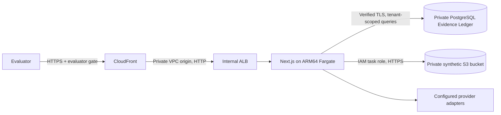

# OncoBrief hackathon evaluator guide

This is a synthetic hackathon prototype. It is not a clinical service, diagnostic system, treatment recommender, or publicly available application. The HTTPS endpoint is internet-addressable but requires evaluator credentials at the edge, then normal role-based application authentication. No real patient records are included in this deployment.

Deployment status, URL and verification results are recorded in [release report 24](24-hackathon-deployment-report.md). Do not infer successful deployment from an architecture diagram or local test result.

## Follow the evidence

1. Open the consultation workspace and select synthetic `DEMO-001`.
2. Inspect fragmented sources and an extracted evidence item. Follow its source/page/span and highlight.
3. Verify a fact explicitly. Inspect the named reviewer/state and preserved original evidence.
4. Open the contradiction room. Compare both sources and resolve it manually with a reason.
5. Inspect the record-readiness view, then create a source-backed administrative task.
6. Review and approve a consultation packet. Exports require the appropriate human approval.
7. Preview and approve an administrative continuity message. Outbound delivery is simulated and recorded in the outbox; no real SMS/WhatsApp message is sent.
8. Sign in as auditor and inspect the audit/ledger chain. Other roles should be denied auditor-only access.

The supplied demo accounts are fictional and exist only behind the separate evaluator gate. Evaluation changes persist; a later evaluator may see a fact already verified by an earlier evaluator. Do not reset the deployed database to conceal those changes.

## Code map for human and AI review

| Concern | Owning source |
| --- | --- |
| Product/safety rules | `CLAUDE.md`, `AGENTS.md`, product references in `docs/` |
| Evidence types, provenance validation, transitions | `packages/domain/src/provenance/`, `packages/domain/src/evidence/`, `packages/domain/src/policy/` |
| Tenant context and verified database TLS | `packages/db/src/client.ts` |
| Document storage/ingestion and extraction promotion | `packages/db/src/services/documents.ts` |
| Ledger, conflict handling, readiness, packets, approvals | `packages/db/src/services/ledger.ts`, `twin.ts`, `packets.ts`, `messages.ts` |
| Authentication and permission checks | `packages/db/src/services/auth.ts`, `apps/web/src/lib/session.ts`, `apps/web/src/lib/auth-api.ts`, domain RBAC |
| Refreshable ECS role credentials | `packages/adapters/src/ecs-credentials.ts`, `s3-storage.ts`, DB container wiring |
| Synthetic fixtures and safe one-time initialization | `packages/db/src/fixtures.ts`, `seedFreshHackathon` in `seed.ts`, `tools/hackathon-bootstrap.ts` |
| Deployed infrastructure | `infra/environments/hackathon/`; shared VPC/RDS/S3 modules |
| Viewer access control | `infra/environments/hackathon/evaluator.js.tftpl`, `tools/test-hackathon-edge.mjs` |
| Reproducible runtime build | `Dockerfile.hackathon`, its allowlisted Docker context, lockfile, immutable ECR image digest |
| Runtime readiness | `apps/web/src/app/api/v1/health/route.ts`, migration `0024_runtime_readiness.sql` |
| Optional cloud-worker implementation | `apps/worker/`; not deployed in this profile |

The timeline is a view over the Evidence Ledger. An LLM/OCR candidate does not become human-verified evidence automatically. Deterministic provenance checks, explicit human transitions, contradiction handling, and downstream approval remain part of the running application.

## What actually runs

- One Next.js full-stack container on ARM64 Fargate; private PostgreSQL 16; private versioned S3; Secrets Manager; CloudWatch logs; internal ALB and CloudFront VPC origin.
- Synchronous web upload → S3 → OCR/extraction → provenance gate → ledger. No S3 ingestion notification or deployed Lambda worker; direct upload is disabled in this profile.
- Deterministic extraction is the baseline. Sarvam/NVIDIA credentials may be configured for optional provider capabilities. Credentials present is not evidence of successful inference; consult the release report's bounded live checks and the runtime provider disclosure.
- ABDM exchange uses the simulated gateway; outbound continuity uses simulated delivery. Local fixture spans are deterministic synthetic inputs, not evidence of live OCR accuracy.

## Evidence and limitations

Use the release report for exact test commands, counts, image/source manifest, deployed checks and unresolved findings. Full-repository lint had existing failures before deployment work; targeted deployment lint and tests do not justify claiming every repository check passes. Shared evaluator credentials are suitable for this controlled prototype, not institutional identity management.

Private HTTP on the internal origin hop is a documented synthetic-demo trade-off. Neither a login gate nor these tests establishes clinical-production readiness, real-patient data protection certification, a production SLA, or measured clinical benefit. Real cloud services are used for hosting/storage/database; simulations and fallbacks are not represented as real integrations.
