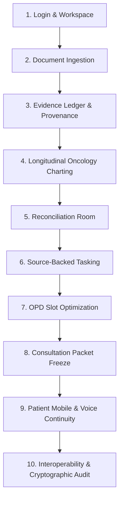

# OncoBrief — Health-a-thon Final Judging Demonstration Runbook (V2)

- **Document Version:** 2.0 (Phase 07C Release Candidate Hardening)
- **Target Audience:** Hackathon Judges, Clinical Evaluators, Technical Architects
- **Estimated Pitch Duration:** 10–12 Minutes
- **Execution Script:** `pnpm --filter @oncobrief/web exec playwright test e2e/independent-judge-journey.spec.ts`

---

## 1. Truth in Healthcare Demonstration: The Transparency Pledge

In accordance with `CLAUDE.md`, `AGENTS.md`, and medical software safety ethics, OncoBrief adheres to strict truth-in-demonstration principles:

| Capability Surface | What Is Demonstrated Live | What Is NOT Claimed |
|---|---|---|
| **Patient Cohort** | Synthetic oncology fixtures (`DEMO-001`, `DEMO-002`, `DEMO-003`) | Zero real patient PHI is used or transmitted |
| **Document AI & OCR** | Sarvam Vision Document AI async polling with deterministic local pixel fallback | No unsupervised generative hallucination of clinical text |
| **Multilingual Voice** | Sarvam Bulbul TTS and Saaras STT with browser Web Speech API offline fallback | No ungrounded audio generation outside pre-approved templates |
| **ABDM Interoperability** | NRCeS ABDM v6.5.0 DocumentBundles, mCODE mapping, and Fidelius Curve25519 ECDH engine | No live national NHA production gateway keys claimed |
| **Mobile Application** | Patient mobile portal verified across responsive 375px mobile browser and compiled native APK | No claim of published App Store / Google Play binaries without signing |
| **Clinical Boundaries** | Administrative digital twin, evidence provenance, and human verification gating | **Zero medical diagnosis, treatment prescription, or automated clinical triage** |

---

## 2. Ten-Scene Demonstration Script (10–12 Minutes)

### Scene 1: Clinician Authentication & Worklist Triage (Minute 0:00–1:00)
- **Action:** Open `http://localhost:3000/login`. Log in as Dr. Ananya Ramanathan (`dr.ananya@rci.demo` / `oncobrief-demo`).
- **Screen:** `/workspace` — Consultation Readiness Worklist.
- **Narrative:** "OncoBrief is an evidence-first oncology operational platform. In cancer care, fragmented referral packets delay treatment. Here, the worklist organizes patients by factual readiness bands (`ready`, `near_ready`, `incomplete`), eliminating clinician guesswork."
- **Verification:** Point out `DEMO-001` (Meenakshi Sundaram) marked `incomplete` with missing surgical pathology records.

### Scene 2: Document Ingestion & Multilingual OCR (Minute 1:00–2:15)
- **Action:** Navigate to `/patients/DEMO-001/sources`. Click "Upload / Import Records". Select synthetic referral PDF. Select language (e.g. Tamil or English).
- **Screen:** `ProcessingStatusCard` with live 6-step ingestion pipeline.
- **Narrative:** "We upload a fragmented referral packet. OncoBrief routes this through Sarvam Vision Document AI or our offline fallback. Notice that upload telemetry is honest: zero artificial sleep timers, dynamic engine reporting, and automatic sub-packet segmentation by page range and issuing facility."

### Scene 3: Evidence Ledger & Click-to-Source Provenance (Minute 2:15–3:30)
- **Action:** Navigate to `/patients/DEMO-001/evidence`. Select an unverified lab row (e.g. `Hemoglobin: 12.8 g/dL`). Click "Inspect Source".
- **Screen:** Source Inspector with bounding box highlight over the original scanned PDF page.
- **Narrative:** "The core rule of OncoBrief: the timeline is a view over the Evidence Ledger; the Evidence Ledger is the source of truth. Every displayed fact requires mathematical provenance. Clicking any fact jumps directly to the source scan with unit bounding-box geometry `[0, 1]`. Extracted candidate facts remain unverified until a clinician clicks 'Verify'."
- **Action:** Click "Verify Fact". State transitions from `extracted` to `verified`.

### Scene 4: Longitudinal Oncology Analyte Trends (Minute 3:30–4:45)
- **Action:** Navigate to `/patients/DEMO-001/clinical-context`.
- **Screen:** Interactive SVG Oncology Trend Chart with shaded reference ranges and Times New Roman typography hierarchy.
- **Narrative:** "Cancer treatments like chemotherapy require tracking longitudinal lab markers across multiple hospital visits. Notice the shaded reference band, abnormal flags, and treatment milestone markers. When we hover over or click any point, an interactive tooltip and Observation Traceability card open, linking directly back to the original source PDF."

### Scene 5: Reconciliation Room (Minute 4:45–6:00)
- **Action:** Navigate to `/patients/DEMO-001/conflicts`. Click "Open Reconciliation Room".
- **Screen:** Split-screen side-by-side reconciliation interface.
- **Narrative:** "Referrals often contain conflicting information. Here, Hospital A's discharge summary states surgery was performed on 2026-03-12, while Hospital B's referral letter says 2026-03-19. Traditional EHRs overwrite one fact with the other. OncoBrief **never silently resolves contradictions**. Both facts are preserved in the Evidence Ledger. The clinician reviews both source scans side-by-side and records a human reconciliation note."

### Scene 6: Source-Backed Administrative Tasks (Minute 6:00–7:00)
- **Action:** Navigate to `/patients/DEMO-001/tasks`. Click "Create Task from Missing Document".
- **Screen:** Task creation bound to missing post-op histology report.
- **Narrative:** "Every administrative task in OncoBrief is grounded in an identified evidence gap. The care coordinator is assigned a task with an SLA deadline to retrieve the missing tissue block report from the peripheral clinic."

### Scene 7: OPD Flow & Dynamic Slot Optimization (Minute 7:00–8:00)
- **Action:** Navigate to `/workspace` -> "OPD Flow & Scheduling".
- **Screen:** Live clinic room board, token queue, and dynamic backfill recommendations.
- **Narrative:** "When a clinic cancellation occurs, OncoBrief uses an operational 2-step candidate offer protocol. It evaluates verified readiness, checks room collision constraints, and offers the vacant slot to an eligible waiting patient. Once accepted, the appointment status synchronizes atomically."

### Scene 8: Consultation Packet Compilation & Tamper-Evident Freeze (Minute 8:00–9:15)
- **Action:** Navigate to `/patients/DEMO-001/packet`.
- **Screen:** Consultation Packet review, PDF/HTML print export, and freeze controls.
- **Narrative:** "Before the clinician begins the visit, the consultation packet compiles only verified evidence facts. When approved, OncoBrief computes a SHA-256 tamper-evident digest across the entire packet and locks it. If any underlying source is subsequently withdrawn, the packet freezes and alerts the care team."

### Scene 9: Patient Mobile Portal & Bilingual Voice Continuity (Minute 9:15–10:30)
- **Action:** Open `http://localhost:3000/activate` or switch to patient mobile view. Toggle language to Tamil (`தமிழ்`). Tap the speaker audio icon on an upcoming appointment reminder.
- **Screen:** Patient Mobile Dashboard with oncology cycle ribbon, preparation notebook, and audio playback.
- **Narrative:** "On mobile, patients access their verified records with informed consent gating. All copy is translated into native script without English fallback. Sarvam Bulbul TTS synthesizes localized reminders in Tamil or Hindi, bridging the digital divide for rural caregivers. Notice that the patient app strictly obeys the clinical boundary: zero medical advice, zero autonomous triage, zero dosing calculations."

### Scene 10: FHIR R4 Interoperability & Cryptographic Audit Trail (Minute 10:30–12:00)
- **Action:** Open `/api/v1/fhir/export` or inspect audit logs at `/patients/DEMO-001/audit` as Auditor (`auditor@rci.demo`).
- **Screen:** Standards-compliant NRCeS ABDM v6.5.0 DocumentBundle JSON and cryptographic audit log.
- **Narrative:** "OncoBrief exports verified patient facts into compliant NRCeS DocumentBundles and HL7 mCODE oncology resources. Inbound digital FHIR records carry exact JSONPath element pointers (`Bundle.entry[i].resource.valueQuantity`), with zero fabricated OCR bounding boxes. Finally, every single action is permanently recorded in our cryptographic audit log with SHA-256 hash chaining."

---

## 3. Disaster Recovery & Offline Fallback Matrix

| Potential Demo Hazard | Built-In Automated Fallback | Immediate Recovery Command |
|---|---|---|
| **Internet / Wi-Fi Drops** | System automatically switches to `LocalMultimodalOcrAdapter`, browser Web Speech synthesis, and in-memory synthetic FHIR server. Zero errors. | No command required (automatic failover). |
| **Demo Data Contaminated** | Test database contains stray entries from earlier manual testing. | Run `pnpm db:seed` (takes 3.2s; cleanly reseeds `DEMO-001`, `002`, `003`). |
| **Local Server Stopped** | Port 3000 not responding. | Run `pnpm dev` or `pnpm start` from `apps/web/`. |
| **Browser Audio Muted** | OS audio device disconnected. | Tooltip displays verbatim native-script Tamil/Hindi text matching spoken audio. |

---

## 4. Runbook Sign-Off
- **Status:** **APPROVED FOR HEALTH-A-THON JUDGING DEMO**
- **Automated Verification:** Verified green via `e2e/independent-judge-journey.spec.ts` (10 passed in 17.2s).
