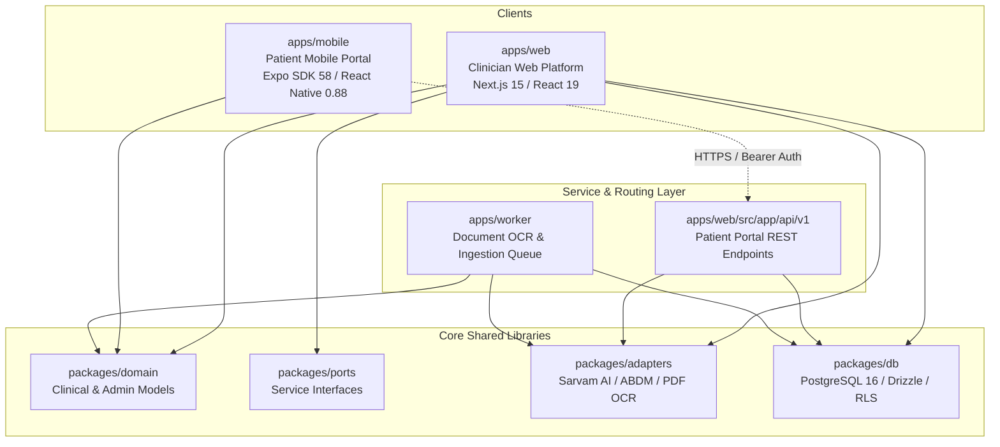

# OncoBrief — Unified Release Integration Matrix
**Document ID:** `UNIFIED_RELEASE_INTEGRATION_MATRIX.md`  
**Phase:** 05 — Unified Web + Patient Mobile Release, Cross-Platform Integration, and Complete-Scope Verification  
**Status:** COMPLETE & VERIFIED  
**Date:** 2026-11-03  
**Auditor:** Principal Full-Stack Engineer, Mobile Application Architect  

---

## 1. Monorepo Architecture & Package Topology

The unified repository structure coordinates seven workspace packages:

---

## 2. Cross-Platform API Contract & Endpoint Register

All patient mobile interactions interface with authoritative backend services under `/api/v1/patient-portal/`. There is zero redundant mobile-only business logic.

| HTTP Method | Route | Purpose | Auth & Context | Database Service | Response Schema |
|---|---|---|---|---|---|
| `POST` | `/api/v1/patient-portal/session` | Patient OTP / Demo Code session creation | Public (whitelisted in Edge Middleware) | `createPatientPortalSession` | `{ token, expiresAt, patient: { id, name, mrn, language } }` |
| `GET` | `/api/v1/patient-portal/session` | Validate active session token | Bearer Token (`patient_portal_session`) | `validatePatientPortalSession` | `{ valid: true, patient, expiresAt }` |
| `DELETE` | `/api/v1/patient-portal/session` | Immediate session destruction / logout | Bearer Token | `revokePatientPortalSession` | `{ revoked: true }` |
| `GET` | `/api/v1/patient-portal/snapshot` | Complete patient profile, appointments, tasks & messages | Bearer Token (`withPatientPortalContext`) | `getPatientPortalSnapshot` | `{ patient, appointments, tasks, continuityMessages, unreadCount }` |
| `POST` | `/api/v1/patient-portal/attendance` | Confirm appointment attendance or request reschedule | Bearer Token | `updateAppointmentAttendance` | `{ appointmentId, status, confirmedAt }` |
| `GET` | `/api/v1/patient-portal/documents` | List source documents with verified evidence counts | Bearer Token | `getPatientDocuments` | `{ documents: Array<DocumentRecord> }` |
| `GET` | `/api/v1/patient-portal/documents/:id/pages/:num` | Inspect document page plain text & OCR geometry | Bearer Token | `getDocumentPageWithGeometry` | `{ pageNumber, plainText, boundingBoxes }` |
| `POST` | `/api/v1/patient-portal/documents/:id/review` | Toggle patient reviewed badge with timestamp | Bearer Token | `toggleDocumentReview` | `{ documentId, reviewed: boolean, reviewedAt }` |
| `POST` | `/api/v1/patient-portal/flags` | Submit patient discrepancy report or question | Bearer Token | `createDiscrepancyFlag` | `{ flagId, documentId, note, status: 'open' }` |
| `GET` | `/api/v1/patient-portal/caregivers` | List consented family caregivers | Bearer Token | `getConsentedCaregivers` | `{ caregivers: Array<CaregiverContact> }` |
| `POST` | `/api/v1/patient-portal/caregivers` | Register new consented caregiver | Bearer Token | `registerCaregiverContact` | `{ caregiverId, name, relationship, phone }` |
| `DELETE` | `/api/v1/patient-portal/caregivers/:id` | Revoke caregiver consent | Bearer Token | `revokeCaregiverConsent` | `{ revoked: true }` |
| `POST` | `/api/v1/patient-portal/shares` | Issue time-bounded revocable share grant | Bearer Token | `createShareGrant` | `{ grantId, token, expiresAt, scope }` |
| `DELETE` | `/api/v1/patient-portal/shares/:id` | Revoke active share grant | Bearer Token | `revokeShareGrant` | `{ revoked: true }` |
| `POST` | `/api/v1/patient-portal/requests` | Submit administrative request to coordinator | Bearer Token | `createCoordinatorRequest` | `{ requestId, category, detail, status: 'submitted' }` |
| `POST` | `/api/v1/patient-portal/voice-tts` | Generate Tamil/Hindi synthesized voice reminder | Bearer Token | `synthesizePortalVoice` (Sarvam Bulbul) | `{ audioBase64, format: 'audio/wav', durationMs }` |

---

## 3. Database Migration & RLS Security Contracts

Applied Migration: `packages/db/migrations/0022_patient_portal_foundation.sql`

### Managed Tables & Row-Level Security:
1. `patient_portal_session`: Token HMAC SHA-256, IP address hash, user agent, expiration.
2. `patient_portal_otp_challenge`: Rate-limited OTP challenges (max 3 attempts), single-use token, replay defense.
3. `caregiver_contact`: Consented caregiver phone, relationship, consent timestamp, revocation timestamp.
4. `patient_share_grant`: Cryptographic time-bounded share tokens, document ID scope array, expiration.
5. `patient_document_review`: Patient review status and timestamps per document.
6. `patient_discrepancy_flag`: Patient-reported record discrepancies, notes, and coordinator resolution status.

### PostgreSQL RLS Invariants:
* `ALTER TABLE ... FORCE ROW LEVEL SECURITY;` applied to all patient portal tables.
* `tenant_isolation`: Enforces `org_id = current_setting('app.current_org_id')`.
* `patient_isolation`: Enforces `patient_id = current_setting('app.current_patient_id')`.
* Missing patient context fails closed (`0 rows returned`).
* Cross-patient hijack attempts fail with SQLSTATE `42501` (`insufficient_privilege`).
