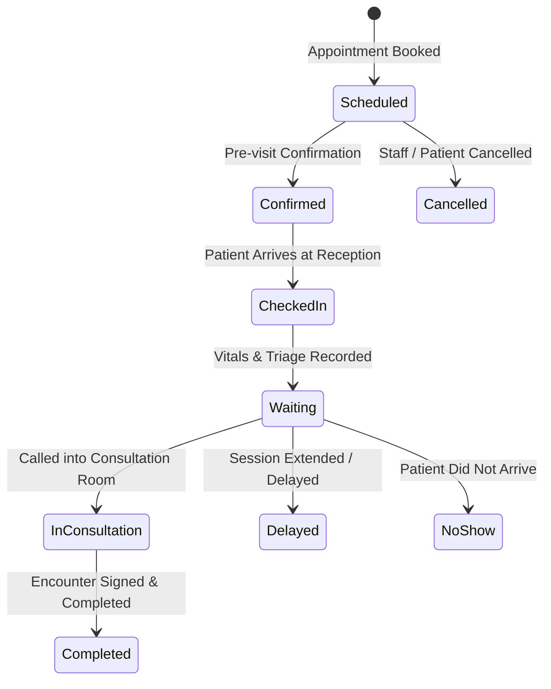

# OncoBrief — Outpatient Department (OPD) Operations & Flow Control

## 1. Executive Summary

Oncology outpatient clinics present unique operational challenges: high patient volume, multidisciplinary care teams, unpredictable consultation durations (chemotherapy toxicity assessments vs. routine checkups), and critical sequencing of diagnostic tests.

OncoBrief provides a unified OPD operations console inside `/workspace?view=opd` that links real appointment bookings, patient queue tokens, consulting room statuses, and waitlist slot backfilling.

---

## 2. Queue Lifecycle & Status Transitions

Each OPD visit moves through strict operational stages:

### Queue Token Numbers
- When an appointment is scheduled or an arrival is processed, OncoBrief generates a sequential daily queue token: `TK-001`, `TK-002`, `TK-003`, etc.
- Displays on reception kiosks, patient notifications, and OPD queue monitors.

---

## 3. Waitlist & Slot Backfill Operations

When an appointment slot is cancelled or delayed, the OPD engine identifies eligible waitlisted patients:
- **Eligible Candidate Discovery**: Matches specialty, department, and patient availability.
- **Staff-Authorized Backfill**: Ensures an authorized receptionist or coordinator confirms the slot reassignment rather than automated rebooking without human approval.
- **Walk-in Handling**: Staff can register unscheduled walk-in patients with arrival category `walk_in` without overriding pre-booked slots.

---

## 4. OPD Live Board (`/workspace?view=opd`)

The OPD view in the clinical workspace provides real-time visibility across clinic sessions:
- **Session Selector**: Filter by clinic date, department (Medical, Surgical, Radiation Oncology), and consulting room.
- **Queue Pipeline View**: Visual columns grouping patients by their current stage (`Waiting`, `In Consultation`, `Completed`, `Delayed`).
- **Clinician Room Status**: Displays which oncologist is currently seeing which patient and the elapsed consultation time.
- **Direct Consultation Jump**: Clicking "Open Consultation" opens the live Consultation Room (`/patients/[id]/encounters/[encounterId]`).
