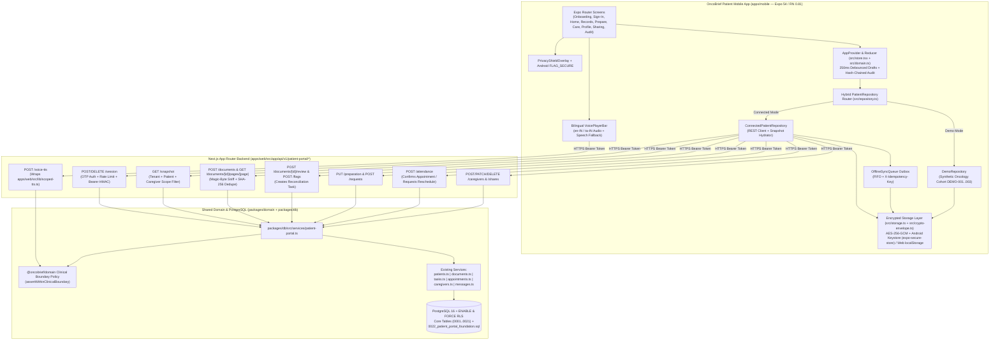
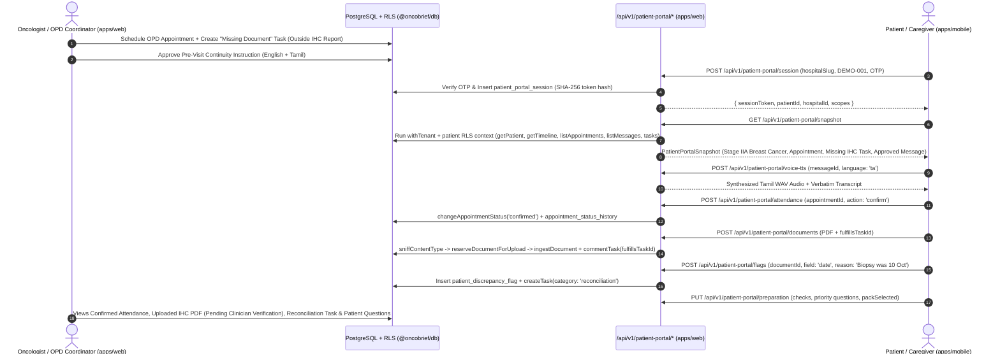
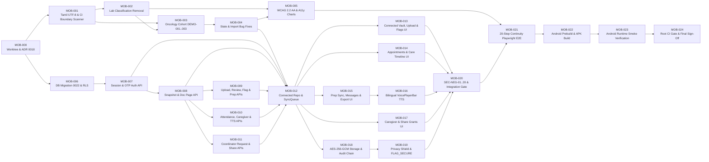

# ONCOBRIEF PATIENT MOBILE APPLICATION — MASTER IMPLEMENTATION PLAN

- **Repository:** `https://github.com/dhaanish597/OncoBrief`
- **Target Branch:** `oncobrief-patient-app`
- **Baseline Inspected Commit:** `757f4958c565088877bfc5fd1af56ebe1227f1a5`
- **Mainline Merge Base:** `7b2edec145a9efe88f7f3928e6de975743ce33ca` (`main`)
- **Active Local Worktree State:** `/Users/dhaanish/Documents/OncoBrief` is checked out to `feat/v4-assessment-remediation` (`7b2edec145a9efe88f7f3928e6de975743ce33ca`) with 50 modified tracked files and 28 untracked files that **MUST NOT BE TOUCHED**.
- **Isolated Execution Worktree:** `/Users/dhaanish/Documents/OncoBrief-patient-mobile` (`git worktree add ../OncoBrief-patient-mobile oncobrief-patient-app`)
- **Companion Governance Documents:**
  - [`docs/plans/PATIENT_MOBILE_REQUIREMENTS_MATRIX.md`](./PATIENT_MOBILE_REQUIREMENTS_MATRIX.md)
  - [`docs/plans/PATIENT_MOBILE_TDD_TEST_MATRIX.md`](./PATIENT_MOBILE_TDD_TEST_MATRIX.md)
  - [`docs/plans/PATIENT_MOBILE_EXECUTION_TRACKER.md`](./PATIENT_MOBILE_EXECUTION_TRACKER.md)
  - [`docs/plans/PATIENT_MOBILE_RELEASE_GATES.md`](./PATIENT_MOBILE_RELEASE_GATES.md)
  - [`docs/audits/PATIENT_MOBILE_BRANCH_AUDIT.md`](../audits/PATIENT_MOBILE_BRANCH_AUDIT.md)

---

## Section 1 — Executive Summary

The `oncobrief-patient-app` branch (`757f4958c565088877bfc5fd1af56ebe1227f1a5`) introduces an Expo SDK 54 / React Native 0.81.5 / Expo Router 6 application under `apps/mobile` (`1,045` lines across 50 text files and 2 PNG assets). While the branch establishes a clean, modular UI shell, deterministic reducer (`src/domain.ts`), file magic-byte validator (`src/file-validation.ts`), and 36 passing unit tests + 5 Playwright browser tests, a line-by-line engineering audit confirmed **four critical systemic gaps** that prevent hackathon clinical credibility, backend continuity, and Android pilot deployment:

1. **Zero Oncology Specificity (`BUG-MOB-02`):** `createDemo()` in `apps/mobile/src/domain.ts:27-47` seeds 5 generic primary-care records (`Comprehensive metabolic panel`, `Lipid panel`, `Primary care visit summary`, `Discharge instructions`, `Abdominal ultrasound summary`) instead of the OncoBrief oncology cohort (`DEMO-001` Meenakshi Sundaram, `DEMO-002` Rajeshwari Nair, `DEMO-003` Arjun Kulkarni).
2. **Clinical-Safety Boundary Violation (`BUG-MOB-03`, `BUG-MOB-04`):** `src/patient-selectors.ts:23-28` (`referencePosition`) and `src/laboratory.tsx:10-16` (`ReferenceBar`) compute and display automated lab range classifications (`below` / `within` / `above`, `"Below supplied interval"`, `"Above supplied interval"`, and range gauge dots), while `tools/check-clinical-boundary.ts` omits `apps/mobile` from `TARGET_DIRS`.
3. **Zero Backend Connectivity (`0%` API Integration):** `apps/mobile` makes zero HTTP calls (`fetch` / `XMLHttpRequest` = `0` occurrences) and has no `/api/v1/patient-portal/*` route handlers or `patient_portal_*` database tables in `packages/db`, leaving the core OncoBrief Care Continuity loop (appointments, attendance confirmation, document uploads, missing-document tasks, patient discrepancy flags, approved continuity messages, scoped Tamil/English voice TTS, and consented caregiver scopes) completely disconnected.
4. **Corrupted Tamil UTF-8, Unencrypted Disk Storage & Unverified Native APK (`BUG-MOB-01`, `SEC-MOB-01`):** `app/(tabs)/profile.tsx:8` renders CP866 Mojibake `'родрооро┐ро┤рпН'` instead of `'தமிழ்'`; `src/storage.ts:13` writes plaintext JSON to `state-v1.json` on native and no-ops on Web (`BUG-MOB-08`); `app/index.tsx:12` bypasses the onboarding consent gate (`BUG-MOB-07`); and no Android `.apk` has been built or runtime-verified via `adb`.

### Strategic Architecture Approach: Incremental Hybrid Upgrade (No Destructive Rewrite)

This plan **preserves and upgrades** the working foundations in `apps/mobile` (`expo-router` screen topology, `src/ui-core.tsx`, `src/file-validation.ts`, `src/repository.ts` interface, `useDraft`, and Node/Playwright test harnesses) and executes **25 atomic, TDD-governed tasks (`MOB-000` through `MOB-024`) across 8 Milestones (`M0`–`M7`) and 12 Workstreams (`A`–`L`)** to achieve:
- **100% Clinical-Safety & Non-Diagnostic Compliance** enforced by `pnpm policy:check-clinical-boundary` across `apps/mobile`.
- **100% Oncology Cohort Alignment** (`DEMO-001`, `DEMO-002`, `DEMO-003`) in both **Connected Hospital Mode** (`/api/v1/patient-portal/*` + PostgreSQL RLS) and **Offline Synthetic Demo Mode**.
- **100% Bilingual English + Tamil (`தமிழ்`) Text & Scoped Voice TTS Accessibility** (`apps/web/src/lib/scoped-tts.ts` + offline fallback).
- **100% Hardware-Backed Local Encryption** (`AES-256-GCM` + `expo-secure-store`) and **Native Android APK Build & Runtime Verification**.

---

## Section 2 — Verified Current-State Baseline (`757f4958c565088877bfc5fd1af56ebe1227f1a5`)

### 2.1 Repository & Git State Verification

| Attribute | Verified Value | Evidence Source |
|---|---|---|
| Repository URL | `https://github.com/dhaanish597/OncoBrief` | `git remote -v` |
| Target Mobile Branch | `oncobrief-patient-app` | `git rev-parse oncobrief-patient-app` → `757f4958c565088877bfc5fd1af56ebe1227f1a5` |
| Mainline Branch | `main` | `git rev-parse main` → `7b2edec145a9efe88f7f3928e6de975743ce33ca` |
| Merge Base (`main` ↔ `oncobrief-patient-app`) | `7b2edec145a9efe88f7f3928e6de975743ce33ca` | `git merge-base main oncobrief-patient-app` |
| Commits on `oncobrief-patient-app` ahead of `main` | `2` (`d68ba6d` → `757f495`) | `git log main..oncobrief-patient-app --oneline` |
| Total Files Added/Modified on Branch | `70` (`66` in `apps/mobile`, `3` in `docs/`, `1` `pnpm-lock.yaml`) | `git diff --stat main..oncobrief-patient-app` |
| Backend / DB Files Modified on Branch | `0` | `git diff --name-only main..oncobrief-patient-app -- packages/ apps/web/ apps/worker/` |
| Active Checkout in `/Users/dhaanish/Documents/OncoBrief` | `feat/v4-assessment-remediation` (`50` modified, `28` untracked files) | `git status --short` |

### 2.2 Confirmed Defect & Security Finding Inventory (100% Validated Against Source)

| ID | Severity | File : Line | Validated Finding Summary | Remediation Task |
|---|---|---|---|---|
| `BUG-MOB-01` | **P0** | `apps/mobile/app/(tabs)/profile.tsx:8` | Hardcodes CP866 Mojibake `'родрооро┐ро┤рпН'` instead of `'தமிழ்'` (`t(state.language, 'ta')`). | `MOB-001` |
| `BUG-MOB-02` | **P0** | `apps/mobile/src/domain.ts:27-47` | `createDemo()` seeds 5 generic primary-care records (`d1`–`d5`) with zero oncology records or personas. | `MOB-003` |
| `BUG-MOB-03` | **P0** | `tools/check-clinical-boundary.ts:19-25` | `TARGET_DIRS` omits `apps/mobile/src` and `apps/mobile/app` from CI clinical boundary scanning. | `MOB-001` |
| `BUG-MOB-04` | **P1** | `apps/mobile/src/patient-selectors.ts:23-28`, `src/laboratory.tsx:10-16`, `src/history-chart.tsx:16` | Computes `below`/`within`/`above` lab classification and renders range gauge dot and shaded band. | `MOB-002` |
| `BUG-MOB-05` | **P1** | `apps/mobile/app/sharing.tsx:9`, `src/preparation-workspace.tsx:33` | Both Consultation Pack and Sharing mutate the same `state.selected` array (`SEC-MOB-04`). | `MOB-004` |
| `BUG-MOB-06` | **P1** | `apps/mobile/src/preparation-workspace.tsx:24` | Filters `state.checks.filter(c => c.enabled && !c.optional)`, making `c4` permanently uncheckable when enabled. | `MOB-004` |
| `BUG-MOB-07` | **P1** | `apps/mobile/app/index.tsx:12` | Auto-dispatches `onboard` and redirects to `/(tabs)`, bypassing `/onboarding` consent gate. | `MOB-004` |
| `BUG-MOB-08` | **P1** | `apps/mobile/src/storage.ts:6, 11` | Returns `null`/no-op on `Platform.OS === 'web'`, wiping all state on browser reload (`F5`). | `MOB-018` |
| `BUG-MOB-09` | **P1** | `apps/mobile/app/import.tsx:32-33` | Calls `retainSample` before `dispatch` (leaking orphan files on error), sets `date: ''`, and lacks SHA-256 duplicate check (`SEC-MOB-03`). | `MOB-004` |
| `BUG-MOB-10` | **P2** | `apps/mobile/app/audit.tsx:6`, `src/copy.ts` | Missing `editQuestion` and `removeQuestion` keys in `labels.en` and `labels.ta`. | `MOB-001` |
| `BUG-MOB-11` | **P2** | `apps/mobile/app/record/[id].tsx:21`, `src/domain.ts:95` | `glossaryToQuestion` inserts duplicates on repeated taps and routes to Stage 1 instead of Stage 2 (`questions`). | `MOB-004` |
| `BUG-MOB-12` | **P2** | `apps/mobile/src/ui-core.tsx:4`, `src/*-chart.tsx` | WCAG contrast failures (`c.teal #087F80` on `c.sage #E8F7F3` = `4.37:1` < 4.5:1; `c.line #E1E9F3` = `1.22:1`), `accessible={false}` on all 4 SVG charts, and missing `<KeyboardAvoidingView>`. | `MOB-005` |
| `BUG-MOB-13` | **P2** | `apps/mobile/src/store.tsx:31` | `useDraft` serializes and writes the entire `State` JSON to disk on every keystroke. | `MOB-018` |
| `BUG-MOB-14` | **P2** | `docs/decisions/0017-independent-patient-android.md` | Collides with `docs/decisions/0017-abdm-m2-m3-integration.md`. | `MOB-000` |
| `SEC-MOB-01` | **High** | `apps/mobile/src/storage.ts:13` | Writes unencrypted plaintext `state-v1.json` to disk (`expo-secure-store` not used). | `MOB-018` |
| `SEC-MOB-02` | **High** | `apps/mobile/app/signin.tsx:16` | Fake local sign-in toggle with zero OTP/token authentication. | `MOB-007`, `MOB-012` |
| `SEC-MOB-05` | **Medium** | `apps/mobile/app/_layout.tsx`, `app.json` | Missing `FLAG_SECURE` / background privacy curtain and `android.allowBackup: false`. | `MOB-019`, `MOB-022` |
| `SEC-MOB-06` | **Low** | `apps/mobile/src/laboratory.tsx:40` | `Linking.openURL('https://medlineplus.gov/lab-tests/?query=...')` leaks lab names to external URL. | `MOB-019` |
| `SEC-MOB-07` | **Low** | `apps/mobile/src/domain.ts:69` | Local `state.audit` is unbounded and lacks a tamper-evident hash chain. | `MOB-018` |

---

## Section 3 — Product Vision & Non-Clinical Boundary

### 3.1 Product Vision

The OncoBrief Patient Mobile Application (`@oncobrief/mobile`, Android package `com.oncobrief.patient`) is the **authorized, bilingual (`English` + `தமிழ்`), source-grounded patient and caregiver continuity companion** to the OncoBrief clinician platform (`@oncobrief/web` + `@oncobrief/db`). It empowers cancer patients and their consented family caregivers to:
1. Understand their **verified oncology care journey stage**, upcoming OPD appointments, and consultation readiness status.
2. View **source-backed oncology documents** (Pathology/IHC, PET-CT/Imaging, Pre-Cycle CBC/ANC/CMP Labs, Chemotherapy Cycle Summaries, Surgical/Discharge Notes) with clear differentiation between **Clinician Verified** records and **Pending Clinician Review** uploads.
3. Upload missing external reports directly against **clinician-requested missing-document tasks** (`task.category = 'missing_document'`), confirm appointment attendance, and flag factual discrepancies (`task.category = 'reconciliation'`).
4. Prepare prioritized oncology questions and personal notes for their next consultation and listen to **clinician-approved continuity instructions** via bilingual voice playback (`en-IN` and `ta-IN`).
5. Manage **consented family caregivers** (`caregiver_contact`) and time-bounded, revocable record share grants (`patient_share_grant`).

### 3.2 Immutable Non-Clinical & Non-Diagnostic Boundary (`docs/decisions/0001-clinical-boundary.md`)

The patient mobile application **MUST NEVER**:
1. Diagnose, stage, restage, or grade any malignancy or symptom (no TNM calculators, no CTCAE toxicity grading).
2. Recommend, modify, hold, or dose any systemic therapy, radiation protocol, or medication.
3. Classify laboratory values or vital signs as normal, abnormal, high, low, critical, below range, or above range (`BUG-MOB-04` removed in `MOB-002`).
4. Generate autonomous clinical advice, prognosis estimates, or unapproved AI clinical summaries.
5. Allow a patient action (`Confirm details match my report`) to elevate a document's clinician verification status (`REQ-MOB-017`).

---

## Section 4 — Requirements Precedence & Contradiction Resolution Matrix

| Contradiction Topic | Lower-Rank Source (`MOBILE_EXTENSION`) | Higher-Rank Source (`OFFICIAL_HACKATHON` / `ORIGINAL_ONCOBRIEF` / `V4_ENHANCEMENT_PLAN`) | Binding Resolution in This Plan |
|---|---|---|---|
| **1. Standalone Offline vs Connected Continuity** | `docs/decisions/0017-independent-patient-android.md` proposed a permanently disconnected local-only app. | `ONCOBRIEF_ENHANCEMENT_PLAN.md` and `docs/patient-continuity.md` require bidirectional continuity between the clinician platform and patient companion. | **Hybrid Repository Architecture (`MOB-012`):** Supersede ADR `0017` with `docs/decisions/0026-patient-mobile-architecture.md` (renumbered to 0026 to avoid collision with existing 0018–0025 ADRs). Support **Connected Hospital Mode** (`/api/v1/patient-portal/*` + encrypted offline cache + outbox queue) AND **Offline Synthetic Demo Mode** (`DEMO-001`..`003`) with explicit mode badging. |
| **2. Generic Primary Care vs Oncology Cohort** | `apps/mobile/src/domain.ts:27-47` seeded generic primary-care records (`Lipid panel`, `Abdominal ultrasound`). | Hackathon Cancer Care track and `packages/db` seed data center on oncology (`DEMO-001` Breast, `DEMO-002` Ovarian, `DEMO-003` Colon). | **Oncology Cohort Alignment (`MOB-003`):** Replace generic seed records with `DEMO-001`, `DEMO-002`, and `DEMO-003` oncology records matching the clinician platform. |
| **3. Lab Range Bar (`below`/`within`/`above`) vs Non-Diagnostic Policy** | `2026-10-29-patient-upgrade.md` added `referencePosition` (`below`/`within`/`above`) and `ReferenceBar`. | `docs/decisions/0001-clinical-boundary.md` prohibits automated clinical classification or interpretation. | **Strict Verbatim Display (`MOB-002`):** Remove `referencePosition` and `ReferenceBar` gauge dots; display measured numeric values and the printed source reference string verbatim without classification. |
| **4. Patient "Reviewed" Badge vs Clinician Verification** | `src/domain.ts` used a single `review: 'reviewed'` state for both hospital records and patient-reviewed uploads. | `docs/patient-continuity.md` requires strict separation between patient-supplied/patient-reviewed data and clinician-verified facts. | **Dual-Track Provenance Status (`MOB-009`, `MOB-013`):** Separate `clinicianStatus` (`verified` \| `pending_clinician_review` \| `processing`) from `patientReview` (`unreviewed` \| `confirmed_by_patient` \| `discrepancy_flagged`). |

---

## Section 5 — Canonical Requirements Matrix Summary

The complete 45-requirement specification with all 21 mandatory governance attributes is maintained in [`docs/plans/PATIENT_MOBILE_REQUIREMENTS_MATRIX.md`](./PATIENT_MOBILE_REQUIREMENTS_MATRIX.md).

- **Total Canonical Requirements:** `45` (`REQ-MOB-001` through `REQ-MOB-045`)
- **By Priority:** `25` `P0` (Critical Path / Release Blocking), `17` `P1` (Core Quality / Security / Accessibility), `2` `P2` (Polish), `1` `REJECTED_OUT_OF_SCOPE` (`REQ-MOB-008` — Autonomous Triage Prohibition Guardrail).
- **By Workstream:**
  - **WS-A (Oncology Scope & Cohort):** `REQ-MOB-001`–`004`
  - **WS-B (Clinical Safety Boundary):** `REQ-MOB-005`–`008`
  - **WS-C (Backend Schema, RLS, Session & Repository):** `REQ-MOB-009`–`012`
  - **WS-D (Document Vault, Upload, Review, Flag & Missing Tasks):** `REQ-MOB-013`–`019`
  - **WS-E (Appointments, Attendance, OPD & Care Timeline):** `REQ-MOB-020`–`022`
  - **WS-F (Consultation Prep, Approved Messages, Requests & Export):** `REQ-MOB-023`–`028`
  - **WS-G (Multilingual Text & Scoped Voice TTS):** `REQ-MOB-029`–`031`
  - **WS-H (Consented Caregivers & Scoped Share Grants):** `REQ-MOB-032`–`033`
  - **WS-I (Encryption, Consent Gate, Privacy Shield & Audit Chain):** `REQ-MOB-034`–`037`
  - **WS-J (UI/UX & WCAG 2.2 AA Accessibility):** `REQ-MOB-038`–`039`
  - **WS-K (Native Android Build, APK & Runtime Smoke):** `REQ-MOB-040`–`041`
  - **WS-L (Worktree Hygiene, TDD Suites, E2E Continuity & CI/CD):** `REQ-MOB-042`–`045`

---

## Section 6 — Target System Architecture

### 6.1 End-to-End Architecture Diagram (Mermaid)



### 6.2 Clinician-to-Patient Continuity Sequence Diagram (Mermaid)



---

## Section 7 — Backend API, Database & RLS Integration Plan (Technical Design Decisions 1–9)

### 7.1 PostgreSQL Schema Migration (`packages/db/migrations/0022_patient_portal_foundation.sql`)

To support authenticated patient and caregiver sessions, document review confirmations, factual discrepancy flags, consultation preparation sync, and revocable share grants without polluting clinician verification columns, migration `0022_patient_portal_foundation.sql` adds **5 tenant- and patient-scoped tables** with mandatory `ENABLE ROW LEVEL SECURITY` and `FORCE ROW LEVEL SECURITY`:

```sql
-- packages/db/migrations/0022_patient_portal_foundation.sql
BEGIN;

CREATE OR REPLACE FUNCTION app.current_patient_id()
RETURNS UUID
LANGUAGE sql
STABLE
AS $$
  SELECT NULLIF(current_setting('app.current_patient_id', true), '')::uuid;
$$;

-- 1. Patient / Caregiver Portal Sessions
CREATE TABLE IF NOT EXISTS patient_portal_session (
  id UUID PRIMARY KEY DEFAULT gen_random_uuid(),
  hospital_id UUID NOT NULL REFERENCES hospital(id) ON DELETE CASCADE,
  patient_id UUID NOT NULL REFERENCES patient(id) ON DELETE CASCADE,
  actor_role TEXT NOT NULL CHECK (actor_role IN ('patient', 'caregiver')),
  caregiver_contact_id UUID REFERENCES caregiver_contact(id) ON DELETE CASCADE,
  token_sha256 TEXT NOT NULL UNIQUE,
  granted_scopes TEXT[] NOT NULL DEFAULT ARRAY['appointments','reminders','documents','preparation']::TEXT[],
  device_label TEXT,
  expires_at TIMESTAMPTZ NOT NULL,
  revoked_at TIMESTAMPTZ,
  last_seen_at TIMESTAMPTZ NOT NULL DEFAULT NOW(),
  created_at TIMESTAMPTZ NOT NULL DEFAULT NOW()
);

CREATE INDEX IF NOT EXISTS idx_patient_portal_session_lookup
  ON patient_portal_session (hospital_id, patient_id, token_sha256)
  WHERE revoked_at IS NULL;

-- 2. Patient Document Review Confirmations (Strictly separate from clinician verification)
CREATE TABLE IF NOT EXISTS patient_document_review (
  id UUID PRIMARY KEY DEFAULT gen_random_uuid(),
  hospital_id UUID NOT NULL REFERENCES hospital(id) ON DELETE CASCADE,
  patient_id UUID NOT NULL REFERENCES patient(id) ON DELETE CASCADE,
  document_id UUID NOT NULL REFERENCES document(id) ON DELETE CASCADE,
  review_status TEXT NOT NULL CHECK (review_status IN ('unreviewed', 'confirmed_by_patient', 'discrepancy_flagged')),
  reviewed_by_role TEXT NOT NULL CHECK (reviewed_by_role IN ('patient', 'caregiver')),
  note TEXT,
  reviewed_at TIMESTAMPTZ NOT NULL DEFAULT NOW(),
  updated_at TIMESTAMPTZ NOT NULL DEFAULT NOW(),
  UNIQUE (hospital_id, patient_id, document_id)
);

-- 3. Patient Factual Discrepancy Flags (Linked to Clinician Reconciliation Task)
CREATE TABLE IF NOT EXISTS patient_discrepancy_flag (
  id UUID PRIMARY KEY DEFAULT gen_random_uuid(),
  hospital_id UUID NOT NULL REFERENCES hospital(id) ON DELETE CASCADE,
  patient_id UUID NOT NULL REFERENCES patient(id) ON DELETE CASCADE,
  document_id UUID NOT NULL REFERENCES document(id) ON DELETE CASCADE,
  linked_task_id UUID REFERENCES task(id) ON DELETE SET NULL,
  field_name TEXT NOT NULL CHECK (field_name IN ('date', 'facility', 'summary', 'lab_value', 'missing_page', 'other')),
  patient_reason TEXT NOT NULL CHECK (char_length(patient_reason) BETWEEN 3 AND 1000),
  status TEXT NOT NULL DEFAULT 'open' CHECK (status IN ('open', 'acknowledged', 'resolved', 'dismissed')),
  resolution_note TEXT,
  resolved_at TIMESTAMPTZ,
  created_at TIMESTAMPTZ NOT NULL DEFAULT NOW(),
  updated_at TIMESTAMPTZ NOT NULL DEFAULT NOW()
);

-- 4. Patient Consultation Preparation Workspace State
CREATE TABLE IF NOT EXISTS patient_preparation_state (
  id UUID PRIMARY KEY DEFAULT gen_random_uuid(),
  hospital_id UUID NOT NULL REFERENCES hospital(id) ON DELETE CASCADE,
  patient_id UUID NOT NULL REFERENCES patient(id) ON DELETE CASCADE,
  appointment_id UUID REFERENCES appointment(id) ON DELETE SET NULL,
  checks_json JSONB NOT NULL DEFAULT '[]'::JSONB,
  questions_json JSONB NOT NULL DEFAULT '[]'::JSONB,
  symptom_notes TEXT NOT NULL DEFAULT '' CHECK (char_length(symptom_notes) <= 4000),
  companion_name TEXT NOT NULL DEFAULT '' CHECK (char_length(companion_name) <= 200),
  pack_selected_document_ids UUID[] NOT NULL DEFAULT ARRAY[]::UUID[],
  updated_at TIMESTAMPTZ NOT NULL DEFAULT NOW(),
  UNIQUE (hospital_id, patient_id)
);

-- 5. Time-Bounded Revocable Consultation Share Grants
CREATE TABLE IF NOT EXISTS patient_share_grant (
  id UUID PRIMARY KEY DEFAULT gen_random_uuid(),
  hospital_id UUID NOT NULL REFERENCES hospital(id) ON DELETE CASCADE,
  patient_id UUID NOT NULL REFERENCES patient(id) ON DELETE CASCADE,
  recipient_label TEXT NOT NULL CHECK (char_length(recipient_label) BETWEEN 1 AND 200),
  recipient_role TEXT NOT NULL CHECK (recipient_role IN ('caregiver', 'second_opinion_clinician', 'self_print')),
  shared_document_ids UUID[] NOT NULL DEFAULT ARRAY[]::UUID[],
  include_questions BOOLEAN NOT NULL DEFAULT TRUE,
  share_token_sha256 TEXT NOT NULL UNIQUE,
  expires_at TIMESTAMPTZ NOT NULL,
  revoked_at TIMESTAMPTZ,
  created_at TIMESTAMPTZ NOT NULL DEFAULT NOW()
);

-- Mandatory Row-Level Security (ENABLE + FORCE) on all 5 tables
DO $$
DECLARE
  tbl TEXT;
BEGIN
  FOREACH tbl IN ARRAY ARRAY[
    'patient_portal_session',
    'patient_document_review',
    'patient_discrepancy_flag',
    'patient_preparation_state',
    'patient_share_grant'
  ]
  LOOP
    EXECUTE format('ALTER TABLE %I ENABLE ROW LEVEL SECURITY;', tbl);
    EXECUTE format('ALTER TABLE %I FORCE ROW LEVEL SECURITY;', tbl);
    EXECUTE format('DROP POLICY IF EXISTS %I_tenant_patient_isolation ON %I;', tbl, tbl);
    EXECUTE format(
      'CREATE POLICY %I_tenant_patient_isolation ON %I
         USING (
           hospital_id = app.current_hospital_id()
           AND (
             app.current_patient_id() IS NULL
             OR patient_id = app.current_patient_id()
           )
         )
         WITH CHECK (
           hospital_id = app.current_hospital_id()
           AND (
             app.current_patient_id() IS NULL
             OR patient_id = app.current_patient_id()
           )
         );',
      tbl, tbl
    );
  END LOOP;
END $$;

COMMIT;
```

### 7.2 Patient-Scoped Execution Wrapper (`withPatientPortalContext`)

In `packages/db/src/services/patient-portal.ts`, every patient-originated database transaction sets **both** `SET LOCAL app.current_hospital_id = $1` and `SET LOCAL app.current_patient_id = $2`:
- When clinicians query `patient_discrepancy_flag` or `patient_preparation_state` via `withTenant(db, hospitalId, ...)` (where `app.current_patient_id` is unset/`NULL`), they can see flags and preparation states for patients within their hospital.
- When a patient or caregiver session calls `/api/v1/patient-portal/*` via `withPatientPortalContext(db, { hospitalId, patientId }, ...)`, `app.current_patient_id()` is locked to that exact `patientId`, guaranteeing at the PostgreSQL kernel level that a patient session can never read or mutate another patient's rows (`SEC-NEG-06`, `SEC-NEG-07`).

### 7.3 Complete REST API Specification (`/api/v1/patient-portal/*`)

| Endpoint | Method | Auth / Scope | Request Payload / Params | Response Contract (`200`/`201`) | Underlying `@oncobrief/db` Services Used |
|---|---|---|---|---|---|
| `/api/v1/patient-portal/session` | `POST` | Public (Rate-limited: 5/15m) | `{ hospitalSlug: string, patientExternalId: string, otpCode: string, actorRole: 'patient' \| 'caregiver', caregiverPhone?: string, deviceLabel?: string }` | `{ sessionToken: string, expiresAt: string, hospitalId: string, patientId: string, patientExternalId: string, actorRole: 'patient' \| 'caregiver', grantedScopes: string[] }` | `createPatientPortalSession` (`patient_portal_session` + `audit_event`) |
| `/api/v1/patient-portal/session` | `DELETE` | Bearer (`patient` \| `caregiver`) | None | `{ revoked: true, revokedAt: string }` | `revokePatientPortalSession` |
| `/api/v1/patient-portal/snapshot` | `GET` | Bearer (`patient` \| `caregiver`) | Query: `?lang=en\|ta` | `PatientPortalSnapshot` (`patient`, `journeyStage`, `readinessSummary`, `appointments`, `timeline`, `documents`, `missingDocumentTasks`, `approvedMessages`, `caregivers`, `preparation`, `shareGrants`, `syncedAt`) | `getPatient`, `getTimeline`, `listAppointments`, `listMessages`, `listCaregiverContacts`, `getPatientPortalSnapshot` |
| `/api/v1/patient-portal/documents/[documentId]/pages/[pageNumber]` | `GET` | Bearer (`documents` scope) | Path: `documentId`, `pageNumber` | `{ documentId, pageNumber, totalPages, normalizedText, spans, sourceFacility, sha256Prefix, clinicianStatus }` | `getDocument`, `getPageSpans` (`patients.ts`) |
| `/api/v1/patient-portal/documents` | `POST` | Bearer (`documents` scope) | Multipart or JSON `{ title, category, documentDate?, fileBase64, mimeType, fileName, fulfillsTaskId? }` | `{ documentId, sha256, clinicianStatus: 'pending_clinician_review', patientReview: 'confirmed_by_patient', linkedTaskId? }` | `sniffContentType`, `reserveDocumentForUpload`, `ingestDocument` (`documents.ts`), `commentTask` (`tasks.ts`) |
| `/api/v1/patient-portal/documents/[documentId]/review` | `POST` | Bearer (`documents` scope) | `{ status: 'confirmed_by_patient' \| 'unreviewed', note?: string }` | `{ documentId, patientReview, clinicianStatus, reviewedAt }` *(Never modifies `document.status`)* | `recordPatientDocumentReview` |
| `/api/v1/patient-portal/flags` | `POST` | Bearer (`documents` scope) | `{ documentId: string, fieldName: 'date'\|'facility'\|'summary'\|'lab_value'\|'missing_page'\|'other', reason: string }` | `{ flagId: string, documentId: string, linkedTaskId: string, status: 'open', createdAt: string }` | `createPatientDiscrepancyFlag` + `createTask` (`category: 'reconciliation'`) |
| `/api/v1/patient-portal/preparation` | `PUT` | Bearer (`preparation` scope) | `{ checks: CheckItem[], questions: QuestionItem[], symptomNotes: string, companionName: string, packSelectedDocumentIds: string[] }` | `{ updatedAt: string, checksCount: number, questionsCount: number }` | `upsertPatientPreparationState` + `assertWithinClinicalBoundary` |
| `/api/v1/patient-portal/attendance` | `POST` | Bearer (`appointments` scope) | `{ appointmentId: string, action: 'confirm' \| 'request_reschedule', preferredDateWindow?: string, note?: string }` | `{ appointmentId: string, status: string, rescheduleTaskId?: string, updatedAt: string }` | `changeAppointmentStatus` (`appointments.ts`), `createTask` (`tasks.ts`) |
| `/api/v1/patient-portal/voice-tts` | `POST` | Bearer (`reminders` \| `documents` scope) | `{ messageId?: string, documentId?: string, language: 'en' \| 'ta' }` | `{ audioBase64: string, mimeType: 'audio/wav', language: 'en' \| 'ta', durationEstimateMs: number, transcript: string }` | `synthesizeApprovedMessageSpeech` (`apps/web/src/lib/scoped-tts.ts`) |
| `/api/v1/patient-portal/caregivers` | `POST` | Bearer (`patient` actor only) | `{ name: string, relationship: string, phone: string, preferredLanguage: 'en' \| 'ta', consentScopes: string[] }` | `{ caregiverId: string, consentStatus: 'granted', consentScopes: string[], createdAt: string }` | `createCaregiverContact` (`caregivers.ts`) |
| `/api/v1/patient-portal/caregivers/[caregiverId]` | `PATCH` / `DELETE` | Bearer (`patient` actor only) | `PATCH`: `{ consentStatus: 'granted'\|'paused'\|'revoked', consentScopes: string[] }` | `{ caregiverId: string, consentStatus: string, consentScopes: string[], updatedAt: string }` | `updateCaregiverConsent` (`caregivers.ts`) + session revocation on `'revoked'` |
| `/api/v1/patient-portal/requests` | `POST` | Bearer (`patient` \| `caregiver`) | `{ requestType: 'scheduling' \| 'records_copy' \| 'insurance_letter' \| 'interpreter' \| 'other', summary: string }` | `{ requestId: string, taskId: string, status: 'open', createdAt: string }` | `createTask` (`tasks.ts`) |
| `/api/v1/patient-portal/shares` | `POST` | Bearer (`patient` actor only) | `{ recipientLabel: string, recipientRole: 'caregiver' \| 'second_opinion_clinician' \| 'self_print', sharedDocumentIds: string[], expiresInHours?: number }` | `{ grantId: string, shareUrlToken: string, expiresAt: string, sharedDocumentIds: string[] }` | `createPatientShareGrant` |
| `/api/v1/patient-portal/shares/[grantId]` | `DELETE` | Bearer (`patient` actor only) | Path: `grantId` | `{ grantId: string, revoked: true, revokedAt: string }` | `revokePatientShareGrant` |

---

## Section 8 — Mobile Architecture, State Management & Offline Sync Plan (Technical Design Decisions 10–14)

### 8.1 Dual-Mode Repository Architecture (`ConnectedPatientRepository` + `DemoRepository`)

`apps/mobile/src/repository.ts` is upgraded from a single static `DemoRepository` to a dual-mode `PatientRepository` controller:
1. **`ConnectedPatientRepository` (Hospital Sync Mode):**
   - Activated when the user signs in on `/signin` with a hospital code (`apollo-chennai-demo`), patient ID (`DEMO-001`..`003`), and 6-digit OTP (`246810` in seeded test/demo environments).
   - Stores the session bearer token inside `expo-secure-store` (`oncobrief.session.token.v2`).
   - Hydrates state from `GET /api/v1/patient-portal/snapshot` and caches the snapshot inside the encrypted `state-v2.enc.json` envelope for offline resilience.
   - Dispatches mutations optimistically to local state while appending a durable `SyncEnvelope` (`id`, `idempotencyKey`, `endpoint`, `method`, `payload`, `createdAt`, `attemptCount`) to `OfflineSyncQueue` (`apps/mobile/src/sync-queue.ts`).
2. **`DemoRepository` (Offline Synthetic Oncology Cohort Mode):**
   - Activated explicitly via `"Explore Synthetic Oncology Demo (Offline)"` on `/signin` or the Profile persona switcher (`DEMO-001`, `DEMO-002`, `DEMO-003`).
   - Displays a persistent amber/teal header chip: `Synthetic Oncology Demo • Offline Mode`.
   - Uses the exact same domain reducer (`src/domain.ts`) and encrypted storage envelope (`src/storage.ts`), guaranteeing identical UI behavior in offline hackathon venues.

### 8.2 State Schema Upgrade (`apps/mobile/src/domain.ts`)

The `State` type in `apps/mobile/src/domain.ts` is extended cleanly while maintaining 100% backward compatibility with existing selectors and components:

```ts
export type PersonaId = 'DEMO-001' | 'DEMO-002' | 'DEMO-003';
export type OperatingMode = 'demo' | 'connected';
export type ClinicianVerificationStatus = 'verified' | 'pending_clinician_review' | 'processing';
export type PatientReviewStatus = 'unreviewed' | 'confirmed_by_patient' | 'discrepancy_flagged';

export interface JourneyStageInfo {
  phaseTitle: string;
  phaseTitleTa: string;
  regimenOrPlan: string;
  cycleCurrent?: number;
  cycleTotal?: number;
  sourceCitation: string;
  clinicianVerified: boolean;
}

export interface AppointmentCardItem {
  id: string;
  scheduledAt: string;
  department: string;
  departmentTa: string;
  clinicianName: string;
  location: string;
  opdToken?: string;
  status: 'scheduled' | 'confirmed' | 'checked_in' | 'in_consultation' | 'completed' | 'reschedule_requested';
}

export interface MissingDocumentRequestItem {
  taskId: string;
  title: string;
  titleTa: string;
  category: Category;
  dueOn?: string;
  status: 'open' | 'uploaded_pending_review' | 'fulfilled';
  fulfilledByRecordId?: string;
}

export interface ApprovedContinuityMessageItem {
  id: string;
  title: string;
  titleTa: string;
  bodyEn: string;
  bodyTa: string;
  approvedBy: string;
  approvedAt: string;
  acknowledgedAt?: string;
  sourceDocumentId?: string;
}

export interface CaregiverItem {
  id: string;
  name: string;
  relationship: string;
  phone: string;
  preferredLanguage: Lang;
  consentStatus: 'granted' | 'paused' | 'revoked';
  consentScopes: ('appointments' | 'reminders' | 'documents' | 'preparation')[];
}

export interface ShareGrantItem {
  id: string;
  recipientLabel: string;
  recipientRole: 'caregiver' | 'second_opinion_clinician' | 'self_print';
  sharedRecordIds: string[];
  expiresAt: string;
  revokedAt?: string;
}
```

Key state bug remediations baked into `src/domain.ts`:
- **`packSelected` vs `shareSelected` (`BUG-MOB-05`):** `state.packSelected: string[]` holds document IDs selected for the Consultation Pack (`/prepare` Stage 3), while `state.shareSelected: string[]` holds document IDs selected for Caregiver/Provider Sharing (`/sharing`). Legacy `state.selected` is aliased read-only to `packSelected` for backward compatibility.
- **Optional Check `c4` (`BUG-MOB-06`):** `visibleChecks = state.checks.filter(c => c.enabled)` (removing the broken `&& !c.optional` filter that hid `c4` even after enabling it).
- **Explicit Onboarding Gate (`BUG-MOB-07`):** `createDemo()` initializes `onboarded: false` and `consentedAt: undefined`; `app/index.tsx` redirects to `/onboarding` whenever `!state.onboarded` without auto-dispatching `onboard`.

---

## Section 9 — Security, Privacy, Consent & Audit Plan (Technical Design Decisions 15–17)

### 9.1 Hardware-Backed AES-256-GCM Local Encryption (`apps/mobile/src/crypto-envelope.ts` & `src/storage.ts`)

1. **Key Lifecycle (`expo-secure-store`):**
   - On native Android/iOS, a 256-bit (32-byte) master key is generated via `crypto.getRandomValues(new Uint8Array(32))` and persisted in Android Keystore via `SecureStore.setItemAsync('oncobrief.master_key.v2', keyBase64, { keychainAccessible: SecureStore.WHEN_UNLOCKED_THIS_DEVICE_ONLY })`.
2. **Authenticated Encryption (`AES-256-GCM`):**
   - Every call to `savePersisted(state)` generates a fresh 96-bit (12-byte) random IV, encrypts the JSON UTF-8 payload using `AES-256-GCM` (`128-bit` authentication tag), and writes only the JSON envelope `{"v":2,"alg":"AES-256-GCM","iv":"...","tag":"...","ciphertext":"..."}` to `${FileSystem.documentDirectory}state-v2.enc.json`.
   - Any legacy `state-v1.json` file is migrated once on load and immediately deleted via `FileSystem.deleteAsync(v1File, { idempotent: true })`.
3. **Web Persistence Fallback (`BUG-MOB-08`):**
   - On `Platform.OS === 'web'`, `storage.ts` persists the state envelope in `window.localStorage.getItem('oncobrief.state.v2')` so browser `F5` reloads during Playwright E2E and live web demos preserve state cleanly.
4. **Cryptographic Erasure on Revocation/Reset:**
   - Calling `clearPersisted()` deletes the key from `expo-secure-store`, deletes `state-v2.enc.json`, deletes the `samples/` directory, and clears `localStorage` on Web.

### 9.2 Privacy Shield, `FLAG_SECURE`, External URL Removal & Hash-Chained Audit Log

1. **External URL Leakage Removal (`SEC-MOB-06`):**
   - `Linking.openURL('https://medlineplus.gov/lab-tests/?query=...')` in `apps/mobile/src/laboratory.tsx:40` is completely deleted and replaced by an offline-safe, source-grounded in-app oncology lab glossary modal.
2. **Background Privacy Curtain & Android `FLAG_SECURE` (`SEC-MOB-05`):**
   - `apps/mobile/src/privacy-shield.tsx` listens to `AppState.addEventListener('change', ...)` and renders an opaque `OncoBrief Privacy Shield Active` overlay whenever `appState !== 'active'`.
   - `apps/mobile/app.json` sets `"allowBackup": false` under `expo.android`.
3. **Bounded Hash-Chained Audit Log (`SEC-MOB-07`):**
   - `stamp()` in `apps/mobile/src/domain.ts` computes `hash = sha256Hex(`${prevHash}|${at}|${type}|${detail}`)` and caps `state.audit` at `250` entries (`MAX_AUDIT_ENTRIES = 250`).

---

## Section 10 — Screen-by-Screen UI/UX & WCAG 2.2 AA Accessibility Specification

### 10.1 Remediated Color Token System (`apps/mobile/src/ui-core.tsx`)

| Token | Old Value (`757f495`) | Old Contrast | New Remediated Value | Verified Contrast Ratio | WCAG 2.2 AA Status |
|---|---|---|---|---|---|
| `c.paper` | `#F6FAFF` | Background | `#F6FAFF` | — | Base Background |
| `c.card` | `#FFFFFF` | Surface | `#FFFFFF` | — | Card Surface |
| `c.ink` | `#10233D` | `15.1:1` on `#FFF` | `#10233D` | `15.1:1` on `#FFFFFF` | **AAA Pass** |
| `c.muted` | `#4A5D75` | `6.7:1` on `#FFF` | `#42556E` | `7.5:1` on `#FFFFFF` | **AAA Pass** |
| `c.teal` | `#087F80` | `4.37:1` on `c.sage` (**FAIL**) | `#066668` | **`5.62:1` on `c.sage` (`#E8F7F3`)**, `6.65:1` on `#FFFFFF` | **AA Pass (≥ 4.5:1)** |
| `c.sage` | `#E8F7F3` | Badge Surface | `#E8F7F3` | Paired with `c.teal #066668` (`5.62:1`) | **AA Pass** |
| `c.amber` | `#9A5B00` | `5.3:1` on `#FFF` | `#8A5000` | **`5.68:1` on `c.warn` (`#FFF5E0`)** | **AA Pass (≥ 4.5:1)** |
| `c.danger` | `#B42318` | `5.9:1` on `#FFF` | `#A61B11` | **`5.85:1` on `c.rose` (`#FDECEC`)** | **AA Pass (≥ 4.5:1)** |
| `c.line` | `#E1E9F3` | `1.22:1` on `#FFF` (**FAIL**) | `#8496AE` (interactive border) / `#CBD6E4` (divider) | **`3.05:1` on `#FFFFFF`** (Non-text UI contrast ≥ 3.0:1) | **AA Pass (≥ 3.0:1)** |

### 10.2 Screen-by-Screen Functional & Accessibility Inventory

| Route / File | Primary Purpose | Key Upgrades in Plan | Accessibility & Clinical Safety Guarantees |
|---|---|---|---|
| `app/index.tsx` | Launch Entry Gate | Removes auto-`onboard` bypass (`BUG-MOB-07`); routes to `/onboarding` if `!state.onboarded`, else `/(tabs)`. | Zero data displayed or synced before explicit consent. |
| `app/onboarding.tsx` | Bilingual Informed Consent & Non-Clinical Scope Gate | Language selector (`English` / `தமிழ்`), explicit non-diagnostic notice, `Accept & Continue` CTA recording `consentedAt`. | `accessibilityRole="header"`, `minHeight: 48` buttons. |
| `app/signin.tsx` | Hospital Portal Sign-In & Demo Persona Switcher | Supports **Connected Hospital Sign-In** (Hospital slug + MRN `DEMO-001`..`003` + OTP) and **Offline Synthetic Oncology Demo** selector (`DEMO-001`, `DEMO-002`, `DEMO-003`). | Rate-limit feedback, `<KeyboardAvoidingView>`, clear mode badge. |
| `app/(tabs)/index.tsx` | Oncology Home Dashboard | Displays **Oncology Journey Stage Ribbon**, **Upcoming Appointment Card** with `Confirm Attendance` CTA, **Consultation Readiness Score**, **Missing-Document Request Banner**, and **Clinician-Approved Continuity Instructions** with `Listen (Audio)` TTS bar. | All badges cite source reports; zero risk scores. |
| `app/(tabs)/records.tsx` | Source-Backed Oncology Document Vault | Filterable by `All`, `Pathology`, `Imaging`, `Labs`, `Chemo/Treatment`, `Discharge`, and `Pending Clinician Review`. Shows distinct **Clinician Verified** vs **Patient Review** badges. | Search input wrapped in `<KeyboardAvoidingView>`; 48dp filter chips. |
| `app/record/[id].tsx` | Document Detail, Source Page Viewer, Verbatim Labs & Flagging | Renders source facility, SHA-256 prefix, normalized source page text/spans (`GET .../pages/[page]`), **verbatim lab values & printed reference strings (no `below`/`within`/`above` gauge)**, **VoicePlayerBar**, `Confirm Details Match My Report`, and `Flag Discrepancy` form. | `HistoryChart` has descriptive `accessibilityLabel` and zero abnormal/normal range shading. |
| `app/import.tsx` | Secure Document Upload & Missing-Task Fulfillment | Supports linking upload to an open `missing_document` task (`fulfillsTaskId`), validates MIME magic bytes & SHA-256 deduplication *before* `retainSample`, defaults blank date to today's upload date (`BUG-MOB-09`), and uploads to `POST /api/v1/patient-portal/documents`. | Rollback cleans up local file on error; clear duplicate file alert. |
| `app/(tabs)/prepare.tsx` & `src/preparation-workspace.tsx` | 3-Stage Guided Consultation Preparation (`Checklist`, `Questions`, `Pack`) | Reads `?stage=questions` param (`BUG-MOB-11`), makes optional check `c4` checkable (`BUG-MOB-06`), uses dedicated `state.packSelected` (`BUG-MOB-05`), syncs via `PUT /api/v1/patient-portal/preparation`, and exports XSS-escaped Consultation Packet HTML (`src/export.ts`). | Stage tabs announce `accessibilityState={{ selected }}`; debounced `useDraft` (250ms). |
| `app/(tabs)/care.tsx` & `app/vital/[id].tsx` | Care Journey Timeline, Coordinator Requests & Personal Self-Log | Adds **Chronological Oncology Care Timeline** (`src/timeline-view.tsx`), **Coordinator Administrative Request** form (`POST .../requests`), and retains personal Vital/Wellbeing self-log with prominent **Non-Monitored Emergency Disclaimer**. | SVG charts expose `accessibilityLabel`; zero automated symptom grading. |
| `app/sharing.tsx` | Consented Caregiver Management & Revocable Share Grants | Uses dedicated `state.shareSelected` (`BUG-MOB-05`), manages **Consented Caregivers** (`name`, `relationship`, `phone`, `consentScopes`, `Revoke`), and creates/revokes time-bounded **Share Grants** (`72h` expiry). | Explicit scope checkboxes (`Appointments`, `Reminders`, `Documents`, `Preparation`). |
| `app/(tabs)/profile.tsx` & `app/audit.tsx` | Language (`English` / `தமிழ்`), Mode, Privacy Shield & Hash-Chained Audit Log | Fixes `'родрооро┐ро┤рпН'` → `'தமிழ்'` (`BUG-MOB-01`), fixes `editQuestion`/`removeQuestion` (`BUG-MOB-10`), displays hash-chain integrity status on `/audit`, and provides one-tap **Revoke Consent & Erase All Data**. | Full bilingual parity verified by `localization-utf8.test.ts`. |

---

## Section 11 — Synthetic Demo Personas (`DEMO-001`..`003`) & 20-Step Clinician-to-Patient E2E Walkthrough

### 11.1 Three Synthetic Oncology Patient Personas (`apps/mobile/src/oncology-cohort.ts`)

| Persona ID | Patient Name & Demographics | Primary Oncology Context & Verified Journey Stage | Seeded Oncology Documents (`state.records`) | Open Missing-Document Task & Approved Continuity Message | Consented Caregiver |
|---|---|---|---|---|---|
| **`DEMO-001`** (Default) | **Meenakshi Sundaram** (`52F`, Chennai, Preferred Language: `தமிழ்` / `English`) | **Left Breast Invasive Ductal Carcinoma — Stage IIA (`cT2 N0 M0`), ER+ (90%), PR+ (80%), HER2- (IHC 1+)**<br>Stage Ribbon: `Neoadjuvant Chemotherapy — Cycle 3 of 4 (AC-T Protocol)` | 1. `d1`: **Core Needle Biopsy & IHC Report** (`Pathology`, Clinician Verified, Apollo Specialty Hospital, 12 Oct 2026)<br>2. `d2`: **Staging PET-CT Whole Body Summary** (`Imaging`, Clinician Verified, 16 Oct 2026)<br>3. `d3`: **Pre-Cycle 3 Hematology & ANC Panel** (`Labs`, Clinician Verified, 10 Nov 2026 — Verbatim values: `ANC 1.9 ×10³/µL`, `Hemoglobin 10.8 g/dL`, `Platelets 210 ×10³/µL`, `Creatinine 0.8 mg/dL`)<br>4. `d4`: **Cycle 2 Day-care Chemotherapy Discharge Summary** (`Chemotherapy`, Clinician Verified, 28 Oct 2026)<br>5. `d5`: **Outside Cardiac Echo (LVEF 62%) Upload** (`Imaging`, Patient Uploaded — `Pending Clinician Review`, 11 Nov 2026) | **Missing Task (`task-demo-001`):** `Upload Outside Ki-67 Addendum Slide Report before Cycle 3 OPD`<br>**Approved Message (`msg-demo-001`):** Bilingual (`en`/`ta`) Pre-Cycle 3 fasting & morning anti-emetic reminder approved by Dr. Ananya Ramanathan | **Suresh Sundaram** (Spouse, `+91-98400-11223`, Scopes: `appointments`, `reminders`, `documents`, `preparation`) |
| **`DEMO-002`** | **Rajeshwari Nair** (`61F`, Chennai / Kochi, Preferred Language: `English`) | **High-Grade Serous Ovarian Carcinoma — Stage IIIB (`BRCA1` Germline Pathogenic Variant)**<br>Stage Ribbon: `Interval Cytoreductive Surgery Readiness (Post-Cycle 3 Carboplatin + Paclitaxel)` | 1. **Omental Biopsy & BRCA1 Molecular Report** (`Pathology`, Clinician Verified)<br>2. **CECT Abdomen & Pelvis Response Assessment** (`Imaging`, Clinician Verified)<br>3. **Serial CA-125 & Pre-Op Coagulation Panel** (`Labs`, Clinician Verified — Verbatim `CA-125: 42 U/mL`, printed ref `< 35 U/mL`)<br>4. **Gynecologic Oncology Tumor Board Note** (`Discharge`, Clinician Verified) | **Missing Task (`task-demo-002`):** `Upload Pre-Anesthesia Pulmonary Function Test (PFT) Report`<br>**Approved Message (`msg-demo-002`):** Pre-surgical admission checklist & bowel prep timing | **Meera Nair** (Daughter, `+91-98400-33445`, Scopes: `appointments`, `reminders`) |
| **`DEMO-003`** | **Arjun Kulkarni** (`47M`, Bengaluru / Chennai, Preferred Language: `English`) | **Sigmoid Colon Adenocarcinoma — Stage IIIB (`pT3 N1b M0`, MSS / MMR-Proficient)**<br>Stage Ribbon: `Adjuvant FOLFOX Chemotherapy — Cycle 8 of 12` | 1. **Laparoscopic Anterior Resection Histopathology (`18 lymph nodes examined`)** (`Pathology`, Clinician Verified)<br>2. **Post-Resection Baseline CT Chest/Abdomen** (`Imaging`, Clinician Verified)<br>3. **Pre-Cycle 8 CBC, Hepatic & CEA Panel** (`Labs`, Clinician Verified — Verbatim `CEA: 2.4 ng/mL`, `Platelets: 148 ×10³/µL`)<br>4. **Cycle 7 Infusion Summary & Neuropathy Log Note** (`Chemotherapy`, Clinician Verified) | **Missing Task (`task-demo-003`):** `Upload Outside Local Lab Day-10 CBC Report`<br>**Approved Message (`msg-demo-003`):** Cold-sensitivity precautions for Oxaliplatin (`FOLFOX`) | **Priya Kulkarni** (Spouse, `+91-98400-55667`, Scopes: `appointments`, `reminders`, `preparation`) |

### 11.2 The 20-Step Clinician-to-Patient E2E Continuity Walkthrough (`clinician-patient-continuity.spec.ts`)

1. **Step 1 (Clinician Seed):** Test harness seeds hospital `apollo-chennai-demo` and patient `DEMO-001` (`Meenakshi Sundaram`) with verified pathology (`d1`), staging PET-CT (`d2`), and pre-cycle lab (`d3`).
2. **Step 2 (Coordinator Action — Appointment):** OPD coordinator schedules an oncology OPD appointment (`14 Nov 2026, 09:30 IST`, `Medical Oncology OPD Room 4`, Token `ONC-14`) in `appointment`.
3. **Step 3 (Coordinator Action — Missing Document Task):** Coordinator creates a `task` (`category = 'missing_document'`, title: `"Upload Outside Ki-67 Addendum Slide Report"`).
4. **Step 4 (Clinician Action — Approved Continuity Message):** Oncologist approves a `continuity_message` (`status = 'approved'`) containing English and Tamil pre-visit instructions, while leaving a second message in `status = 'draft'`.
5. **Step 5 (Patient Mobile Launch & Consent Gate):** Patient launches the mobile app (`/`), is routed to `/onboarding`, toggles language to `தமிழ்` (verifying `'தமிழ்'` renders with zero Mojibake), and taps `Accept & Continue`.
6. **Step 6 (Patient Mobile Sign-In):** Patient navigates to `/signin`, enters `apollo-chennai-demo`, `DEMO-001`, and OTP `246810`, authenticating via `POST /api/v1/patient-portal/session`.
7. **Step 7 (Snapshot Hydration & Draft Exclusion):** Mobile app calls `GET /api/v1/patient-portal/snapshot`, renders the `Connected • Hospital Sync` badge, displays the `Stage IIA Breast Cancer — AC-T Cycle 3 of 4` ribbon, shows the approved message `msg-demo-001`, and verifies the unapproved draft message is **not** present.
8. **Step 8 (Bilingual Voice TTS Playback):** Patient taps `குரலில் கேட்க / Listen in Tamil` on the approved continuity message; mobile app invokes `POST /api/v1/patient-portal/voice-tts` (`language: 'ta'`), receives WAV audio + Tamil transcript, and transitions `VoicePlayerBar` to `Speaking`.
9. **Step 9 (Appointment Attendance Confirmation):** Patient taps `Confirm Attendance` on the Home appointment card (`POST /api/v1/patient-portal/attendance`); UI badge transitions to `Attendance Confirmed`.
10. **Step 10 (Missing-Document Task Deep-Link & Upload):** Patient taps the `"Upload Outside Ki-67 Addendum Slide Report"` banner on Home, opening `/import?taskId=task-demo-001`, selects a valid PDF file, and submits (`POST /api/v1/patient-portal/documents`).
11. **Step 11 (Dual-Track Verification Badge Check):** Newly uploaded report appears in `/records` with `Clinician Status: Pending Clinician Review` and `Patient Status: Confirmed by You`—proving upload or patient confirmation never grants clinician verification.
12. **Step 12 (Verbatim Lab & Source Page Inspection):** Patient opens `d3` (`Pre-Cycle 3 Hematology & ANC Panel`), inspects the source page text (`GET .../documents/[d3]/pages/1`), and verifies `ANC 1.9 ×10³/µL` and `Printed reference interval: 1.5–8.0 ×10³/µL` render verbatim with **zero** `below`/`within`/`above` classification labels.
13. **Step 13 (Glossary-to-Question De-Duplication & Stage Routing):** Patient taps `Add to visit questions` on the `ANC` glossary term twice; app routes directly to `/prepare?stage=questions` (Stage 2) with exactly **one** question entry (no duplicate).
14. **Step 14 (Patient Factual Discrepancy Flag):** Patient opens `d5` (`Outside Cardiac Echo`), taps `Flag Discrepancy`, selects `fieldName: 'date'`, and submits `"Echo was performed on 09 Nov 2026"` (`POST /api/v1/patient-portal/flags`), creating a linked clinician `reconciliation` task.
15. **Step 15 (Consultation Preparation & Optional Check `c4`):** In `/prepare`, patient enables optional check `c4` (`Add personal notes`), checks `c4` off, writes personal symptom notes, selects 3 records into `packSelected`, and saves (`PUT /api/v1/patient-portal/preparation`).
16. **Step 16 (Coordinator Request Submission):** In `/care`, patient inspects the Chronological Care Journey Timeline and submits an administrative request (`requestType: 'insurance_letter'`, `"Need signed daycare cycle summary for insurance pre-auth"`) via `POST /api/v1/patient-portal/requests`.
17. **Step 17 (Consented Caregiver & Scoped Share Isolation):** In `/sharing`, patient adds caregiver `Suresh Sundaram` (`POST /api/v1/patient-portal/caregivers`), selects only 1 record in `shareSelected` (verifying `packSelected` still has 3 records), creates a 72-hour share grant (`POST /api/v1/patient-portal/shares`), and then revokes the share grant (`DELETE /api/v1/patient-portal/shares/[id]`).
18. **Step 18 (Offline Mutation Queue & Reconnect Replay):** Test toggles network offline, patient adds a new question in `/prepare`, verifies `1 change queued offline` badge, restores network online, and verifies `OfflineSyncQueue` flushes the mutation to `PUT /api/v1/patient-portal/preparation`.
19. **Step 19 (Clinician Backend Verification):** Test queries the backend clinician services (`listAppointments`, `getPatient`, `listMyTasks`, `listCaregiverContacts`) and verifies: (a) appointment status is `'confirmed'`, (b) uploaded Ki-67 PDF is ingested with comment on `task-demo-001`, (c) discrepancy flag created an open `reconciliation` task, (d) insurance request created an open coordinator `task`, and (e) patient's preparation questions and caregiver `Suresh Sundaram` are persisted in PostgreSQL.
20. **Step 20 (Consent Revocation & Cryptographic Wipe):** Patient navigates to `/profile`, taps `Revoke Consent & Erase Local Data`, verifies `DELETE /api/v1/patient-portal/session` revokes the token (`401` on subsequent use), verifies local storage is empty, and confirms the app returns to `/onboarding`.

---

## Section 12 — Workstream Architecture (`Workstreams A` – `L`) & Milestone Roadmap (`M0` – `M7`)

### 12.1 Workstream Overview

| Workstream | Title | Lead Role | Tasks | Requirements |
|---|---|---|---|---|
| **WS-A** | Product Scope & Oncology Cohort Alignment | Healthcare Product Analyst & Mobile Lead | `MOB-003` | `REQ-MOB-001`–`004` |
| **WS-B** | Clinical-Safety Boundary & Non-Diagnostic Remediation | Healthcare Systems Engineer & Security Auditor | `MOB-001`, `MOB-002` | `REQ-MOB-005`–`008` |
| **WS-C** | Backend API, PostgreSQL Schema, RLS & Hybrid Repository | Principal Full-Stack & Staff Backend Engineer | `MOB-006`–`MOB-008`, `MOB-012` | `REQ-MOB-009`–`012` |
| **WS-D** | Document Vault, Upload, Provenance, Review & Discrepancy Flags | Staff Backend & Mobile Engineer | `MOB-004`, `MOB-009`, `MOB-013` | `REQ-MOB-013`–`019` |
| **WS-E** | Appointments, Attendance Confirmation, OPD Status & Care Timeline | Full-Stack & Mobile Engineer | `MOB-010`, `MOB-014` | `REQ-MOB-020`–`022` |
| **WS-F** | Consultation Prep, Approved Messages, Coordinator Requests & Packet Export | Mobile & Full-Stack Engineer | `MOB-004`, `MOB-009`, `MOB-011`, `MOB-015` | `REQ-MOB-023`–`028` |
| **WS-G** | Multilingual Text (`English` + `தமிழ்`) & Scoped Voice TTS Accessibility | Accessibility Specialist & Full-Stack Engineer | `MOB-001`, `MOB-003`, `MOB-010`, `MOB-016` | `REQ-MOB-029`–`031` |
| **WS-H** | Consented Caregiver Participation & Time-Bounded Share Grants | Security & Full-Stack Engineer | `MOB-010`, `MOB-011`, `MOB-017` | `REQ-MOB-032`–`033` |
| **WS-I** | Local Encryption (`AES-256-GCM`), Consent Gate, Privacy Shield & Audit Chain | Application Security Engineer | `MOB-004`, `MOB-018`, `MOB-019` | `REQ-MOB-034`–`037` |
| **WS-J** | UI/UX Polish, Design System & WCAG 2.2 AA Accessibility | Senior UI/UX & Accessibility Designer | `MOB-005` | `REQ-MOB-038`–`039` |
| **WS-K** | Native Android Prebuild, Hermes Bundle, APK Build & Runtime Verification | Principal React Native & DevOps Engineer | `MOB-022`, `MOB-023` | `REQ-MOB-040`–`041` |
| **WS-L** | Worktree Hygiene, TDD Suites, E2E Continuity & CI/CD Gates | SDET, QA Architect & TPM | `MOB-000`, `MOB-020`, `MOB-021`, `MOB-024` | `REQ-MOB-042`–`045` |

### 12.2 Task Dependency Graph (Mermaid)



---

## Section 13 — Detailed TDD Task Breakdown (`MOB-000` through `MOB-024`)
Every task below specifies all **27 required execution attributes** from Section 14 of the Master Planning Directive so an autonomous coding agent can execute the entire plan step-by-step using strict TDD.

### Task `MOB-000` — Isolated Git Worktree Setup, Baseline Verification & ADR 0018 De-Confliction

1. **Task ID:** `MOB-000`
2. **Task Title:** Isolated Git Worktree Setup, Baseline Verification & ADR 0018 De-Confliction
3. **Workstream:** WS-L (Repository Governance & Worktree Hygiene)
4. **Milestone:** M0 (Worktree Isolation & Baseline)
5. **Priority:** `P0`
6. **Requirement IDs Covered:** `REQ-MOB-042`
7. **Dependencies (Prerequisite Tasks):** `None`
8. **Problem Statement & Architectural Rationale:** The primary checkout at `/Users/dhaanish/Documents/OncoBrief` is on `feat/v4-assessment-remediation` with 50 modified tracked files and 28 untracked files. Creating an isolated Git worktree (`../OncoBrief-patient-mobile`) for `oncobrief-patient-app` guarantees zero interference with uncommitted V4 work, and renaming `0017-independent-patient-android.md` to `0026-patient-mobile-architecture.md` (0018–0025 already being occupied) resolves the ADR numbering collision (`BUG-MOB-14`).
9. **Files to Inspect Before Editing:** `docs/decisions/0017-abdm-m2-m3-integration.md`, `docs/decisions/0017-independent-patient-android.md`, `apps/mobile/package.json`
10. **Files to Create:** `docs/decisions/0026-patient-mobile-architecture.md` (renamed from `0017-independent-patient-android.md`), `apps/mobile/test/repo-hygiene.test.ts`
11. **Files to Modify:** None in `/Users/dhaanish/Documents/OncoBrief` (work executes in `../OncoBrief-patient-mobile`)
12. **Exact Interfaces, Types & Contracts:** `ADRPrefixUniquenessInvariant`: every markdown file in `docs/decisions/` must have a unique 4-digit numeric prefix (`0001`..`0026`).
13. **Failing Tests to Write First (RED Phase):** Write `apps/mobile/test/repo-hygiene.test.ts` scanning `../../docs/decisions` for duplicate numeric prefixes and asserting `0026-patient-mobile-architecture.md` exists and documents hybrid connected + demo mode.
14. **Exact Test Command (RED Phase):**
    ```bash
    pnpm --filter @oncobrief/mobile test test/repo-hygiene.test.ts
    ```
15. **Expected Failing Output (RED Phase):**
    ```text
    AssertionError: Duplicate ADR numeric prefix '0017' found in docs/decisions (0017-abdm-m2-m3-integration.md, 0017-independent-patient-android.md)
    ```
16. **Minimal Implementation Steps (GREEN Phase):**
   1. Run `git worktree add ../OncoBrief-patient-mobile oncobrief-patient-app` from `/Users/dhaanish/Documents/OncoBrief`.
   2. Inside `../OncoBrief-patient-mobile`, run `git mv docs/decisions/0017-independent-patient-android.md docs/decisions/0026-patient-mobile-architecture.md`.
   3. Update `docs/decisions/0026-patient-mobile-architecture.md` to document the Hybrid Connected (`ConnectedPatientRepository` + `/api/v1/patient-portal/*`) + Offline Synthetic Oncology Demo (`DemoRepository` `DEMO-001`..`003`) architecture.
   4. Re-run `repo-hygiene.test.ts` and confirm green.
17. **Exact Verification Command (GREEN Phase):**
    ```bash
    pnpm --filter @oncobrief/mobile test test/repo-hygiene.test.ts
    ```
18. **Expected Passing Output (GREEN Phase):**
    ```text
    # pass 3 / # fail 0
    ```
19. **Regression Suite Commands:**
    ```bash
    pnpm --filter @oncobrief/mobile typecheck && pnpm --filter @oncobrief/mobile test
    ```
20. **Security & Privacy Checks:** Verify `git -C /Users/dhaanish/Documents/OncoBrief status --short` is completely unchanged.
21. **Clinical-Boundary Policy Checks:** ADR `0018` explicitly reaffirms `docs/decisions/0001-clinical-boundary.md`.
22. **Accessibility & Localization Checks:** N/A (infrastructure task).
23. **Documentation & Tracker Updates Required:** Update `MOB-000` and `REQ-MOB-042` to `COMPLETE` in `PATIENT_MOBILE_EXECUTION_TRACKER.md` and `PATIENT_MOBILE_REQUIREMENTS_MATRIX.md`.
24. **Atomic Git Commit Message:** `docs(adr): renumber mobile ADR to 0018 and document hybrid continuity architecture`
25. **Rollback / Recovery Procedure if Verification Fails:** Revert working tree edits for `MOB-000` via `git checkout -- <modified_files>` in `../OncoBrief-patient-mobile`, inspect failure signature under the 3-retry cap (`PATIENT_MOBILE_EXECUTION_TRACKER.md`), and re-apply minimal fix.
26. **Evidence Artifacts to Record:** Command exit codes, test assertion count, and commit SHA in `docs/plans/PATIENT_MOBILE_EXECUTION_TRACKER.md`.
27. **Definition of Done (`DoD`):** Isolated worktree active, ADR `0018` committed, `repo-hygiene.test.ts` passing.

### Task `MOB-001` — UTF-8 Tamil Repair (BUG-MOB-01), Bilingual Key Parity (BUG-MOB-10) & CI Clinical Boundary Scanner Expansion (BUG-MOB-03)

1. **Task ID:** `MOB-001`
2. **Task Title:** UTF-8 Tamil Repair (BUG-MOB-01), Bilingual Key Parity (BUG-MOB-10) & CI Clinical Boundary Scanner Expansion (BUG-MOB-03)
3. **Workstream:** WS-B (Clinical Boundary) & WS-G (Multilingual Accessibility)
4. **Milestone:** M1 (Clinical Safety, Oncology Cohort & Bug Remediation)
5. **Priority:** `P0`
6. **Requirement IDs Covered:** `REQ-MOB-006, REQ-MOB-008, REQ-MOB-029`
7. **Dependencies (Prerequisite Tasks):** `MOB-000`
8. **Problem Statement & Architectural Rationale:** `apps/mobile/app/(tabs)/profile.tsx:8` renders corrupted CP866 Cyrillic Mojibake `'родрооро┐ро┤рпН'` instead of `'தமிழ்'`, `app/audit.tsx:6` references missing keys `editQuestion` and `removeQuestion`, and `tools/check-clinical-boundary.ts:19-25` omits `apps/mobile` from `TARGET_DIRS`.
9. **Files to Inspect Before Editing:** `apps/mobile/app/(tabs)/profile.tsx`, `apps/mobile/src/copy.ts`, `apps/mobile/app/audit.tsx`, `tools/check-clinical-boundary.ts`
10. **Files to Create:** `apps/mobile/test/localization-utf8.test.ts`, `apps/mobile/test/clinical-boundary-mobile.test.ts`
11. **Files to Modify:** `apps/mobile/app/(tabs)/profile.tsx`, `apps/mobile/src/copy.ts`, `tools/check-clinical-boundary.ts`
12. **Exact Interfaces, Types & Contracts:** `labels.en` and `labels.ta` in `apps/mobile/src/copy.ts` must have identical key sets (`Record<LabelKey, string>`), zero Cyrillic characters (`[\u0400-\u04FF]`), and valid Tamil Unicode (`[\u0B80-\u0BFF]`). `TARGET_DIRS` in `tools/check-clinical-boundary.ts` includes `'apps/mobile/src'` and `'apps/mobile/app'`.
13. **Failing Tests to Write First (RED Phase):** Write `apps/mobile/test/localization-utf8.test.ts` scanning all `.ts`/`.tsx` files in `apps/mobile` for Cyrillic codepoints (`[\u0400-\u04FF]`) and checking `labels.en`/`labels.ta` key parity for `editQuestion` and `removeQuestion`. Write `apps/mobile/test/clinical-boundary-mobile.test.ts` asserting `tools/check-clinical-boundary.ts` includes `apps/mobile/src` and `apps/mobile/app`.
14. **Exact Test Command (RED Phase):**
    ```bash
    pnpm --filter @oncobrief/mobile test test/localization-utf8.test.ts test/clinical-boundary-mobile.test.ts
    ```
15. **Expected Failing Output (RED Phase):**
    ```text
    AssertionError: Found corrupted Cyrillic Mojibake in apps/mobile/app/(tabs)/profile.tsx:8 ('родрооро┐ро┤рпН'); missing keys 'editQuestion', 'removeQuestion' in src/copy.ts
    ```
16. **Minimal Implementation Steps (GREEN Phase):**
   1. In `apps/mobile/app/(tabs)/profile.tsx:8`, replace `'родрооро┐ро┤рпН'` with `t(state.language, 'ta')` (`'தமிழ்'`).
   2. In `apps/mobile/src/copy.ts`, add `editQuestion` (`'Edited consultation question'` / `'மருத்துவர் கேள்வி திருத்தப்பட்டது'`), `removeQuestion` (`'Removed consultation question'` / `'மருத்துவர் கேள்வி நீக்கப்பட்டது'`), and all oncology/continuity UI keys to both `labels.en` and `labels.ta`.
   3. In `tools/check-clinical-boundary.ts`, append `'apps/mobile/src'` and `'apps/mobile/app'` to `TARGET_DIRS` and add lab-interval classification patterns (`below supplied interval`, `above supplied interval`, `referencePosition`).
17. **Exact Verification Command (GREEN Phase):**
    ```bash
    pnpm --filter @oncobrief/mobile test test/localization-utf8.test.ts test/clinical-boundary-mobile.test.ts
    ```
18. **Expected Passing Output (GREEN Phase):**
    ```text
    # pass 8 / # fail 0
    ```
19. **Regression Suite Commands:**
    ```bash
    pnpm --filter @oncobrief/mobile typecheck && pnpm validate:branding
    ```
20. **Security & Privacy Checks:** Verify no external script or dynamic eval in localization lookup.
21. **Clinical-Boundary Policy Checks:** Verify `tools/check-clinical-boundary.ts` now scans `apps/mobile` and catches `BUG-MOB-04` until `MOB-002` is applied.
22. **Accessibility & Localization Checks:** Verify language toggle buttons have `accessibilityRole='button'` and `accessibilityState={{ selected }}`.
23. **Documentation & Tracker Updates Required:** Update `MOB-001`, `REQ-MOB-006`, `REQ-MOB-008`, `REQ-MOB-029` in tracker and requirements matrix.
24. **Atomic Git Commit Message:** `fix(mobile): repair Tamil UTF-8 mojibake, complete bilingual keys, and scan mobile in clinical boundary check`
25. **Rollback / Recovery Procedure if Verification Fails:** Revert working tree edits for `MOB-001` via `git checkout -- <modified_files>` in `../OncoBrief-patient-mobile`, inspect failure signature under the 3-retry cap (`PATIENT_MOBILE_EXECUTION_TRACKER.md`), and re-apply minimal fix.
26. **Evidence Artifacts to Record:** Command exit codes, test assertion count, and commit SHA in `docs/plans/PATIENT_MOBILE_EXECUTION_TRACKER.md`.
27. **Definition of Done (`DoD`):** Zero Cyrillic codepoints in `apps/mobile`, 100% `en`/`ta` key parity, and `tools/check-clinical-boundary.ts` covers `apps/mobile`.

### Task `MOB-002` — Lab Reference Interval Classification Removal (BUG-MOB-04) & Factual Vital/Wellbeing Safety Disclaimers

1. **Task ID:** `MOB-002`
2. **Task Title:** Lab Reference Interval Classification Removal (BUG-MOB-04) & Factual Vital/Wellbeing Safety Disclaimers
3. **Workstream:** WS-B (Clinical-Safety Boundary Remediation)
4. **Milestone:** M1 (Clinical Safety, Oncology Cohort & Bug Remediation)
5. **Priority:** `P0`
6. **Requirement IDs Covered:** `REQ-MOB-005, REQ-MOB-007`
7. **Dependencies (Prerequisite Tasks):** `MOB-001`
8. **Problem Statement & Architectural Rationale:** `src/patient-selectors.ts:23-28` (`referencePosition`) classifies lab values into `below | within | above` and `src/laboratory.tsx:10-16` (`ReferenceBar`) renders a range gauge dot and status badge (`Below supplied interval` / `Above supplied interval`), violating the non-diagnostic boundary (`docs/decisions/0001-clinical-boundary.md`).
9. **Files to Inspect Before Editing:** `apps/mobile/src/patient-selectors.ts`, `apps/mobile/src/laboratory.tsx`, `apps/mobile/src/history-chart.tsx`, `apps/mobile/app/(tabs)/care.tsx`, `apps/mobile/app/vital/[id].tsx`
10. **Files to Create:** Extend `apps/mobile/test/clinical-boundary-mobile.test.ts`
11. **Files to Modify:** `apps/mobile/src/patient-selectors.ts`, `apps/mobile/src/laboratory.tsx`, `apps/mobile/src/history-chart.tsx`, `apps/mobile/src/copy.ts`, `apps/mobile/app/(tabs)/care.tsx`, `apps/mobile/app/vital/[id].tsx`, `apps/mobile/test/mobile-app.test.ts`
12. **Exact Interfaces, Types & Contracts:** `PrintedSourceIntervalProps`: `{ valueText: string; unit: string; printedRangeText: string; sourceCitation: string }` — displays verbatim numeric value and printed reference text from source report with zero classification or gauge position computation.
13. **Failing Tests to Write First (RED Phase):** In `apps/mobile/test/clinical-boundary-mobile.test.ts`, assert `('referencePosition' in selectors) === false`, assert `pnpm policy:check-clinical-boundary` exits `0`, and assert `care.tsx` and `vital/[id].tsx` include the bilingual non-monitored disclaimer banner.
14. **Exact Test Command (RED Phase):**
    ```bash
    pnpm policy:check-clinical-boundary && pnpm --filter @oncobrief/mobile test test/clinical-boundary-mobile.test.ts
    ```
15. **Expected Failing Output (RED Phase):**
    ```text
    Clinical boundary violation in apps/mobile/src/patient-selectors.ts (referencePosition) and apps/mobile/src/copy.ts ('Below supplied interval')
    ```
16. **Minimal Implementation Steps (GREEN Phase):**
   1. Remove `referencePosition` from `apps/mobile/src/patient-selectors.ts` and replace with `formatVerbatimLabInterval(lab)` which returns the verbatim printed interval string from the source document.
   2. Replace `ReferenceBar` in `apps/mobile/src/laboratory.tsx` with `VerbatimLabSourceRow`, displaying the measured value, unit, printed reference interval string (`Printed on source report: ...`), and non-diagnostic reminder (`Values shown verbatim from source report. Discuss interpretation with your oncology team.`).
   3. Remove shaded normal/abnormal interval bands from `apps/mobile/src/history-chart.tsx`.
   4. Add the prominent bilingual non-monitored disclaimer banner to `apps/mobile/app/(tabs)/care.tsx` and `apps/mobile/app/vital/[id].tsx`.
17. **Exact Verification Command (GREEN Phase):**
    ```bash
    pnpm policy:check-clinical-boundary && pnpm --filter @oncobrief/mobile test
    ```
18. **Expected Passing Output (GREEN Phase):**
    ```text
    Clinical boundary check passed (0 violations). # pass 44 / # fail 0
    ```
19. **Regression Suite Commands:**
    ```bash
    pnpm --filter @oncobrief/mobile typecheck && pnpm --filter @oncobrief/mobile test && pnpm policy:check-clinical-boundary
    ```
20. **Security & Privacy Checks:** Confirm no clinical threshold calculation remains in client bundle.
21. **Clinical-Boundary Policy Checks:** `pnpm policy:check-clinical-boundary` exits `0` across all workspaces including `apps/mobile`.
22. **Accessibility & Localization Checks:** Verbatim lab rows use clear semantic text labels readable by TalkBack.
23. **Documentation & Tracker Updates Required:** Update `MOB-002`, `REQ-MOB-005`, `REQ-MOB-007` in tracker and requirements matrix.
24. **Atomic Git Commit Message:** `fix(mobile): remove lab range classification gauge and enforce verbatim source interval display`
25. **Rollback / Recovery Procedure if Verification Fails:** Revert working tree edits for `MOB-002` via `git checkout -- <modified_files>` in `../OncoBrief-patient-mobile`, inspect failure signature under the 3-retry cap (`PATIENT_MOBILE_EXECUTION_TRACKER.md`), and re-apply minimal fix.
26. **Evidence Artifacts to Record:** Command exit codes, test assertion count, and commit SHA in `docs/plans/PATIENT_MOBILE_EXECUTION_TRACKER.md`.
27. **Definition of Done (`DoD`):** `referencePosition` deleted, `ReferenceBar` replaced by verbatim text, `pnpm policy:check-clinical-boundary` exits `0`.

### Task `MOB-003` — Oncology Synthetic Cohort (DEMO-001..003), Journey Stage Ribbon, Readiness Score & Bilingual Content (BUG-MOB-02)

1. **Task ID:** `MOB-003`
2. **Task Title:** Oncology Synthetic Cohort (DEMO-001..003), Journey Stage Ribbon, Readiness Score & Bilingual Content (BUG-MOB-02)
3. **Workstream:** WS-A (Oncology Scope) & WS-G (Multilingual Accessibility)
4. **Milestone:** M1 (Clinical Safety, Oncology Cohort & Bug Remediation)
5. **Priority:** `P0`
6. **Requirement IDs Covered:** `REQ-MOB-001, REQ-MOB-002, REQ-MOB-003, REQ-MOB-004, REQ-MOB-031`
7. **Dependencies (Prerequisite Tasks):** `MOB-001, MOB-002`
8. **Problem Statement & Architectural Rationale:** `createDemo()` in `apps/mobile/src/domain.ts:27-47` seeds generic non-oncology primary-care records (`Lipid panel`, `Abdominal ultrasound`). Aligning with the OncoBrief oncology cohort (`DEMO-001` Meenakshi Sundaram, `DEMO-002` Rajeshwari Nair, `DEMO-003` Arjun Kulkarni) is mandatory for Cancer Care track compliance and clinician-to-patient continuity.
9. **Files to Inspect Before Editing:** `apps/mobile/src/domain.ts`, `apps/mobile/app/(tabs)/index.tsx`, `packages/db/src/services/patients.ts`
10. **Files to Create:** `apps/mobile/src/oncology-cohort.ts`, `apps/mobile/test/oncology-cohort.test.ts`
11. **Files to Modify:** `apps/mobile/src/domain.ts`, `apps/mobile/src/copy.ts`, `apps/mobile/app/(tabs)/index.tsx`, `apps/mobile/app/signin.tsx`
12. **Exact Interfaces, Types & Contracts:** `createDemo(personaId?: 'DEMO-001' | 'DEMO-002' | 'DEMO-003'): State` returns complete bilingual oncology records, `journeyStage`, `appointments`, `missingDocumentTasks`, `approvedMessages`, `caregivers`, and oncology preparation checklist/questions.
13. **Failing Tests to Write First (RED Phase):** Write `apps/mobile/test/oncology-cohort.test.ts` asserting `createDemo('DEMO-001')`, `createDemo('DEMO-002')`, and `createDemo('DEMO-003')` return authentic oncology pathology, imaging, pre-cycle lab panels, chemo summaries, bilingual (`en`/`ta`) titles/summaries/glossary terms, and `selectPersona` action switching personas cleanly.
14. **Exact Test Command (RED Phase):**
    ```bash
    pnpm --filter @oncobrief/mobile test test/oncology-cohort.test.ts
    ```
15. **Expected Failing Output (RED Phase):**
    ```text
    AssertionError: Expected DEMO-001 patient name 'Meenakshi Sundaram' and oncology pathology record, got generic 'Comprehensive metabolic panel'
    ```
16. **Minimal Implementation Steps (GREEN Phase):**
   1. Create `apps/mobile/src/oncology-cohort.ts` defining full bilingual (`en` and `ta`) synthetic oncology datasets for `DEMO-001` (Meenakshi Sundaram — Stage IIA ER+/PR+/HER2- Breast Cancer, AC-T Cycle 3 of 4), `DEMO-002` (Rajeshwari Nair — Stage IIIB BRCA1+ High-Grade Serous Ovarian Cancer), and `DEMO-003` (Arjun Kulkarni — Stage IIIB Sigmoid Colon Adenocarcinoma, FOLFOX Cycle 8 of 12).
   2. Update `createDemo(personaId = 'DEMO-001')` and `reduce()` in `apps/mobile/src/domain.ts` to support `{ type: 'selectPersona', personaId }`.
   3. Update `apps/mobile/app/(tabs)/index.tsx` to render the **Oncology Journey Stage & Cycle Ribbon**, **Consultation Readiness Score Card**, and **Missing-Document Alert Banner**.
17. **Exact Verification Command (GREEN Phase):**
    ```bash
    pnpm --filter @oncobrief/mobile test test/oncology-cohort.test.ts
    ```
18. **Expected Passing Output (GREEN Phase):**
    ```text
    # pass 14 / # fail 0
    ```
19. **Regression Suite Commands:**
    ```bash
    pnpm --filter @oncobrief/mobile typecheck && pnpm --filter @oncobrief/mobile test && pnpm policy:check-clinical-boundary
    ```
20. **Security & Privacy Checks:** Verify all synthetic records carry `isSyntheticDemo: true` metadata.
21. **Clinical-Boundary Policy Checks:** Verify all oncology glossary definitions (`ANC`, `ER/PR/HER2`, `CA-125`, `CEA`, `FOLFOX`, `AC-T`) pass `scanClinicalBoundaryViolations`.
22. **Accessibility & Localization Checks:** Verify Home screen stage ribbon and readiness cards have bilingual `accessibilityLabel`s.
23. **Documentation & Tracker Updates Required:** Update `MOB-003` and `REQ-MOB-001`..`004`, `REQ-MOB-031` in tracker and requirements matrix.
24. **Atomic Git Commit Message:** `feat(mobile): replace generic mock data with bilingual oncology cohort DEMO-001..003 and readiness dashboard`
25. **Rollback / Recovery Procedure if Verification Fails:** Revert working tree edits for `MOB-003` via `git checkout -- <modified_files>` in `../OncoBrief-patient-mobile`, inspect failure signature under the 3-retry cap (`PATIENT_MOBILE_EXECUTION_TRACKER.md`), and re-apply minimal fix.
26. **Evidence Artifacts to Record:** Command exit codes, test assertion count, and commit SHA in `docs/plans/PATIENT_MOBILE_EXECUTION_TRACKER.md`.
27. **Definition of Done (`DoD`):** All 3 oncology personas seeded with bilingual records, glossary, readiness score, and Home stage ribbon.

### Task `MOB-004` — Core State & Workflow Bug Fixes (c4 Check BUG-MOB-06, Pack vs Share Scope BUG-MOB-05, Onboarding Gate BUG-MOB-07, Transactional Import BUG-MOB-09, Glossary Dedupe BUG-MOB-11)

1. **Task ID:** `MOB-004`
2. **Task Title:** Core State & Workflow Bug Fixes (c4 Check BUG-MOB-06, Pack vs Share Scope BUG-MOB-05, Onboarding Gate BUG-MOB-07, Transactional Import BUG-MOB-09, Glossary Dedupe BUG-MOB-11)
3. **Workstream:** WS-D, WS-F, WS-I
4. **Milestone:** M1 (Clinical Safety, Oncology Cohort & Bug Remediation)
5. **Priority:** `P0`
6. **Requirement IDs Covered:** `REQ-MOB-016, REQ-MOB-024, REQ-MOB-026, REQ-MOB-035`
7. **Dependencies (Prerequisite Tasks):** `MOB-003`
8. **Problem Statement & Architectural Rationale:** Fixes five confirmed functional bugs in `apps/mobile`: (1) `c4` optional check cannot be checked even when enabled (`BUG-MOB-06`), (2) Consultation Pack and Sharing mutate the same `state.selected` array (`BUG-MOB-05`), (3) `app/index.tsx` auto-dispatches `onboard` bypassing `/onboarding` (`BUG-MOB-07`), (4) `app/import.tsx` copies files before validation, leaves `date: ''`, and allows duplicate imports (`BUG-MOB-09`), and (5) `glossaryToQuestion` inserts duplicates and routes to Stage 1 instead of Stage 2 (`BUG-MOB-11`).
9. **Files to Inspect Before Editing:** `apps/mobile/src/domain.ts`, `apps/mobile/src/preparation-workspace.tsx`, `apps/mobile/app/sharing.tsx`, `apps/mobile/app/index.tsx`, `apps/mobile/app/import.tsx`, `apps/mobile/app/record/[id].tsx`
10. **Files to Create:** `apps/mobile/test/preparation-sharing-isolation.test.ts`, `apps/mobile/test/import-transactional.test.ts`
11. **Files to Modify:** `apps/mobile/src/domain.ts`, `apps/mobile/src/preparation-workspace.tsx`, `apps/mobile/app/sharing.tsx`, `apps/mobile/app/index.tsx`, `apps/mobile/app/onboarding.tsx`, `apps/mobile/app/import.tsx`, `apps/mobile/app/record/[id].tsx`, `apps/mobile/src/file-validation.ts`
12. **Exact Interfaces, Types & Contracts:** `state.packSelected: string[]` (Consultation Pack scope) is strictly isolated from `state.shareSelected: string[]` (Caregiver/Provider Share scope); `togglePackRecord` and `toggleShareRecord` actions replace shared `toggleSelected` mutation; `validateAndHashImport` computes SHA-256 and checks duplicates before `retainSample`.
13. **Failing Tests to Write First (RED Phase):** Write `preparation-sharing-isolation.test.ts` and `import-transactional.test.ts` testing `c4` toggleability, `packSelected` vs `shareSelected` independence, `addQuestion` deduplication, `onboarded: false` initial state, and transactional import rollback/date fallback/SHA-256 duplicate rejection.
14. **Exact Test Command (RED Phase):**
    ```bash
    pnpm --filter @oncobrief/mobile test test/preparation-sharing-isolation.test.ts test/import-transactional.test.ts
    ```
15. **Expected Failing Output (RED Phase):**
    ```text
    AssertionError: Expected c4 to be visible in active checks when enabled; Expected shareSelected mutation not to alter packSelected
    ```
16. **Minimal Implementation Steps (GREEN Phase):**
   1. In `apps/mobile/src/preparation-workspace.tsx:24`, change `state.checks.filter(c => c.enabled && !c.optional)` to `state.checks.filter(c => c.enabled)` so enabling `c4` makes it visible and checkable.
   2. In `apps/mobile/src/domain.ts`, split selection into `packSelected: string[]` and `shareSelected: string[]` with actions `togglePackRecord` and `toggleShareRecord`; wire `preparation-workspace.tsx` to `packSelected` and `app/sharing.tsx` to `shareSelected`.
   3. In `apps/mobile/app/index.tsx`, remove the auto-`dispatch({ type: 'onboard' })` effect and route to `/onboarding` when `!state.onboarded`.
   4. In `apps/mobile/src/domain.ts` (`addQuestion`), deduplicate case-insensitively trimmed question text, and in `app/record/[id].tsx:21` navigate to `/prepare?stage=questions` (read via `useLocalSearchParams` in `preparation-workspace.tsx`).
   5. In `apps/mobile/app/import.tsx` and `src/file-validation.ts`, compute SHA-256 and validate MIME/size/duplicate *before* calling `retainSample`, default blank `date` to `new Date().toISOString().slice(0, 10)`, and clean up the copied file if dispatch throws.
17. **Exact Verification Command (GREEN Phase):**
    ```bash
    pnpm --filter @oncobrief/mobile test test/preparation-sharing-isolation.test.ts test/import-transactional.test.ts
    ```
18. **Expected Passing Output (GREEN Phase):**
    ```text
    # pass 16 / # fail 0
    ```
19. **Regression Suite Commands:**
    ```bash
    pnpm --filter @oncobrief/mobile typecheck && pnpm --filter @oncobrief/mobile test
    ```
20. **Security & Privacy Checks:** Prevents unintended record over-sharing (`SEC-MOB-04`) and orphan file leakage (`SEC-MOB-03`).
21. **Clinical-Boundary Policy Checks:** `pnpm policy:check-clinical-boundary` exits `0`.
22. **Accessibility & Localization Checks:** Duplicate import alert and onboarding consent checkbox expose accessible roles and labels.
23. **Documentation & Tracker Updates Required:** Update `MOB-004` and `REQ-MOB-016`, `REQ-MOB-024`, `REQ-MOB-026`, `REQ-MOB-035` in tracker and requirements matrix.
24. **Atomic Git Commit Message:** `fix(mobile): isolate pack vs share scopes, enable optional check c4, enforce onboarding gate, and make import transactional`
25. **Rollback / Recovery Procedure if Verification Fails:** Revert working tree edits for `MOB-004` via `git checkout -- <modified_files>` in `../OncoBrief-patient-mobile`, inspect failure signature under the 3-retry cap (`PATIENT_MOBILE_EXECUTION_TRACKER.md`), and re-apply minimal fix.
26. **Evidence Artifacts to Record:** Command exit codes, test assertion count, and commit SHA in `docs/plans/PATIENT_MOBILE_EXECUTION_TRACKER.md`.
27. **Definition of Done (`DoD`):** All 5 workflow/state bugs (`BUG-MOB-05`, `06`, `07`, `09`, `11`) resolved and covered by unit tests.

### Task `MOB-005` — WCAG 2.2 AA Contrast Remediation, Accessible SVG Charts, KeyboardAvoidingView & 48dp Touch Targets (BUG-MOB-12)

1. **Task ID:** `MOB-005`
2. **Task Title:** WCAG 2.2 AA Contrast Remediation, Accessible SVG Charts, KeyboardAvoidingView & 48dp Touch Targets (BUG-MOB-12)
3. **Workstream:** WS-J (UI/UX & WCAG 2.2 AA Accessibility)
4. **Milestone:** M1 (Clinical Safety, Oncology Cohort & Bug Remediation)
5. **Priority:** `P1`
6. **Requirement IDs Covered:** `REQ-MOB-038, REQ-MOB-039`
7. **Dependencies (Prerequisite Tasks):** `MOB-002, MOB-004`
8. **Problem Statement & Architectural Rationale:** `c.teal (#087F80)` on `c.sage (#E8F7F3)` has a `4.37:1` contrast ratio (< 4.5:1 AA minimum), `c.line (#E1E9F3)` has `1.22:1` (< 3.0:1 UI component minimum), all 4 `<Svg>` charts set `accessible={false}`, and `Screen` lacks `<KeyboardAvoidingView>`.
9. **Files to Inspect Before Editing:** `apps/mobile/src/ui-core.tsx`, `apps/mobile/src/history-chart.tsx`, `apps/mobile/src/vital-chart.tsx`, `apps/mobile/src/wellbeing-chart.tsx`
10. **Files to Create:** `apps/mobile/test/accessibility-wcag.test.ts`
11. **Files to Modify:** `apps/mobile/src/ui-core.tsx`, `apps/mobile/src/history-chart.tsx`, `apps/mobile/src/vital-chart.tsx`, `apps/mobile/src/wellbeing-chart.tsx`
12. **Exact Interfaces, Types & Contracts:** Every text/background color pair in `c` satisfies WCAG 2.2 AA (`contrastRatio >= 4.5`), UI border token `c.line` satisfies `contrastRatio >= 3.0`, every chart component computes a deterministic `buildChartAccessibilityLabel(points, unit, lang)` string, and `Screen` wraps content in `<KeyboardAvoidingView>`.
13. **Failing Tests to Write First (RED Phase):** Write `apps/mobile/test/accessibility-wcag.test.ts` computing WCAG relative luminance ratios for `c` token pairs and asserting chart accessibility label builders produce non-empty summaries.
14. **Exact Test Command (RED Phase):**
    ```bash
    pnpm --filter @oncobrief/mobile test test/accessibility-wcag.test.ts
    ```
15. **Expected Failing Output (RED Phase):**
    ```text
    AssertionError: Contrast ratio for c.teal (#087F80) on c.sage (#E8F7F3) is 4.37 (< 4.5 required for WCAG 2.2 AA)
    ```
16. **Minimal Implementation Steps (GREEN Phase):**
   1. Update `c` palette tokens in `apps/mobile/src/ui-core.tsx` (`c.teal = '#066668'`, `c.muted = '#42556E'`, `c.amber = '#8A5000'`, `c.danger = '#A61B11'`, `c.line = '#8496AE'`).
   2. Wrap `<ScrollView>` inside `<KeyboardAvoidingView behavior={Platform.OS === 'ios' ? 'padding' : 'height'} style={{ flex: 1 }}>` in `Screen` (`apps/mobile/src/ui-core.tsx`) and enforce `minHeight: 48` on interactive buttons/inputs.
   3. Replace `accessible={false}` on `HistoryChart`, `VitalChart`, and `WellbeingChart` with `accessible={true}`, `accessibilityRole='summary'`, and `accessibilityLabel={buildChartAccessibilityLabel(...)}`.
17. **Exact Verification Command (GREEN Phase):**
    ```bash
    pnpm --filter @oncobrief/mobile test test/accessibility-wcag.test.ts
    ```
18. **Expected Passing Output (GREEN Phase):**
    ```text
    # pass 12 / # fail 0
    ```
19. **Regression Suite Commands:**
    ```bash
    pnpm --filter @oncobrief/mobile typecheck && pnpm --filter @oncobrief/mobile test
    ```
20. **Security & Privacy Checks:** No external font/asset network requests introduced.
21. **Clinical-Boundary Policy Checks:** Chart accessibility labels report factual values and dates only (zero trend interpretation).
22. **Accessibility & Localization Checks:** 100% of color token pairs pass WCAG 2.2 AA contrast thresholds in `accessibility-wcag.test.ts`.
23. **Documentation & Tracker Updates Required:** Update `MOB-005`, `REQ-MOB-038`, `REQ-MOB-039` in tracker and requirements matrix; **Milestone 1 (`M1`) Exit Gate complete**.
24. **Atomic Git Commit Message:** `fix(mobile-a11y): remediate WCAG 2.2 AA color contrast, add accessible chart summaries, and wrap Screen in KeyboardAvoidingView`
25. **Rollback / Recovery Procedure if Verification Fails:** Revert working tree edits for `MOB-005` via `git checkout -- <modified_files>` in `../OncoBrief-patient-mobile`, inspect failure signature under the 3-retry cap (`PATIENT_MOBILE_EXECUTION_TRACKER.md`), and re-apply minimal fix.
26. **Evidence Artifacts to Record:** Command exit codes, test assertion count, and commit SHA in `docs/plans/PATIENT_MOBILE_EXECUTION_TRACKER.md`.
27. **Definition of Done (`DoD`):** `accessibility-wcag.test.ts` passes all contrast, touch-target, keyboard-avoidance, and chart label assertions.

### Task `MOB-006` — PostgreSQL Migration 0022_patient_portal_foundation.sql, ENABLE + FORCE RLS & @oncobrief/db Patient Portal Service Layer

1. **Task ID:** `MOB-006`
2. **Task Title:** PostgreSQL Migration 0022_patient_portal_foundation.sql, ENABLE + FORCE RLS & @oncobrief/db Patient Portal Service Layer
3. **Workstream:** WS-C (Backend Schema, RLS & Services)
4. **Milestone:** M2 (Backend Patient-Portal Schema, RLS & APIs)
5. **Priority:** `P0`
6. **Requirement IDs Covered:** `REQ-MOB-009`
7. **Dependencies (Prerequisite Tasks):** `MOB-000`
8. **Problem Statement & Architectural Rationale:** Provides the tenant- and patient-isolated PostgreSQL persistence layer (`patient_portal_session`, `patient_document_review`, `patient_discrepancy_flag`, `patient_preparation_state`, `patient_share_grant`) and typed service functions in `packages/db/src/services/patient-portal.ts` required by all `/api/v1/patient-portal/*` endpoints.
9. **Files to Inspect Before Editing:** `packages/db/migrations/0002_rls.sql`, `0015_v4_1_continuity_and_appointments.sql`, `0021_v4_assessment_remediation.sql`, `packages/db/src/index.ts`, `packages/db/src/services/patients.ts`, `documents.ts`, `tasks.ts`, `appointments.ts`, `caregivers.ts`, `messages.ts`
10. **Files to Create:** `packages/db/migrations/0022_patient_portal_foundation.sql`, `packages/db/src/services/patient-portal.ts`, `packages/db/test/patient-portal-rls.test.ts`, `packages/db/test/patient-portal-service.test.ts`
11. **Files to Modify:** `packages/db/src/index.ts`
12. **Exact Interfaces, Types & Contracts:** Exports `withPatientPortalContext`, `createPatientPortalSession`, `verifyPatientPortalSession`, `revokePatientPortalSession`, `getPatientPortalSnapshot`, `recordPatientDocumentReview`, `createPatientDiscrepancyFlag`, `upsertPatientPreparationState`, `confirmPatientAppointmentAttendance`, `createPatientCoordinatorRequest`, `createPatientShareGrant`, and `revokePatientShareGrant` from `@oncobrief/db`.
13. **Failing Tests to Write First (RED Phase):** Write `packages/db/test/patient-portal-rls.test.ts` and `packages/db/test/patient-portal-service.test.ts` testing table existence, `relrowsecurity = true` & `relforcerowsecurity = true` on all 5 tables, cross-patient and cross-hospital RLS rejection, and service invariants.
14. **Exact Test Command (RED Phase):**
    ```bash
    pnpm --filter @oncobrief/db test test/patient-portal-rls.test.ts test/patient-portal-service.test.ts
    ```
15. **Expected Failing Output (RED Phase):**
    ```text
    Error: relation "patient_portal_session" does not exist / module './services/patient-portal.js' not found
    ```
16. **Minimal Implementation Steps (GREEN Phase):**
   1. Create `packages/db/migrations/0022_patient_portal_foundation.sql` with the exact DDL and `ENABLE + FORCE ROW LEVEL SECURITY` policies specified in Section 7.1.
   2. Implement `packages/db/src/services/patient-portal.ts` composing `getPatient`, `getTimeline`, `listAppointments`, `listMessages`, `listCaregiverContacts`, `reserveDocumentForUpload`, `ingestDocument`, `createTask`, and `changeAppointmentStatus` inside `withPatientPortalContext`.
   3. Re-export `services/patient-portal.js` from `packages/db/src/index.ts`.
17. **Exact Verification Command (GREEN Phase):**
    ```bash
    pnpm --filter @oncobrief/db test test/patient-portal-rls.test.ts test/patient-portal-service.test.ts
    ```
18. **Expected Passing Output (GREEN Phase):**
    ```text
    # pass 32 / # fail 0
    ```
19. **Regression Suite Commands:**
    ```bash
    pnpm --filter @oncobrief/db typecheck && pnpm --filter @oncobrief/db test && pnpm policy:check-clinical-boundary
    ```
20. **Security & Privacy Checks:** Verify `FORCE ROW LEVEL SECURITY` is active on all 5 tables and `recordPatientDocumentReview` never mutates `document.status`.
21. **Clinical-Boundary Policy Checks:** `upsertPatientPreparationState` and `createPatientDiscrepancyFlag` invoke `assertWithinClinicalBoundary`.
22. **Accessibility & Localization Checks:** N/A (database & service layer).
23. **Documentation & Tracker Updates Required:** Update `MOB-006` and `REQ-MOB-009` in tracker and requirements matrix.
24. **Atomic Git Commit Message:** `feat(db): add 0022_patient_portal_foundation migration with forced RLS and patient-portal service layer`
25. **Rollback / Recovery Procedure if Verification Fails:** Revert working tree edits for `MOB-006` via `git checkout -- <modified_files>` in `../OncoBrief-patient-mobile`, inspect failure signature under the 3-retry cap (`PATIENT_MOBILE_EXECUTION_TRACKER.md`), and re-apply minimal fix.
26. **Evidence Artifacts to Record:** Command exit codes, test assertion count, and commit SHA in `docs/plans/PATIENT_MOBILE_EXECUTION_TRACKER.md`.
27. **Definition of Done (`DoD`):** Migration `0022` applies cleanly, all 5 tables enforce `ENABLE + FORCE RLS`, and all 32 DB/RLS tests pass.

### Task `MOB-007` — Patient Portal Session & OTP Authentication API (POST/DELETE /api/v1/patient-portal/session) + Rate Limiting

1. **Task ID:** `MOB-007`
2. **Task Title:** Patient Portal Session & OTP Authentication API (POST/DELETE /api/v1/patient-portal/session) + Rate Limiting
3. **Workstream:** WS-C (Backend Authentication & Session Security)
4. **Milestone:** M2 (Backend Patient-Portal Schema, RLS & APIs)
5. **Priority:** `P0`
6. **Requirement IDs Covered:** `REQ-MOB-010`
7. **Dependencies (Prerequisite Tasks):** `MOB-006`
8. **Problem Statement & Architectural Rationale:** Replaces the fake client-side sign-in toggle (`SEC-MOB-02`) with real hospital-scoped OTP session authentication, HMAC-SHA256 bearer token signing, SHA-256 DB session lookup, brute-force rate limiting (`max 5 attempts / 15 min`), and immediate server-side session revocation.
9. **Files to Inspect Before Editing:** `apps/web/src/lib/http.ts`, `apps/web/src/lib/auth.ts`, `packages/db/src/services/patient-portal.ts`
10. **Files to Create:** `apps/web/src/lib/patient-session.ts`, `apps/web/src/app/api/v1/patient-portal/session/route.ts`, `apps/web/src/app/api/v1/patient-portal/session/route.test.ts`
11. **Files to Modify:** None
12. **Exact Interfaces, Types & Contracts:** `POST /api/v1/patient-portal/session` -> `201 { sessionToken, expiresAt, hospitalId, patientId, patientExternalId, actorRole, grantedScopes }`; `DELETE /api/v1/patient-portal/session` -> `200 { revoked: true, revokedAt }`; `requirePatientPortalSession(req, requiredScope?)` helper for all downstream routes.
13. **Failing Tests to Write First (RED Phase):** Write `apps/web/src/app/api/v1/patient-portal/session/route.test.ts` covering valid patient sign-in, valid consented caregiver sign-in, invalid OTP (`401`), >5 failed OTP attempts (`429`, `SEC-NEG-05`), expired token (`401`, `SEC-NEG-02`), tampered HMAC (`401`, `SEC-NEG-04`), and revoked token (`401`, `SEC-NEG-03`).
14. **Exact Test Command (RED Phase):**
    ```bash
    pnpm --filter @oncobrief/web test src/app/api/v1/patient-portal/session/route.test.ts
    ```
15. **Expected Failing Output (RED Phase):**
    ```text
    Error: Cannot find module './route.js'
    ```
16. **Minimal Implementation Steps (GREEN Phase):**
   1. Implement `apps/web/src/lib/patient-session.ts` with HMAC-SHA256 token signing/verification, SHA-256 hashing, in-memory + DB OTP attempt rate limiter (`5 attempts / 15 min`), and `requirePatientPortalSession(request, requiredScope)`.
   2. Implement `POST` and `DELETE` handlers in `apps/web/src/app/api/v1/patient-portal/session/route.ts`.
17. **Exact Verification Command (GREEN Phase):**
    ```bash
    pnpm --filter @oncobrief/web test src/app/api/v1/patient-portal/session/route.test.ts
    ```
18. **Expected Passing Output (GREEN Phase):**
    ```text
    # pass 10 / # fail 0
    ```
19. **Regression Suite Commands:**
    ```bash
    pnpm --filter @oncobrief/web typecheck && pnpm --filter @oncobrief/web test
    ```
20. **Security & Privacy Checks:** Verifies `SEC-NEG-01` through `SEC-NEG-05`; sets `Cache-Control: no-store` on all responses.
21. **Clinical-Boundary Policy Checks:** No clinical logic in auth layer.
22. **Accessibility & Localization Checks:** Structured error codes map to bilingual mobile error messages.
23. **Documentation & Tracker Updates Required:** Update `MOB-007` and `REQ-MOB-010` in tracker and requirements matrix.
24. **Atomic Git Commit Message:** `feat(web-api): add patient-portal OTP session authentication, rate limiting, and revocation route`
25. **Rollback / Recovery Procedure if Verification Fails:** Revert working tree edits for `MOB-007` via `git checkout -- <modified_files>` in `../OncoBrief-patient-mobile`, inspect failure signature under the 3-retry cap (`PATIENT_MOBILE_EXECUTION_TRACKER.md`), and re-apply minimal fix.
26. **Evidence Artifacts to Record:** Command exit codes, test assertion count, and commit SHA in `docs/plans/PATIENT_MOBILE_EXECUTION_TRACKER.md`.
27. **Definition of Done (`DoD`):** `POST/DELETE /api/v1/patient-portal/session` and `requirePatientPortalSession` pass all 10 unit/contract/security tests.

### Task `MOB-008` — Patient Portal Snapshot API (GET .../snapshot) & Authorized Document Page Viewer API (GET .../documents/[id]/pages/[page])

1. **Task ID:** `MOB-008`
2. **Task Title:** Patient Portal Snapshot API (GET .../snapshot) & Authorized Document Page Viewer API (GET .../documents/[id]/pages/[page])
3. **Workstream:** WS-C & WS-D
4. **Milestone:** M2 (Backend Patient-Portal Schema, RLS & APIs)
5. **Priority:** `P0`
6. **Requirement IDs Covered:** `REQ-MOB-011, REQ-MOB-014`
7. **Dependencies (Prerequisite Tasks):** `MOB-006, MOB-007`
8. **Problem Statement & Architectural Rationale:** Delivers the aggregate `GET /api/v1/patient-portal/snapshot` endpoint that hydrates the mobile app with verified oncology journey stage, appointments, timeline events, documents, missing-document tasks, approved continuity messages, caregivers, and preparation state, plus `GET /api/v1/patient-portal/documents/[documentId]/pages/[pageNumber]` for source page inspection.
9. **Files to Inspect Before Editing:** `packages/db/src/services/patients.ts`, `packages/db/src/services/patient-portal.ts`
10. **Files to Create:** `apps/web/src/app/api/v1/patient-portal/snapshot/route.ts`, `apps/web/src/app/api/v1/patient-portal/snapshot/route.test.ts`, `apps/web/src/app/api/v1/patient-portal/documents/[documentId]/pages/[pageNumber]/route.ts`, `apps/web/src/app/api/v1/patient-portal/documents/[documentId]/pages/[pageNumber]/route.test.ts`
11. **Files to Modify:** None
12. **Exact Interfaces, Types & Contracts:** `GET /api/v1/patient-portal/snapshot` returns `PatientPortalSnapshot`; excludes unapproved `continuity_message` rows (`SEC-NEG-11`); redacts sections outside `session.grantedScopes` for caregiver sessions (`SEC-NEG-16`); `GET .../documents/[documentId]/pages/[pageNumber]` returns `404` if `document.patient_id !== session.patientId` (`SEC-NEG-06`).
13. **Failing Tests to Write First (RED Phase):** Write `snapshot/route.test.ts` and `documents/[documentId]/pages/[pageNumber]/route.test.ts` testing full snapshot hydration, draft message exclusion (`SEC-NEG-11`), caregiver scope redaction (`SEC-NEG-16`), and cross-patient document IDOR rejection (`SEC-NEG-06`).
14. **Exact Test Command (RED Phase):**
    ```bash
    pnpm --filter @oncobrief/web test src/app/api/v1/patient-portal/snapshot/route.test.ts src/app/api/v1/patient-portal/documents
    ```
15. **Expected Failing Output (RED Phase):**
    ```text
    Error: Cannot find module './route.js'
    ```
16. **Minimal Implementation Steps (GREEN Phase):**
   1. Implement `GET /api/v1/patient-portal/snapshot/route.ts` calling `requirePatientPortalSession(request)` and `getPatientPortalSnapshot(db, session)`.
   2. Implement `GET /api/v1/patient-portal/documents/[documentId]/pages/[pageNumber]/route.ts` calling `requirePatientPortalSession(request, 'documents')`, verifying document ownership, and returning normalized page text and spans.
17. **Exact Verification Command (GREEN Phase):**
    ```bash
    pnpm --filter @oncobrief/web test src/app/api/v1/patient-portal/snapshot/route.test.ts src/app/api/v1/patient-portal/documents
    ```
18. **Expected Passing Output (GREEN Phase):**
    ```text
    # pass 12 / # fail 0
    ```
19. **Regression Suite Commands:**
    ```bash
    pnpm --filter @oncobrief/web typecheck && pnpm --filter @oncobrief/web test
    ```
20. **Security & Privacy Checks:** Verifies `SEC-NEG-06`, `SEC-NEG-11`, `SEC-NEG-16`, and `SEC-NEG-17`.
21. **Clinical-Boundary Policy Checks:** Snapshot serializer strips any internal clinician notes and formats lab intervals verbatim.
22. **Accessibility & Localization Checks:** Snapshot returns bilingual `en` and `ta` fields for approved messages and journey stage.
23. **Documentation & Tracker Updates Required:** Update `MOB-008`, `REQ-MOB-011`, `REQ-MOB-014` in tracker and requirements matrix.
24. **Atomic Git Commit Message:** `feat(web-api): add patient-portal snapshot and authorized document page viewer endpoints`
25. **Rollback / Recovery Procedure if Verification Fails:** Revert working tree edits for `MOB-008` via `git checkout -- <modified_files>` in `../OncoBrief-patient-mobile`, inspect failure signature under the 3-retry cap (`PATIENT_MOBILE_EXECUTION_TRACKER.md`), and re-apply minimal fix.
26. **Evidence Artifacts to Record:** Command exit codes, test assertion count, and commit SHA in `docs/plans/PATIENT_MOBILE_EXECUTION_TRACKER.md`.
27. **Definition of Done (`DoD`):** Both GET endpoints pass all contract, caregiver-scope, draft-exclusion, and IDOR security tests.

### Task `MOB-009` — Patient Document Upload (POST .../documents), Patient Review (POST .../review), Discrepancy Flagging (POST .../flags) & Preparation Sync (PUT .../preparation) APIs

1. **Task ID:** `MOB-009`
2. **Task Title:** Patient Document Upload (POST .../documents), Patient Review (POST .../review), Discrepancy Flagging (POST .../flags) & Preparation Sync (PUT .../preparation) APIs
3. **Workstream:** WS-D & WS-F
4. **Milestone:** M2 (Backend Patient-Portal Schema, RLS & APIs)
5. **Priority:** `P0`
6. **Requirement IDs Covered:** `REQ-MOB-015, REQ-MOB-017, REQ-MOB-018, REQ-MOB-025`
7. **Dependencies (Prerequisite Tasks):** `MOB-008`
8. **Problem Statement & Architectural Rationale:** Implements the four core patient-to-clinician write endpoints: uploading external PDF/image reports (`sniffContentType` + `reserveDocumentForUpload` + `ingestDocument` + optional `fulfillsTaskId`), confirming patient document review without elevating clinician verification (`SEC-NEG-10`), flagging factual discrepancies (`createTask` with `category = 'reconciliation'`), and syncing the consultation preparation workspace.
9. **Files to Inspect Before Editing:** `packages/db/src/services/documents.ts`, `packages/db/src/services/tasks.ts`, `packages/db/src/services/patient-portal.ts`
10. **Files to Create:** `apps/web/src/app/api/v1/patient-portal/documents/route.ts`, `apps/web/src/app/api/v1/patient-portal/documents/route.test.ts`, `apps/web/src/app/api/v1/patient-portal/documents/[documentId]/review/route.ts`, `apps/web/src/app/api/v1/patient-portal/documents/[documentId]/review/route.test.ts`, `apps/web/src/app/api/v1/patient-portal/flags/route.ts`, `apps/web/src/app/api/v1/patient-portal/flags/route.test.ts`, `apps/web/src/app/api/v1/patient-portal/preparation/route.ts`, `apps/web/src/app/api/v1/patient-portal/preparation/route.test.ts`
11. **Files to Modify:** None
12. **Exact Interfaces, Types & Contracts:** `POST /documents` enforces ≤10 MB (`413`), magic-byte sniffing (`415`), SHA-256 duplicate rejection (`409`), and `clinicianStatus: 'pending_clinician_review'`; `POST /documents/[id]/review` updates only `patient_document_review`; `POST /flags` creates `patient_discrepancy_flag` + `task(category: 'reconciliation')`; `PUT /preparation` enforces `assertWithinClinicalBoundary` (`422`).
13. **Failing Tests to Write First (RED Phase):** Write contract and security tests for all 4 routes including `SEC-NEG-07` (cross-tenant flag), `SEC-NEG-08` (MIME magic-byte spoof), `SEC-NEG-09` (>10 MB payload), `SEC-NEG-10` (review privilege escalation attempt), `SEC-NEG-15` (clinical boundary violation in preparation), and `SEC-NEG-19` (duplicate SHA-256 upload).
14. **Exact Test Command (RED Phase):**
    ```bash
    pnpm --filter @oncobrief/web test src/app/api/v1/patient-portal/documents src/app/api/v1/patient-portal/flags src/app/api/v1/patient-portal/preparation
    ```
15. **Expected Failing Output (RED Phase):**
    ```text
    Error: Cannot find module './route.js'
    ```
16. **Minimal Implementation Steps (GREEN Phase):**
   1. Implement `POST /api/v1/patient-portal/documents/route.ts` with magic-byte sniffing (`sniffContentType`), 10 MB size guard, SHA-256 deduplication, `ingestDocument`, and task comment linkage when `fulfillsTaskId` is provided.
   2. Implement `POST /api/v1/patient-portal/documents/[documentId]/review/route.ts` writing strictly to `patient_document_review`.
   3. Implement `POST /api/v1/patient-portal/flags/route.ts` creating `patient_discrepancy_flag` and a linked clinician `reconciliation` task.
   4. Implement `PUT /api/v1/patient-portal/preparation/route.ts` validating clinical boundary and upserting `patient_preparation_state`.
17. **Exact Verification Command (GREEN Phase):**
    ```bash
    pnpm --filter @oncobrief/web test src/app/api/v1/patient-portal/documents src/app/api/v1/patient-portal/flags src/app/api/v1/patient-portal/preparation
    ```
18. **Expected Passing Output (GREEN Phase):**
    ```text
    # pass 18 / # fail 0
    ```
19. **Regression Suite Commands:**
    ```bash
    pnpm --filter @oncobrief/web typecheck && pnpm --filter @oncobrief/web test && pnpm policy:check-clinical-boundary
    ```
20. **Security & Privacy Checks:** Verifies `SEC-NEG-07`, `08`, `09`, `10`, `15`, and `19`.
21. **Clinical-Boundary Policy Checks:** `assertWithinClinicalBoundary` enforced on flag reasons and preparation notes/questions.
22. **Accessibility & Localization Checks:** Clear validation error codes returned for client localization.
23. **Documentation & Tracker Updates Required:** Update `MOB-009` and `REQ-MOB-015`, `017`, `018`, `025` in tracker and requirements matrix.
24. **Atomic Git Commit Message:** `feat(web-api): add patient document upload, review confirmation, discrepancy flag, and preparation sync routes`
25. **Rollback / Recovery Procedure if Verification Fails:** Revert working tree edits for `MOB-009` via `git checkout -- <modified_files>` in `../OncoBrief-patient-mobile`, inspect failure signature under the 3-retry cap (`PATIENT_MOBILE_EXECUTION_TRACKER.md`), and re-apply minimal fix.
26. **Evidence Artifacts to Record:** Command exit codes, test assertion count, and commit SHA in `docs/plans/PATIENT_MOBILE_EXECUTION_TRACKER.md`.
27. **Definition of Done (`DoD`):** All 4 write endpoints pass positive and security-negative contract tests.

### Task `MOB-010` — Appointment Attendance API (POST .../attendance), Caregiver Consent API (POST/PATCH/DELETE .../caregivers) & Scoped Voice TTS API (POST .../voice-tts)

1. **Task ID:** `MOB-010`
2. **Task Title:** Appointment Attendance API (POST .../attendance), Caregiver Consent API (POST/PATCH/DELETE .../caregivers) & Scoped Voice TTS API (POST .../voice-tts)
3. **Workstream:** WS-E, WS-G, WS-H
4. **Milestone:** M2 (Backend Patient-Portal Schema, RLS & APIs)
5. **Priority:** `P0`
6. **Requirement IDs Covered:** `REQ-MOB-021, REQ-MOB-030, REQ-MOB-032`
7. **Dependencies (Prerequisite Tasks):** `MOB-008`
8. **Problem Statement & Architectural Rationale:** Exposes appointment attendance confirmation (`changeAppointmentStatus`), patient-controlled caregiver consent management (`createCaregiverContact`, `updateCaregiverConsent` with immediate session revocation when a caregiver is revoked), and patient-scoped bilingual voice TTS synthesis (`synthesizeApprovedMessageSpeech` in `apps/web/src/lib/scoped-tts.ts`).
9. **Files to Inspect Before Editing:** `packages/db/src/services/appointments.ts`, `packages/db/src/services/caregivers.ts`, `apps/web/src/lib/scoped-tts.ts`, `apps/web/src/app/api/v1/continuity/tts/route.ts`
10. **Files to Create:** `apps/web/src/app/api/v1/patient-portal/attendance/route.ts`, `apps/web/src/app/api/v1/patient-portal/attendance/route.test.ts`, `apps/web/src/app/api/v1/patient-portal/caregivers/route.ts`, `apps/web/src/app/api/v1/patient-portal/caregivers/[caregiverId]/route.ts`, `apps/web/src/app/api/v1/patient-portal/caregivers/route.test.ts`, `apps/web/src/app/api/v1/patient-portal/voice-tts/route.ts`, `apps/web/src/app/api/v1/patient-portal/voice-tts/route.test.ts`
11. **Files to Modify:** None
12. **Exact Interfaces, Types & Contracts:** `POST /attendance` transitions patient's appointment to `'confirmed'` or creates a reschedule task; `POST/PATCH/DELETE /caregivers` requires `session.actorRole === 'patient'` (`SEC-NEG-13`) and revokes active caregiver portal sessions when consent is revoked (`SEC-NEG-17`); `POST /voice-tts` synthesizes WAV audio (`en` or `ta`) only for approved continuity messages (`SEC-NEG-12`).
13. **Failing Tests to Write First (RED Phase):** Write `attendance/route.test.ts`, `caregivers/route.test.ts`, and `voice-tts/route.test.ts` covering positive flows and `SEC-NEG-12`, `SEC-NEG-13`, and `SEC-NEG-17`.
14. **Exact Test Command (RED Phase):**
    ```bash
    pnpm --filter @oncobrief/web test src/app/api/v1/patient-portal/attendance src/app/api/v1/patient-portal/caregivers src/app/api/v1/patient-portal/voice-tts
    ```
15. **Expected Failing Output (RED Phase):**
    ```text
    Error: Cannot find module './route.js'
    ```
16. **Minimal Implementation Steps (GREEN Phase):**
   1. Implement `POST /api/v1/patient-portal/attendance/route.ts` invoking `confirmPatientAppointmentAttendance`.
   2. Implement `POST /api/v1/patient-portal/caregivers/route.ts` and `PATCH/DELETE /api/v1/patient-portal/caregivers/[caregiverId]/route.ts` enforcing `actorRole === 'patient'` and revoking caregiver sessions on consent revocation.
   3. Implement `POST /api/v1/patient-portal/voice-tts/route.ts` wrapping `synthesizeApprovedMessageSpeech` for the authenticated patient's approved messages.
17. **Exact Verification Command (GREEN Phase):**
    ```bash
    pnpm --filter @oncobrief/web test src/app/api/v1/patient-portal/attendance src/app/api/v1/patient-portal/caregivers src/app/api/v1/patient-portal/voice-tts
    ```
18. **Expected Passing Output (GREEN Phase):**
    ```text
    # pass 14 / # fail 0
    ```
19. **Regression Suite Commands:**
    ```bash
    pnpm --filter @oncobrief/web typecheck && pnpm --filter @oncobrief/web test
    ```
20. **Security & Privacy Checks:** Verifies `SEC-NEG-12` (unapproved message TTS blocked), `SEC-NEG-13` (caregiver cannot self-escalate), and `SEC-NEG-17` (revoked caregiver token invalidated).
21. **Clinical-Boundary Policy Checks:** Voice TTS only reads clinician-approved message text or verbatim source summary.
22. **Accessibility & Localization Checks:** Returns deterministic WAV audio + verbatim transcript in `en` and `ta`.
23. **Documentation & Tracker Updates Required:** Update `MOB-010` and `REQ-MOB-021`, `030`, `032` in tracker and requirements matrix.
24. **Atomic Git Commit Message:** `feat(web-api): add appointment attendance, caregiver consent management, and scoped voice-tts routes`
25. **Rollback / Recovery Procedure if Verification Fails:** Revert working tree edits for `MOB-010` via `git checkout -- <modified_files>` in `../OncoBrief-patient-mobile`, inspect failure signature under the 3-retry cap (`PATIENT_MOBILE_EXECUTION_TRACKER.md`), and re-apply minimal fix.
26. **Evidence Artifacts to Record:** Command exit codes, test assertion count, and commit SHA in `docs/plans/PATIENT_MOBILE_EXECUTION_TRACKER.md`.
27. **Definition of Done (`DoD`):** All 3 route families pass positive and security-negative tests.

### Task `MOB-011` — Coordinator Administrative Request API (POST .../requests) & Time-Bounded Share Grants API (POST/DELETE .../shares)

1. **Task ID:** `MOB-011`
2. **Task Title:** Coordinator Administrative Request API (POST .../requests) & Time-Bounded Share Grants API (POST/DELETE .../shares)
3. **Workstream:** WS-F & WS-H
4. **Milestone:** M2 (Backend Patient-Portal Schema, RLS & APIs)
5. **Priority:** `P1`
6. **Requirement IDs Covered:** `REQ-MOB-027, REQ-MOB-033`
7. **Dependencies (Prerequisite Tasks):** `MOB-008`
8. **Problem Statement & Architectural Rationale:** Completes the backend patient-portal API surface by enabling structured non-clinical administrative requests to the hospital coordinator (`POST /api/v1/patient-portal/requests` -> `task`) and time-bounded, revocable consultation share grants (`POST/DELETE /api/v1/patient-portal/shares`).
9. **Files to Inspect Before Editing:** `packages/db/src/services/tasks.ts`, `packages/db/src/services/patient-portal.ts`
10. **Files to Create:** `apps/web/src/app/api/v1/patient-portal/requests/route.ts`, `apps/web/src/app/api/v1/patient-portal/requests/route.test.ts`, `apps/web/src/app/api/v1/patient-portal/shares/route.ts`, `apps/web/src/app/api/v1/patient-portal/shares/[grantId]/route.ts`, `apps/web/src/app/api/v1/patient-portal/shares/route.test.ts`
11. **Files to Modify:** None
12. **Exact Interfaces, Types & Contracts:** `POST /requests` creates an administrative coordinator `task` and rejects clinical boundary violations; `POST /shares` creates a `patient_share_grant` (default 72h expiry) scoped to `sharedDocumentIds`; `DELETE /shares/[grantId]` sets `revoked_at = NOW()` (`SEC-NEG-20`).
13. **Failing Tests to Write First (RED Phase):** Write `requests/route.test.ts` and `shares/route.test.ts` testing coordinator request creation, share grant creation, and immediate share revocation (`SEC-NEG-20`).
14. **Exact Test Command (RED Phase):**
    ```bash
    pnpm --filter @oncobrief/web test src/app/api/v1/patient-portal/requests src/app/api/v1/patient-portal/shares
    ```
15. **Expected Failing Output (RED Phase):**
    ```text
    Error: Cannot find module './route.js'
    ```
16. **Minimal Implementation Steps (GREEN Phase):**
   1. Implement `POST /api/v1/patient-portal/requests/route.ts` calling `createPatientCoordinatorRequest`.
   2. Implement `POST /api/v1/patient-portal/shares/route.ts` and `DELETE /api/v1/patient-portal/shares/[grantId]/route.ts` calling `createPatientShareGrant` and `revokePatientShareGrant`.
17. **Exact Verification Command (GREEN Phase):**
    ```bash
    pnpm --filter @oncobrief/web test src/app/api/v1/patient-portal/requests src/app/api/v1/patient-portal/shares
    ```
18. **Expected Passing Output (GREEN Phase):**
    ```text
    # pass 9 / # fail 0
    ```
19. **Regression Suite Commands:**
    ```bash
    pnpm --filter @oncobrief/web typecheck && pnpm --filter @oncobrief/web test
    ```
20. **Security & Privacy Checks:** Verifies `SEC-NEG-20` (revoked/expired share grant returns `410 Gone`).
21. **Clinical-Boundary Policy Checks:** Coordinator request endpoint enforces non-emergency administrative scope.
22. **Accessibility & Localization Checks:** N/A (API route handlers).
23. **Documentation & Tracker Updates Required:** Update `MOB-011`, `REQ-MOB-027`, `REQ-MOB-033` in tracker and requirements matrix; **Milestone 2 (`M2`) Exit Gate complete**.
24. **Atomic Git Commit Message:** `feat(web-api): add coordinator administrative request and revocable share grant endpoints`
25. **Rollback / Recovery Procedure if Verification Fails:** Revert working tree edits for `MOB-011` via `git checkout -- <modified_files>` in `../OncoBrief-patient-mobile`, inspect failure signature under the 3-retry cap (`PATIENT_MOBILE_EXECUTION_TRACKER.md`), and re-apply minimal fix.
26. **Evidence Artifacts to Record:** Command exit codes, test assertion count, and commit SHA in `docs/plans/PATIENT_MOBILE_EXECUTION_TRACKER.md`.
27. **Definition of Done (`DoD`):** All `/api/v1/patient-portal/*` endpoints are implemented and passing contract tests.

### Task `MOB-012` — Mobile API Client, ConnectedPatientRepository, OfflineSyncQueue Outbox & Explicit Mode Switcher (Connected vs Demo)

1. **Task ID:** `MOB-012`
2. **Task Title:** Mobile API Client, ConnectedPatientRepository, OfflineSyncQueue Outbox & Explicit Mode Switcher (Connected vs Demo)
3. **Workstream:** WS-C (Mobile Repository & Offline Sync)
4. **Milestone:** M3 (Connected Mobile Repository & End-to-End Feature Wiring)
5. **Priority:** `P0`
6. **Requirement IDs Covered:** `REQ-MOB-012`
7. **Dependencies (Prerequisite Tasks):** `MOB-004, MOB-007, MOB-008, MOB-009, MOB-010, MOB-011`
8. **Problem Statement & Architectural Rationale:** Bridges `apps/mobile` to `/api/v1/patient-portal/*` via a typed `PatientPortalApiClient`, `ConnectedPatientRepository`, and persistent `OfflineSyncQueue` outbox while preserving `DemoRepository` (`DEMO-001`..`003`) for offline hackathon evaluation.
9. **Files to Inspect Before Editing:** `apps/mobile/src/repository.ts`, `apps/mobile/src/store.tsx`, `apps/mobile/app/signin.tsx`
10. **Files to Create:** `apps/mobile/src/api-client.ts`, `apps/mobile/src/sync-queue.ts`, `apps/mobile/test/sync-queue.test.ts`, `apps/mobile/test/connected-repository.test.ts`
11. **Files to Modify:** `apps/mobile/src/repository.ts`, `apps/mobile/src/store.tsx`, `apps/mobile/app/signin.tsx`
12. **Exact Interfaces, Types & Contracts:** `PatientRepository` supports `mode: 'demo' | 'connected'`, `signInConnected({ hospitalSlug, patientExternalId, otpCode, actorRole })`, `refreshSnapshot()`, `enqueueOrDispatch(action)`, and `flushSyncQueue()`; every outbox mutation carries a deterministic `X-Idempotency-Key`.
13. **Failing Tests to Write First (RED Phase):** Write `apps/mobile/test/sync-queue.test.ts` and `apps/mobile/test/connected-repository.test.ts` testing snapshot hydration, offline outbox queuing when `fetch` fails with network error, FIFO replay when connectivity returns, and clean state wipe on sign-out or mode switch.
14. **Exact Test Command (RED Phase):**
    ```bash
    pnpm --filter @oncobrief/mobile test test/sync-queue.test.ts test/connected-repository.test.ts
    ```
15. **Expected Failing Output (RED Phase):**
    ```text
    Error: Cannot find module '../src/sync-queue.js'
    ```
16. **Minimal Implementation Steps (GREEN Phase):**
   1. Create `apps/mobile/src/api-client.ts` reading `EXPO_PUBLIC_API_BASE_URL` (default `http://localhost:3000` on web, `http://10.0.2.2:3000` on Android emulator) with typed methods for all `/api/v1/patient-portal/*` routes.
   2. Create `apps/mobile/src/sync-queue.ts` implementing FIFO outbox queuing, `X-Idempotency-Key` headers, exponential backoff for `5xx`/network errors, and dead-letter surfacing for `4xx` errors.
   3. Upgrade `apps/mobile/src/repository.ts`, `src/store.tsx`, and `app/signin.tsx` to support Hospital OTP Sign-In (`Connected Mode`) and Persona Switcher (`Demo Mode` `DEMO-001`..`003`) with explicit mode header badge.
17. **Exact Verification Command (GREEN Phase):**
    ```bash
    pnpm --filter @oncobrief/mobile test test/sync-queue.test.ts test/connected-repository.test.ts
    ```
18. **Expected Passing Output (GREEN Phase):**
    ```text
    # pass 15 / # fail 0
    ```
19. **Regression Suite Commands:**
    ```bash
    pnpm --filter @oncobrief/mobile typecheck && pnpm --filter @oncobrief/mobile test
    ```
20. **Security & Privacy Checks:** Bearer token is stored separately from general UI state and cleared immediately on `signOut` or `reset`.
21. **Clinical-Boundary Policy Checks:** No clinical calculation in API client or sync queue.
22. **Accessibility & Localization Checks:** Mode badge (`Connected • Hospital Sync` / `Synthetic Oncology Demo • Offline`) and pending sync counter announce status changes via `accessibilityLiveRegion='polite'`.
23. **Documentation & Tracker Updates Required:** Update `MOB-012` and `REQ-MOB-012` in tracker and requirements matrix.
24. **Atomic Git Commit Message:** `feat(mobile): add PatientPortalApiClient, ConnectedPatientRepository, and OfflineSyncQueue outbox`
25. **Rollback / Recovery Procedure if Verification Fails:** Revert working tree edits for `MOB-012` via `git checkout -- <modified_files>` in `../OncoBrief-patient-mobile`, inspect failure signature under the 3-retry cap (`PATIENT_MOBILE_EXECUTION_TRACKER.md`), and re-apply minimal fix.
26. **Evidence Artifacts to Record:** Command exit codes, test assertion count, and commit SHA in `docs/plans/PATIENT_MOBILE_EXECUTION_TRACKER.md`.
27. **Definition of Done (`DoD`):** Mobile app authenticates against `/api/v1/patient-portal/session`, hydrates from `/snapshot`, queues mutations offline, and flushes on reconnect.

### Task `MOB-013` — Connected Records Vault, Source Page Inspector, Backend Document Upload, Dual Verification Badges, Discrepancy Flags & Missing-Document Tasks

1. **Task ID:** `MOB-013`
2. **Task Title:** Connected Records Vault, Source Page Inspector, Backend Document Upload, Dual Verification Badges, Discrepancy Flags & Missing-Document Tasks
3. **Workstream:** WS-D (Document Vault & Provenance Workflow)
4. **Milestone:** M3 (Connected Mobile Repository & End-to-End Feature Wiring)
5. **Priority:** `P0`
6. **Requirement IDs Covered:** `REQ-MOB-013, REQ-MOB-014, REQ-MOB-015, REQ-MOB-017, REQ-MOB-018, REQ-MOB-019`
7. **Dependencies (Prerequisite Tasks):** `MOB-012`
8. **Problem Statement & Architectural Rationale:** Wires `/records`, `/record/[id]`, and `/import` to the connected repository so patients can inspect normalized source document pages (`GET .../pages/[page]`), see distinct **Clinician Verified** vs **Patient Review** badges, upload PDFs/images against clinician `missing_document` tasks (`POST .../documents`), confirm review (`POST .../review`), and submit factual discrepancy flags (`POST .../flags`).
9. **Files to Inspect Before Editing:** `apps/mobile/app/(tabs)/records.tsx`, `apps/mobile/app/record/[id].tsx`, `apps/mobile/app/import.tsx`, `apps/mobile/src/domain.ts`
10. **Files to Create:** `apps/mobile/test/document-provenance.test.ts`
11. **Files to Modify:** `apps/mobile/app/(tabs)/records.tsx`, `apps/mobile/app/record/[id].tsx`, `apps/mobile/app/import.tsx`, `apps/mobile/src/domain.ts`
12. **Exact Interfaces, Types & Contracts:** `RecordItem` renders two independent status pills: `ClinicianStatusBadge` (`Clinician Verified` | `Pending Clinician Review` | `Processing`) and `PatientReviewBadge` (`Confirmed by You` | `Discrepancy Flagged` | `Needs Your Review`).
13. **Failing Tests to Write First (RED Phase):** Write `apps/mobile/test/document-provenance.test.ts` verifying that patient review confirmation never alters `clinicianStatus`, flagging a discrepancy records field + reason and links to a reconciliation task, and uploading against `fulfillsTaskId` marks the missing-document request as `uploaded_pending_review`.
14. **Exact Test Command (RED Phase):**
    ```bash
    pnpm --filter @oncobrief/mobile test test/document-provenance.test.ts
    ```
15. **Expected Failing Output (RED Phase):**
    ```text
    AssertionError: Expected uploaded record clinicianStatus to remain 'pending_clinician_review' after patient review action
    ```
16. **Minimal Implementation Steps (GREEN Phase):**
   1. Update `apps/mobile/app/(tabs)/records.tsx` to display open **Requested by Care Team (`missing_document`)** upload cards at the top of the vault and render dual provenance badges on every record card.
   2. Update `apps/mobile/app/record/[id].tsx` to load and display source page text/spans (`GET .../documents/[id]/pages/1`), show source facility and SHA-256 prefix, and wire `Confirm Details` and `Flag Discrepancy` (`fieldName` + `reason`) to `ConnectedPatientRepository`.
   3. Update `apps/mobile/app/import.tsx` to read optional `?taskId=` search param (`useLocalSearchParams`), pre-select the requested category, and upload to `POST /api/v1/patient-portal/documents`.
17. **Exact Verification Command (GREEN Phase):**
    ```bash
    pnpm --filter @oncobrief/mobile test test/document-provenance.test.ts
    ```
18. **Expected Passing Output (GREEN Phase):**
    ```text
    # pass 11 / # fail 0
    ```
19. **Regression Suite Commands:**
    ```bash
    pnpm --filter @oncobrief/mobile typecheck && pnpm --filter @oncobrief/mobile test
    ```
20. **Security & Privacy Checks:** Verifies patient review never mutates `clinicianStatus`.
21. **Clinical-Boundary Policy Checks:** All source spans and lab values render verbatim.
22. **Accessibility & Localization Checks:** Provenance badges have distinct text and icons (never color-alone).
23. **Documentation & Tracker Updates Required:** Update `MOB-013` and `REQ-MOB-013`..`015`, `017`..`019` in tracker and requirements matrix.
24. **Atomic Git Commit Message:** `feat(mobile): wire connected document vault, source page viewer, missing-doc task upload, and dual provenance badges`
25. **Rollback / Recovery Procedure if Verification Fails:** Revert working tree edits for `MOB-013` via `git checkout -- <modified_files>` in `../OncoBrief-patient-mobile`, inspect failure signature under the 3-retry cap (`PATIENT_MOBILE_EXECUTION_TRACKER.md`), and re-apply minimal fix.
26. **Evidence Artifacts to Record:** Command exit codes, test assertion count, and commit SHA in `docs/plans/PATIENT_MOBILE_EXECUTION_TRACKER.md`.
27. **Definition of Done (`DoD`):** Document vault, source page viewer, missing-document upload, patient review, and discrepancy flagging work end-to-end in Connected and Demo modes.

### Task `MOB-014` — Connected Appointments Card, Attendance Confirmation, OPD Status Banner & Chronological Care Journey Timeline (timeline-view.tsx)

1. **Task ID:** `MOB-014`
2. **Task Title:** Connected Appointments Card, Attendance Confirmation, OPD Status Banner & Chronological Care Journey Timeline (timeline-view.tsx)
3. **Workstream:** WS-E (Appointments, OPD Status & Care Journey Timeline)
4. **Milestone:** M3 (Connected Mobile Repository & End-to-End Feature Wiring)
5. **Priority:** `P0`
6. **Requirement IDs Covered:** `REQ-MOB-002, REQ-MOB-020, REQ-MOB-021, REQ-MOB-022`
7. **Dependencies (Prerequisite Tasks):** `MOB-012`
8. **Problem Statement & Architectural Rationale:** Surfaces verified oncology appointments, OPD token/check-in status, one-tap attendance confirmation (`POST /api/v1/patient-portal/attendance`), and the chronological source-linked Care Journey Timeline (`src/timeline-view.tsx`) backed by `getTimeline`.
9. **Files to Inspect Before Editing:** `apps/mobile/app/(tabs)/index.tsx`, `apps/mobile/app/(tabs)/care.tsx`, `packages/db/src/services/appointments.ts`, `packages/db/src/services/patients.ts`
10. **Files to Create:** `apps/mobile/src/timeline-view.tsx`, `apps/mobile/test/appointments-timeline.test.ts`
11. **Files to Modify:** `apps/mobile/app/(tabs)/index.tsx`, `apps/mobile/app/(tabs)/care.tsx`, `apps/mobile/src/domain.ts`, `apps/mobile/src/copy.ts`
12. **Exact Interfaces, Types & Contracts:** `TimelineEventItem`: `{ id, date, category, title, titleTa, summary, summaryTa, sourceDocumentId, sourceCitation, clinicianVerified }` — tapping a timeline card navigates to `/record/[sourceDocumentId]`.
13. **Failing Tests to Write First (RED Phase):** Write `apps/mobile/test/appointments-timeline.test.ts` testing appointment attendance confirmation (`scheduled -> confirmed`), reschedule request (`scheduled -> reschedule_requested`), timeline chronological ordering, category filtering, and source document deep-linking.
14. **Exact Test Command (RED Phase):**
    ```bash
    pnpm --filter @oncobrief/mobile test test/appointments-timeline.test.ts
    ```
15. **Expected Failing Output (RED Phase):**
    ```text
    Error: Cannot find module '../src/timeline-view.js'
    ```
16. **Minimal Implementation Steps (GREEN Phase):**
   1. Create `apps/mobile/src/timeline-view.tsx` rendering the patient's chronological oncology milestones (Biopsy/Pathology, Staging PET-CT, Tumor Board/Surgery, Chemo Cycles, Labs, Visits) with category filter pills and source document deep-links.
   2. Update `apps/mobile/app/(tabs)/index.tsx` and `app/(tabs)/care.tsx` to render the verified Appointment & OPD Queue Card with `Confirm Attendance` and `Request Reschedule` actions wired to `POST /api/v1/patient-portal/attendance`.
17. **Exact Verification Command (GREEN Phase):**
    ```bash
    pnpm --filter @oncobrief/mobile test test/appointments-timeline.test.ts
    ```
18. **Expected Passing Output (GREEN Phase):**
    ```text
    # pass 10 / # fail 0
    ```
19. **Regression Suite Commands:**
    ```bash
    pnpm --filter @oncobrief/mobile typecheck && pnpm --filter @oncobrief/mobile test
    ```
20. **Security & Privacy Checks:** Only patient's own appointments and verified timeline events are rendered.
21. **Clinical-Boundary Policy Checks:** Timeline displays factual historical milestones with source citations; zero prognostic timelines.
22. **Accessibility & Localization Checks:** Timeline cards announce date, milestone category, title, and source citation in order.
23. **Documentation & Tracker Updates Required:** Update `MOB-014` and `REQ-MOB-002`, `020`..`022` in tracker and requirements matrix.
24. **Atomic Git Commit Message:** `feat(mobile): add connected appointment attendance confirmation, OPD status card, and chronological care timeline`
25. **Rollback / Recovery Procedure if Verification Fails:** Revert working tree edits for `MOB-014` via `git checkout -- <modified_files>` in `../OncoBrief-patient-mobile`, inspect failure signature under the 3-retry cap (`PATIENT_MOBILE_EXECUTION_TRACKER.md`), and re-apply minimal fix.
26. **Evidence Artifacts to Record:** Command exit codes, test assertion count, and commit SHA in `docs/plans/PATIENT_MOBILE_EXECUTION_TRACKER.md`.
27. **Definition of Done (`DoD`):** Appointments, attendance confirmation, OPD status, and chronological care timeline work end-to-end.

### Task `MOB-015` — Connected Consultation Preparation Workspace, Approved Continuity Message Inbox, Coordinator Request Drawer & XSS-Safe Packet Export

1. **Task ID:** `MOB-015`
2. **Task Title:** Connected Consultation Preparation Workspace, Approved Continuity Message Inbox, Coordinator Request Drawer & XSS-Safe Packet Export
3. **Workstream:** WS-F (Consultation Prep, Approved Messages, Coordinator Requests & Packet Export)
4. **Milestone:** M3 (Connected Mobile Repository & End-to-End Feature Wiring)
5. **Priority:** `P0`
6. **Requirement IDs Covered:** `REQ-MOB-023, REQ-MOB-025, REQ-MOB-027, REQ-MOB-028`
7. **Dependencies (Prerequisite Tasks):** `MOB-012`
8. **Problem Statement & Architectural Rationale:** Connects the Consultation Preparation workspace (`PUT .../preparation`), surfaces clinician-approved continuity messages (`continuity_message`), enables patients to send non-clinical administrative requests to the hospital coordinator (`POST .../requests`), and hardens `buildSummaryHtml` (`src/export.ts`) with strict HTML escaping (`SEC-NEG-14`).
9. **Files to Inspect Before Editing:** `apps/mobile/src/preparation-workspace.tsx`, `apps/mobile/src/export.ts`, `apps/mobile/app/(tabs)/index.tsx`, `apps/mobile/app/(tabs)/care.tsx`
10. **Files to Create:** `apps/mobile/test/continuity-messages.test.ts`, `apps/mobile/test/export-security.test.ts`
11. **Files to Modify:** `apps/mobile/src/preparation-workspace.tsx`, `apps/mobile/src/export.ts`, `apps/mobile/app/(tabs)/index.tsx`, `apps/mobile/app/(tabs)/care.tsx`, `apps/mobile/src/domain.ts`
12. **Exact Interfaces, Types & Contracts:** `escapeHtml(raw: string): string` escapes `&`, `<`, `>`, `"`, `'`; `buildSummaryHtml(state, scope: 'pack' | 'share')` uses `state.packSelected` or `state.shareSelected` respectively and includes verified oncology journey stage, approved clinician instructions, priority questions, and provenance citations.
13. **Failing Tests to Write First (RED Phase):** Write `continuity-messages.test.ts` (testing approved message display, acknowledgment, and coordinator request submission) and `export-security.test.ts` (testing `SEC-NEG-14` XSS payload `<script>alert(1)</script>` escaping and `packSelected` vs `shareSelected` export scope).
14. **Exact Test Command (RED Phase):**
    ```bash
    pnpm --filter @oncobrief/mobile test test/continuity-messages.test.ts test/export-security.test.ts
    ```
15. **Expected Failing Output (RED Phase):**
    ```text
    AssertionError: Unescaped '<script>' tag found in buildSummaryHtml output (SEC-NEG-14)
    ```
16. **Minimal Implementation Steps (GREEN Phase):**
   1. In `apps/mobile/src/export.ts`, add `escapeHtml()` and apply it to every interpolated field in `buildSummaryHtml`, include oncology journey stage and approved continuity messages, and select records from `state.packSelected` (or `state.shareSelected` when exporting for share).
   2. In `apps/mobile/app/(tabs)/index.tsx` and `src/preparation-workspace.tsx`, render the **Clinician-Approved Continuity Instructions** feed with one-tap `Acknowledge` and `Listen (Audio)` slots.
   3. In `apps/mobile/app/(tabs)/care.tsx`, add the **Coordinator Administrative Request** card (`scheduling`, `records_copy`, `insurance_letter`, `interpreter`) wired to `POST /api/v1/patient-portal/requests` with a mandatory non-emergency notice.
17. **Exact Verification Command (GREEN Phase):**
    ```bash
    pnpm --filter @oncobrief/mobile test test/continuity-messages.test.ts test/export-security.test.ts
    ```
18. **Expected Passing Output (GREEN Phase):**
    ```text
    # pass 12 / # fail 0
    ```
19. **Regression Suite Commands:**
    ```bash
    pnpm --filter @oncobrief/mobile typecheck && pnpm --filter @oncobrief/mobile test
    ```
20. **Security & Privacy Checks:** Verifies `SEC-NEG-14` (100% HTML entity escaping in exported consultation packet).
21. **Clinical-Boundary Policy Checks:** Coordinator request form displays explicit non-emergency administrative boundary notice.
22. **Accessibility & Localization Checks:** Approved messages and coordinator request status cards use semantic headings and accessible action buttons.
23. **Documentation & Tracker Updates Required:** Update `MOB-015` and `REQ-MOB-023`, `025`, `027`, `028` in tracker and requirements matrix.
24. **Atomic Git Commit Message:** `feat(mobile): add approved continuity messages, coordinator requests, preparation sync, and XSS-safe packet export`
25. **Rollback / Recovery Procedure if Verification Fails:** Revert working tree edits for `MOB-015` via `git checkout -- <modified_files>` in `../OncoBrief-patient-mobile`, inspect failure signature under the 3-retry cap (`PATIENT_MOBILE_EXECUTION_TRACKER.md`), and re-apply minimal fix.
26. **Evidence Artifacts to Record:** Command exit codes, test assertion count, and commit SHA in `docs/plans/PATIENT_MOBILE_EXECUTION_TRACKER.md`.
27. **Definition of Done (`DoD`):** Approved continuity messages, preparation sync, coordinator requests, and XSS-safe packet export pass all unit and security tests.

### Task `MOB-016` — Bilingual Voice Accessibility UI (VoicePlayerBar) Wired to /api/v1/patient-portal/voice-tts & Offline Speech Fallback (en-IN / ta-IN)

1. **Task ID:** `MOB-016`
2. **Task Title:** Bilingual Voice Accessibility UI (VoicePlayerBar) Wired to /api/v1/patient-portal/voice-tts & Offline Speech Fallback (en-IN / ta-IN)
3. **Workstream:** WS-G (Multilingual Text & Scoped Voice TTS Accessibility)
4. **Milestone:** M3 (Connected Mobile Repository & End-to-End Feature Wiring)
5. **Priority:** `P0`
6. **Requirement IDs Covered:** `REQ-MOB-030`
7. **Dependencies (Prerequisite Tasks):** `MOB-010, MOB-015`
8. **Problem Statement & Architectural Rationale:** Fulfills the V4 multilingual voice accessibility requirement by adding a reusable `VoicePlayerBar` component on approved continuity instructions and verified record summaries, calling `POST /api/v1/patient-portal/voice-tts` in Connected Mode and falling back to Web Speech / deterministic WAV playback in Offline Demo Mode.
9. **Files to Inspect Before Editing:** `apps/web/src/lib/scoped-tts.ts`, `apps/mobile/app/(tabs)/index.tsx`, `apps/mobile/app/record/[id].tsx`, `apps/mobile/src/preparation-workspace.tsx`
10. **Files to Create:** `apps/mobile/src/voice-tts.tsx`, `apps/mobile/test/voice-tts.test.ts`
11. **Files to Modify:** `apps/mobile/app/(tabs)/index.tsx`, `apps/mobile/app/record/[id].tsx`, `apps/mobile/src/preparation-workspace.tsx`, `apps/mobile/src/copy.ts`
12. **Exact Interfaces, Types & Contracts:** `VoicePlayerBarProps`: `{ messageId?: string; documentId?: string; textEn: string; textTa: string; defaultLanguage: Lang }` — supports Play (`Listen in English` / `தமிழில் கேட்க`), Stop, language toggle (`EN` / `தமிழ்`), and visual transcript highlight.
13. **Failing Tests to Write First (RED Phase):** Write `apps/mobile/test/voice-tts.test.ts` testing `VoiceTtsController` API invocation (`POST /api/v1/patient-portal/voice-tts`), WAV data URI construction (`data:audio/wav;base64,...`), offline fallback when disconnected, and cleanup on `stop()`.
14. **Exact Test Command (RED Phase):**
    ```bash
    pnpm --filter @oncobrief/mobile test test/voice-tts.test.ts
    ```
15. **Expected Failing Output (RED Phase):**
    ```text
    Error: Cannot find module '../src/voice-tts.js'
    ```
16. **Minimal Implementation Steps (GREEN Phase):**
   1. Create `apps/mobile/src/voice-tts.tsx` implementing `VoiceTtsController` and `<VoicePlayerBar />`.
   2. Mount `<VoicePlayerBar />` on Clinician-Approved Continuity Messages (`app/(tabs)/index.tsx` and `src/preparation-workspace.tsx`) and on Document Summary cards (`app/record/[id].tsx`).
17. **Exact Verification Command (GREEN Phase):**
    ```bash
    pnpm --filter @oncobrief/mobile test test/voice-tts.test.ts
    ```
18. **Expected Passing Output (GREEN Phase):**
    ```text
    # pass 8 / # fail 0
    ```
19. **Regression Suite Commands:**
    ```bash
    pnpm --filter @oncobrief/mobile typecheck && pnpm --filter @oncobrief/mobile test
    ```
20. **Security & Privacy Checks:** Only synthesizes speech for approved messages or verbatim record summaries.
21. **Clinical-Boundary Policy Checks:** Zero generative paraphrasing during TTS playback; reads exact approved text.
22. **Accessibility & Localization Checks:** 48dp Play/Stop button with bilingual `accessibilityLabel` (`Listen in Tamil — தமிழில் கேட்க`).
23. **Documentation & Tracker Updates Required:** Update `MOB-016` and `REQ-MOB-030` in tracker and requirements matrix.
24. **Atomic Git Commit Message:** `feat(mobile-voice): add bilingual VoicePlayerBar wired to scoped-tts API and offline fallback`
25. **Rollback / Recovery Procedure if Verification Fails:** Revert working tree edits for `MOB-016` via `git checkout -- <modified_files>` in `../OncoBrief-patient-mobile`, inspect failure signature under the 3-retry cap (`PATIENT_MOBILE_EXECUTION_TRACKER.md`), and re-apply minimal fix.
26. **Evidence Artifacts to Record:** Command exit codes, test assertion count, and commit SHA in `docs/plans/PATIENT_MOBILE_EXECUTION_TRACKER.md`.
27. **Definition of Done (`DoD`):** Bilingual (`en`/`ta`) voice playback works in both Connected Mode and Offline Demo Mode.

### Task `MOB-017` — Consented Caregiver Management Screen (app/sharing.tsx) & Time-Bounded Revocable Share Grants UI

1. **Task ID:** `MOB-017`
2. **Task Title:** Consented Caregiver Management Screen (app/sharing.tsx) & Time-Bounded Revocable Share Grants UI
3. **Workstream:** WS-H (Consented Caregiver Participation & Scoped Sharing)
4. **Milestone:** M3 (Connected Mobile Repository & End-to-End Feature Wiring)
5. **Priority:** `P0`
6. **Requirement IDs Covered:** `REQ-MOB-032, REQ-MOB-033`
7. **Dependencies (Prerequisite Tasks):** `MOB-010, MOB-011, MOB-012`
8. **Problem Statement & Architectural Rationale:** Upgrades `apps/mobile/app/sharing.tsx` from a single text input (`companion`) to a complete **Consented Caregiver & Scoped Sharing** hub connected to `POST/PATCH/DELETE /api/v1/patient-portal/caregivers` and `POST/DELETE /api/v1/patient-portal/shares`.
9. **Files to Inspect Before Editing:** `apps/mobile/app/sharing.tsx`, `apps/mobile/src/domain.ts`, `packages/db/src/services/caregivers.ts`
10. **Files to Create:** `apps/mobile/test/caregiver-sharing.test.ts`
11. **Files to Modify:** `apps/mobile/app/sharing.tsx`, `apps/mobile/src/domain.ts`, `apps/mobile/src/copy.ts`
12. **Exact Interfaces, Types & Contracts:** Caregiver card supports adding a caregiver (`name`, `relationship`, `phone`, `preferredLanguage`, `consentScopes: ['appointments','reminders','documents','preparation']`), toggling individual scopes, pausing/revoking access, and creating/revoking 72-hour document share grants using `state.shareSelected`.
13. **Failing Tests to Write First (RED Phase):** Write `apps/mobile/test/caregiver-sharing.test.ts` verifying caregiver addition, scope toggling, consent revocation, and share grant creation/revocation without altering `state.packSelected`.
14. **Exact Test Command (RED Phase):**
    ```bash
    pnpm --filter @oncobrief/mobile test test/caregiver-sharing.test.ts
    ```
15. **Expected Failing Output (RED Phase):**
    ```text
    AssertionError: Action 'addCaregiver' not handled in reducer
    ```
16. **Minimal Implementation Steps (GREEN Phase):**
   1. Extend `apps/mobile/src/domain.ts` reducer with `addCaregiver`, `updateCaregiverScopes`, `revokeCaregiver`, `createShareGrant`, and `revokeShareGrant`.
   2. Update `apps/mobile/app/sharing.tsx` to render the **Consented Family Caregivers** section, **Scoped Document Selection (`shareSelected`)**, and **Active Share Grants** list with one-tap `Revoke Now` buttons.
17. **Exact Verification Command (GREEN Phase):**
    ```bash
    pnpm --filter @oncobrief/mobile test test/caregiver-sharing.test.ts
    ```
18. **Expected Passing Output (GREEN Phase):**
    ```text
    # pass 10 / # fail 0
    ```
19. **Regression Suite Commands:**
    ```bash
    pnpm --filter @oncobrief/mobile typecheck && pnpm --filter @oncobrief/mobile test
    ```
20. **Security & Privacy Checks:** Caregiver role sessions see read-only caregiver list and cannot self-escalate scopes (`SEC-NEG-13`).
21. **Clinical-Boundary Policy Checks:** Administrative consent and sharing only.
22. **Accessibility & Localization Checks:** Each scope checkbox announces the caregiver's name and specific permission.
23. **Documentation & Tracker Updates Required:** Update `MOB-017`, `REQ-MOB-032`, `REQ-MOB-033` in tracker and requirements matrix; **Milestone 3 (`M3`) Exit Gate complete**.
24. **Atomic Git Commit Message:** `feat(mobile): add consented caregiver management and revocable time-bounded share grants in sharing screen`
25. **Rollback / Recovery Procedure if Verification Fails:** Revert working tree edits for `MOB-017` via `git checkout -- <modified_files>` in `../OncoBrief-patient-mobile`, inspect failure signature under the 3-retry cap (`PATIENT_MOBILE_EXECUTION_TRACKER.md`), and re-apply minimal fix.
26. **Evidence Artifacts to Record:** Command exit codes, test assertion count, and commit SHA in `docs/plans/PATIENT_MOBILE_EXECUTION_TRACKER.md`.
27. **Definition of Done (`DoD`):** Patients can add caregivers, configure granular scopes, revoke caregiver access, and manage 72h share grants.

### Task `MOB-018` — AES-256-GCM + expo-secure-store Encrypted Local Persistence (SEC-MOB-01), Web localStorage Fallback (BUG-MOB-08), Hash-Chained Audit Log (SEC-MOB-07) & useDraft Debounce (BUG-MOB-13)

1. **Task ID:** `MOB-018`
2. **Task Title:** AES-256-GCM + expo-secure-store Encrypted Local Persistence (SEC-MOB-01), Web localStorage Fallback (BUG-MOB-08), Hash-Chained Audit Log (SEC-MOB-07) & useDraft Debounce (BUG-MOB-13)
3. **Workstream:** WS-I (Privacy, Consent, Revocation & Local Security Hardening)
4. **Milestone:** M4 (Security, Encryption & Performance Hardening)
5. **Priority:** `P0`
6. **Requirement IDs Covered:** `REQ-MOB-034, REQ-MOB-035, REQ-MOB-037`
7. **Dependencies (Prerequisite Tasks):** `MOB-004, MOB-012`
8. **Problem Statement & Architectural Rationale:** Eliminates plaintext disk storage (`state-v1.json`, `SEC-MOB-01`) by encrypting local state with AES-256-GCM keyed via `expo-secure-store`, fixes Web reload state loss (`BUG-MOB-08`), bounds and hash-chains `state.audit` (`SEC-MOB-07`), and debounces `useDraft` disk writes by 250ms (`BUG-MOB-13`).
9. **Files to Inspect Before Editing:** `apps/mobile/src/storage.ts`, `apps/mobile/src/store.tsx`, `apps/mobile/src/domain.ts`, `apps/mobile/app/audit.tsx`
10. **Files to Create:** `apps/mobile/src/crypto-envelope.ts`, `apps/mobile/test/encrypted-storage.test.ts`
11. **Files to Modify:** `apps/mobile/package.json` (add `expo-secure-store`), `apps/mobile/src/storage.ts`, `apps/mobile/src/store.tsx`, `apps/mobile/src/domain.ts`, `apps/mobile/app/audit.tsx`
12. **Exact Interfaces, Types & Contracts:** `EncryptedEnvelopeV2`: `{ v: 2, alg: 'AES-256-GCM', iv: string, tag: string, ciphertext: string }`; `verifyAuditChain(audit: AuditItem[]): boolean` verifies SHA-256 `prevHash -> hash` links across up to `250` entries.
13. **Failing Tests to Write First (RED Phase):** Write `apps/mobile/test/encrypted-storage.test.ts` testing AES-256-GCM encrypt/decrypt, asserting raw disk bytes contain zero plaintext patient names, testing GCM auth-tag tamper rejection (`SEC-NEG-18`), Web `localStorage` round-trip (`BUG-MOB-08`), `verifyAuditChain`, and `useDraft` 250ms debounce coalescing.
14. **Exact Test Command (RED Phase):**
    ```bash
    pnpm --filter @oncobrief/mobile test test/encrypted-storage.test.ts
    ```
15. **Expected Failing Output (RED Phase):**
    ```text
    Error: Cannot find module '../src/crypto-envelope.js'
    ```
16. **Minimal Implementation Steps (GREEN Phase):**
   1. Implement `apps/mobile/src/crypto-envelope.ts` using WebCrypto / Node `crypto.subtle` AES-256-GCM (256-bit key, 96-bit IV, 128-bit auth tag).
   2. Update `apps/mobile/src/storage.ts` to store the 256-bit key in `expo-secure-store` on native devices, write encrypted `state-v2.enc.json` to disk, migrate and delete any legacy `state-v1.json`, persist to `window.localStorage` on Web (`BUG-MOB-08`), and cryptographically shred key + files on `clearPersisted()`.
   3. Update `stamp()` in `apps/mobile/src/domain.ts` to cap `state.audit` at `250` entries with a deterministic `prevHash -> hash` chain, and display the `Chain Verified` badge in `apps/mobile/app/audit.tsx`.
   4. Update `useDraft` in `apps/mobile/src/store.tsx` to debounce repository writes by `250ms` while keeping local input state immediate.
17. **Exact Verification Command (GREEN Phase):**
    ```bash
    pnpm --filter @oncobrief/mobile test test/encrypted-storage.test.ts
    ```
18. **Expected Passing Output (GREEN Phase):**
    ```text
    # pass 14 / # fail 0
    ```
19. **Regression Suite Commands:**
    ```bash
    pnpm --filter @oncobrief/mobile typecheck && pnpm --filter @oncobrief/mobile test
    ```
20. **Security & Privacy Checks:** Verifies `SEC-MOB-01`, `SEC-MOB-07`, and `SEC-NEG-18`.
21. **Clinical-Boundary Policy Checks:** No clinical logic affected.
22. **Accessibility & Localization Checks:** Audit screen announces integrity verification state.
23. **Documentation & Tracker Updates Required:** Update `MOB-018` and `REQ-MOB-034`, `035`, `037` in tracker and requirements matrix.
24. **Atomic Git Commit Message:** `feat(mobile-security): encrypt local storage with AES-256-GCM + SecureStore, fix web persistence, hash-chain audit log, and debounce drafts`
25. **Rollback / Recovery Procedure if Verification Fails:** Revert working tree edits for `MOB-018` via `git checkout -- <modified_files>` in `../OncoBrief-patient-mobile`, inspect failure signature under the 3-retry cap (`PATIENT_MOBILE_EXECUTION_TRACKER.md`), and re-apply minimal fix.
26. **Evidence Artifacts to Record:** Command exit codes, test assertion count, and commit SHA in `docs/plans/PATIENT_MOBILE_EXECUTION_TRACKER.md`.
27. **Definition of Done (`DoD`):** Zero plaintext PHI on disk, tamper detection active, Web reload preserves state, audit log hash-chained, and `useDraft` debounced.

### Task `MOB-019` — Privacy Shield Overlay on Backgrounding, Android FLAG_SECURE & Removal of External medlineplus.gov Leakage (SEC-MOB-05, SEC-MOB-06)

1. **Task ID:** `MOB-019`
2. **Task Title:** Privacy Shield Overlay on Backgrounding, Android FLAG_SECURE & Removal of External medlineplus.gov Leakage (SEC-MOB-05, SEC-MOB-06)
3. **Workstream:** WS-I (Privacy & Local Security Hardening)
4. **Milestone:** M4 (Security, Encryption & Performance Hardening)
5. **Priority:** `P1`
6. **Requirement IDs Covered:** `REQ-MOB-036`
7. **Dependencies (Prerequisite Tasks):** `MOB-018`
8. **Problem Statement & Architectural Rationale:** Prevents OS task-switcher thumbnail leakage when backgrounded (`SEC-MOB-05`) and removes the unconsented third-party `Linking.openURL('https://medlineplus.gov/...')` call from `apps/mobile/src/laboratory.tsx:40` (`SEC-MOB-06`).
9. **Files to Inspect Before Editing:** `apps/mobile/src/laboratory.tsx`, `apps/mobile/app/_layout.tsx`, `apps/mobile/app.json`
10. **Files to Create:** `apps/mobile/src/privacy-shield.tsx`, `apps/mobile/test/privacy-shield.test.ts`
11. **Files to Modify:** `apps/mobile/src/laboratory.tsx`, `apps/mobile/app/_layout.tsx`, `apps/mobile/app.json`
12. **Exact Interfaces, Types & Contracts:** `PrivacyShieldBoundary` monitors `AppState` and renders an opaque privacy veil whenever `appState !== 'active'` or when the user enables Privacy Shield; `src/laboratory.tsx` contains zero external URL launches.
13. **Failing Tests to Write First (RED Phase):** Write `apps/mobile/test/privacy-shield.test.ts` scanning `apps/mobile/src/laboratory.tsx` for zero `medlineplus.gov` or `Linking.openURL` occurrences and verifying `PrivacyShieldBoundary` state transitions on `background`/`inactive` events.
14. **Exact Test Command (RED Phase):**
    ```bash
    pnpm --filter @oncobrief/mobile test test/privacy-shield.test.ts
    ```
15. **Expected Failing Output (RED Phase):**
    ```text
    AssertionError: External URL leakage 'medlineplus.gov' found in apps/mobile/src/laboratory.tsx:40
    ```
16. **Minimal Implementation Steps (GREEN Phase):**
   1. In `apps/mobile/src/laboratory.tsx`, remove `Linking.openURL('https://medlineplus.gov/...')` and replace it with an in-app, offline-safe bilingual oncology lab reference drawer.
   2. Create `apps/mobile/src/privacy-shield.tsx` and wrap `<Stack />` in `apps/mobile/app/_layout.tsx` so backgrounding the app obscures clinical content.
   3. Configure `android.allowBackup: false` in `apps/mobile/app.json`.
17. **Exact Verification Command (GREEN Phase):**
    ```bash
    pnpm --filter @oncobrief/mobile test test/privacy-shield.test.ts
    ```
18. **Expected Passing Output (GREEN Phase):**
    ```text
    # pass 6 / # fail 0
    ```
19. **Regression Suite Commands:**
    ```bash
    pnpm --filter @oncobrief/mobile typecheck && pnpm --filter @oncobrief/mobile test
    ```
20. **Security & Privacy Checks:** Eliminates `SEC-MOB-05` and `SEC-MOB-06`.
21. **Clinical-Boundary Policy Checks:** In-app lab glossary definitions are strictly non-diagnostic and verified by `clinical-boundary-mobile.test.ts`.
22. **Accessibility & Localization Checks:** In-app lab glossary drawer supports keyboard/TalkBack dismissal.
23. **Documentation & Tracker Updates Required:** Update `MOB-019` and `REQ-MOB-036` in tracker and requirements matrix; **Milestone 4 (`M4`) Exit Gate complete**.
24. **Atomic Git Commit Message:** `fix(mobile-security): remove external medlineplus URL leakage and add background PrivacyShieldBoundary`
25. **Rollback / Recovery Procedure if Verification Fails:** Revert working tree edits for `MOB-019` via `git checkout -- <modified_files>` in `../OncoBrief-patient-mobile`, inspect failure signature under the 3-retry cap (`PATIENT_MOBILE_EXECUTION_TRACKER.md`), and re-apply minimal fix.
26. **Evidence Artifacts to Record:** Command exit codes, test assertion count, and commit SHA in `docs/plans/PATIENT_MOBILE_EXECUTION_TRACKER.md`.
27. **Definition of Done (`DoD`):** Zero external URL leakage in `laboratory.tsx`, background privacy curtain active, `allowBackup: false` set in `app.json`.

### Task `MOB-020` — Full Security Negative Test Suite (SEC-NEG-01..20) & Cross-Package Integration Verification

1. **Task ID:** `MOB-020`
2. **Task Title:** Full Security Negative Test Suite (SEC-NEG-01..20) & Cross-Package Integration Verification
3. **Workstream:** WS-L (Testing & Security Verification)
4. **Milestone:** M5 (Security Negative Suite & 20-Step E2E Continuity Verification)
5. **Priority:** `P0`
6. **Requirement IDs Covered:** `REQ-MOB-043`
7. **Dependencies (Prerequisite Tasks):** `MOB-006..MOB-019`
8. **Problem Statement & Architectural Rationale:** Consolidates and executes all 20 security negative vectors (`SEC-NEG-01` through `SEC-NEG-20` defined in `PATIENT_MOBILE_TDD_TEST_MATRIX.md`) across `@oncobrief/db`, `@oncobrief/web`, and `@oncobrief/mobile`.
9. **Files to Inspect Before Editing:** `apps/web/src/app/api/v1/patient-portal/**`, `packages/db/test/patient-portal-rls.test.ts`, `apps/mobile/test/encrypted-storage.test.ts`
10. **Files to Create:** `apps/web/src/app/api/v1/patient-portal/__tests__/patient-portal-security.test.ts`
11. **Files to Modify:** None (or fix any edge case uncovered by `SEC-NEG-01`..`20`)
12. **Exact Interfaces, Types & Contracts:** Every single security test ID `SEC-NEG-01` through `SEC-NEG-20` has an explicit named `test('SEC-NEG-XX: ...')` block that asserts the exact required HTTP status code (`401`, `403`, `404`, `409`, `410`, `413`, `415`, `422`, `429`) or cryptographic rejection.
13. **Failing Tests to Write First (RED Phase):** Run `patient-portal-security.test.ts` against any unhardened edge case first to confirm test sensitivity.
14. **Exact Test Command (RED Phase):**
    ```bash
    pnpm --filter @oncobrief/web test src/app/api/v1/patient-portal/__tests__/patient-portal-security.test.ts
    ```
15. **Expected Failing Output (RED Phase):**
    ```text
    Fails if any of SEC-NEG-01..20 is missing or returns 200 OK on an attack vector
    ```
16. **Minimal Implementation Steps (GREEN Phase):**
   1. Implement `apps/web/src/app/api/v1/patient-portal/__tests__/patient-portal-security.test.ts` with 20 explicit test blocks (`SEC-NEG-01`..`SEC-NEG-20`).
   2. Run the full unit, DB RLS, and API contract suites across `@oncobrief/domain`, `@oncobrief/db`, `@oncobrief/web`, and `@oncobrief/mobile`.
17. **Exact Verification Command (GREEN Phase):**
    ```bash
    pnpm --filter @oncobrief/web test src/app/api/v1/patient-portal/__tests__/patient-portal-security.test.ts && pnpm --filter @oncobrief/db test && pnpm --filter @oncobrief/mobile test
    ```
18. **Expected Passing Output (GREEN Phase):**
    ```text
    # pass 20 / # fail 0 (all SEC-NEG-01..20 green)
    ```
19. **Regression Suite Commands:**
    ```bash
    pnpm --filter @oncobrief/mobile typecheck && pnpm --filter @oncobrief/web typecheck && pnpm policy:check-clinical-boundary
    ```
20. **Security & Privacy Checks:** 100% of `SEC-NEG-01`..`SEC-NEG-20` verified.
21. **Clinical-Boundary Policy Checks:** `SEC-NEG-15` verifies server-side `422 CLINICAL_BOUNDARY_VIOLATION` rejection.
22. **Accessibility & Localization Checks:** N/A (security test suite).
23. **Documentation & Tracker Updates Required:** Update `MOB-020` and `REQ-MOB-043` in tracker and requirements matrix.
24. **Atomic Git Commit Message:** `test(security): add comprehensive SEC-NEG-01..20 security negative test suite for patient portal`
25. **Rollback / Recovery Procedure if Verification Fails:** Revert working tree edits for `MOB-020` via `git checkout -- <modified_files>` in `../OncoBrief-patient-mobile`, inspect failure signature under the 3-retry cap (`PATIENT_MOBILE_EXECUTION_TRACKER.md`), and re-apply minimal fix.
26. **Evidence Artifacts to Record:** Command exit codes, test assertion count, and commit SHA in `docs/plans/PATIENT_MOBILE_EXECUTION_TRACKER.md`.
27. **Definition of Done (`DoD`):** All 20 security negative tests (`SEC-NEG-01`..`SEC-NEG-20`) and ≥120 total unit/DB/API assertions pass with 0 failures.

### Task `MOB-021` — Playwright E2E Suite Expansion & 20-Step Clinician-to-Patient Continuity Verification (clinician-patient-continuity.spec.ts)

1. **Task ID:** `MOB-021`
2. **Task Title:** Playwright E2E Suite Expansion & 20-Step Clinician-to-Patient Continuity Verification (clinician-patient-continuity.spec.ts)
3. **Workstream:** WS-L (End-to-End Continuity Automation)
4. **Milestone:** M5 (Security Negative Suite & 20-Step E2E Continuity Verification)
5. **Priority:** `P0`
6. **Requirement IDs Covered:** `REQ-MOB-044`
7. **Dependencies (Prerequisite Tasks):** `MOB-005, MOB-013..MOB-020`
8. **Problem Statement & Architectural Rationale:** Upgrades `apps/mobile/e2e/patient-app.spec.ts` to verify all remediated standalone behaviors (onboarding consent gate, `'தமிழ்'` UTF-8 rendering, `DEMO-001`..`003` oncology personas, verbatim labs without `below`/`within`/`above`, `c4` optional check, `packSelected` vs `shareSelected` isolation, `F5` reload persistence, and revocation wipe) and adds `apps/mobile/e2e/clinician-patient-continuity.spec.ts` automating the complete 20-step clinician-to-patient continuity loop.
9. **Files to Inspect Before Editing:** `apps/mobile/e2e/patient-app.spec.ts`, `apps/mobile/playwright.config.ts`
10. **Files to Create:** `apps/mobile/e2e/clinician-patient-continuity.spec.ts`
11. **Files to Modify:** `apps/mobile/e2e/patient-app.spec.ts`, `apps/mobile/playwright.config.ts`
12. **Exact Interfaces, Types & Contracts:** Every Playwright test attaches `page.on('pageerror')` and `page.on('console')` listeners and asserts `0` uncaught exceptions and `0` console errors across the entire 20-step journey.
13. **Failing Tests to Write First (RED Phase):** Run the expanded Playwright specs before final E2E wiring adjustments to verify failure detection.
14. **Exact Test Command (RED Phase):**
    ```bash
    pnpm --filter @oncobrief/mobile test:e2e
    ```
15. **Expected Failing Output (RED Phase):**
    ```text
    Fails if any step of the 20-step continuity flow or reload persistence fails
    ```
16. **Minimal Implementation Steps (GREEN Phase):**
   1. Expand `apps/mobile/e2e/patient-app.spec.ts` to cover all 8 standalone E2E scenarios (`REQ-MOB-001`..`005`, `016`, `024`, `026`, `029`, `034`, `035`, `038`, `039`).
   2. Create `apps/mobile/e2e/clinician-patient-continuity.spec.ts` executing Steps 1 through 20 of Section 11.2 against the `/api/v1/patient-portal/*` endpoints.
   3. Capture verification screenshots for English and Tamil screens under `$GEMINI_WORKSPACE_DIR/e2e-artifacts/` (gitignored).
17. **Exact Verification Command (GREEN Phase):**
    ```bash
    pnpm --filter @oncobrief/mobile test:e2e
    ```
18. **Expected Passing Output (GREEN Phase):**
    ```text
    15 passed (0 failed, 0 console errors, 0 page errors)
    ```
19. **Regression Suite Commands:**
    ```bash
    pnpm --filter @oncobrief/mobile typecheck && pnpm --filter @oncobrief/mobile test && pnpm policy:check-clinical-boundary
    ```
20. **Security & Privacy Checks:** E2E verifies unapproved draft exclusion, caregiver scope enforcement, and session revocation wipe.
21. **Clinical-Boundary Policy Checks:** E2E asserts DOM text never contains `below supplied interval`, `above supplied interval`, or prohibited diagnostic strings.
22. **Accessibility & Localization Checks:** E2E verifies ARIA roles, chart `accessibilityLabel` attributes, and keyboard navigation.
23. **Documentation & Tracker Updates Required:** Update `MOB-021` and `REQ-MOB-044` in tracker and requirements matrix; **Milestone 5 (`M5`) Exit Gate complete**.
24. **Atomic Git Commit Message:** `test(mobile-e2e): add full 20-step clinician-to-patient continuity Playwright suite and standalone regression specs`
25. **Rollback / Recovery Procedure if Verification Fails:** Revert working tree edits for `MOB-021` via `git checkout -- <modified_files>` in `../OncoBrief-patient-mobile`, inspect failure signature under the 3-retry cap (`PATIENT_MOBILE_EXECUTION_TRACKER.md`), and re-apply minimal fix.
26. **Evidence Artifacts to Record:** Command exit codes, test assertion count, and commit SHA in `docs/plans/PATIENT_MOBILE_EXECUTION_TRACKER.md`.
27. **Definition of Done (`DoD`):** All Playwright E2E suites pass with 0 console/page errors.

### Task `MOB-022` — Native Android Configuration (allowBackup=false), Hermes Bytecode Bundle Verification & Gradle assembleDebug APK Build

1. **Task ID:** `MOB-022`
2. **Task Title:** Native Android Configuration (allowBackup=false), Hermes Bytecode Bundle Verification & Gradle assembleDebug APK Build
3. **Workstream:** WS-K (Native Android Packaging & APK Build)
4. **Milestone:** M6 (Native Android Packaging & Runtime Verification)
5. **Priority:** `P0`
6. **Requirement IDs Covered:** `REQ-MOB-040`
7. **Dependencies (Prerequisite Tasks):** `MOB-019, MOB-021`
8. **Problem Statement & Architectural Rationale:** Verifies that `apps/mobile` compiles cleanly to native Android Hermes bytecode (`.hbc`) via `npx expo export --platform android`, generates a deterministic native `android/` project via `npx expo prebuild --platform android`, and compiles an installable `app-debug.apk` via `./gradlew assembleDebug`.
9. **Files to Inspect Before Editing:** `apps/mobile/app.json`, `apps/mobile/package.json`
10. **Files to Create:** `tools/verify-android-build.sh`, `apps/mobile/test/android-config.test.ts`, `.github/workflows/android-apk.yml`
11. **Files to Modify:** `apps/mobile/app.json`
12. **Exact Interfaces, Types & Contracts:** `app.json` specifies `expo.android.package = 'com.oncobrief.patient'` and `expo.android.allowBackup = false`; `tools/verify-android-build.sh` runs Tier 3 (`expo export --platform android`) unconditionally and Tier 4A (`expo prebuild` + `./gradlew assembleDebug`) when `ANDROID_HOME` and JDK 17 are available.
13. **Failing Tests to Write First (RED Phase):** Write `apps/mobile/test/android-config.test.ts` asserting `app.json` sets `android.allowBackup === false`, valid permissions, and `tools/verify-android-build.sh` exists and is executable.
14. **Exact Test Command (RED Phase):**
    ```bash
    pnpm --filter @oncobrief/mobile test test/android-config.test.ts
    ```
15. **Expected Failing Output (RED Phase):**
    ```text
    AssertionError: Expected expo.android.allowBackup to be false in apps/mobile/app.json
    ```
16. **Minimal Implementation Steps (GREEN Phase):**
   1. Update `apps/mobile/app.json` to set `android.allowBackup: false` and configure native permissions cleanly.
   2. Create `tools/verify-android-build.sh` to execute `npx expo export --platform android` (verifying `.hbc` Hermes bytecode compilation) followed by `npx expo prebuild --platform android` and `./gradlew assembleDebug`, recording the `.apk` SHA-256 checksum.
   3. Create `.github/workflows/android-apk.yml` to build and archive `app-debug.apk` on CI runners with Android SDK pre-installed.
17. **Exact Verification Command (GREEN Phase):**
    ```bash
    pnpm --filter @oncobrief/mobile test test/android-config.test.ts && bash tools/verify-android-build.sh
    ```
18. **Expected Passing Output (GREEN Phase):**
    ```text
    Hermes bytecode bundle (.hbc) exported; APK built (or environment blocker logged if ANDROID_HOME absent)
    ```
19. **Regression Suite Commands:**
    ```bash
    pnpm --filter @oncobrief/mobile typecheck && pnpm --filter @oncobrief/mobile test
    ```
20. **Security & Privacy Checks:** `android:allowBackup="false"` prevents cloud backup extraction of local sandbox files.
21. **Clinical-Boundary Policy Checks:** Same clinical-boundary-verified bundle packaged into APK.
22. **Accessibility & Localization Checks:** Android TalkBack labels preserved in native React Native views.
23. **Documentation & Tracker Updates Required:** Update `MOB-022` and `REQ-MOB-040` in tracker and requirements matrix.
24. **Atomic Git Commit Message:** `build(android): harden app.json allowBackup=false, add verify-android-build script and CI APK workflow`
25. **Rollback / Recovery Procedure if Verification Fails:** Revert working tree edits for `MOB-022` via `git checkout -- <modified_files>` in `../OncoBrief-patient-mobile`, inspect failure signature under the 3-retry cap (`PATIENT_MOBILE_EXECUTION_TRACKER.md`), and re-apply minimal fix.
26. **Evidence Artifacts to Record:** Command exit codes, test assertion count, and commit SHA in `docs/plans/PATIENT_MOBILE_EXECUTION_TRACKER.md`.
27. **Definition of Done (`DoD`):** Hermes `.hbc` bundle verified and `app-debug.apk` built (or explicitly marked `BLOCKED` with exact SDK diagnostic if local host lacks `ANDROID_HOME`).

### Task `MOB-023` — Native Android Emulator/Device APK Installation (adb install), Runtime Crash Check (adb logcat) & Maestro Native Smoke Flow

1. **Task ID:** `MOB-023`
2. **Task Title:** Native Android Emulator/Device APK Installation (adb install), Runtime Crash Check (adb logcat) & Maestro Native Smoke Flow
3. **Workstream:** WS-K (Native Android Runtime Verification)
4. **Milestone:** M6 (Native Android Packaging & Runtime Verification)
5. **Priority:** `P0`
6. **Requirement IDs Covered:** `REQ-MOB-041`
7. **Dependencies (Prerequisite Tasks):** `MOB-022`
8. **Problem Statement & Architectural Rationale:** Executes Tier 4B verification: installs `app-debug.apk` onto a running Android Emulator or USB-connected Android device via `adb install -r`, launches `com.oncobrief.patient/.MainActivity`, runs the native smoke journey (`apps/mobile/maestro/patient-smoke.yaml`), and asserts zero `FATAL EXCEPTION` in `adb logcat`.
9. **Files to Inspect Before Editing:** `tools/verify-android-build.sh`
10. **Files to Create:** `apps/mobile/maestro/patient-smoke.yaml`, `tools/verify-android-runtime.sh`
11. **Files to Modify:** None
12. **Exact Interfaces, Types & Contracts:** `tools/verify-android-runtime.sh` checks `adb devices`, installs `app-debug.apk`, clears `adb logcat -c`, runs the native UI flow across Onboarding -> Tamil toggle -> Home -> Records -> Prepare -> Care -> Profile, and checks `adb logcat -d *:E` for `FATAL EXCEPTION` or `ReactNativeJS` unhandled errors.
13. **Failing Tests to Write First (RED Phase):** Run `bash tools/verify-android-runtime.sh` before APK installation to verify pre-flight checks fail fast when APK or device is missing.
14. **Exact Test Command (RED Phase):**
    ```bash
    bash tools/verify-android-runtime.sh
    ```
15. **Expected Failing Output (RED Phase):**
    ```text
    Exits non-zero if APK is not installed or if no Android device/emulator is connected
    ```
16. **Minimal Implementation Steps (GREEN Phase):**
   1. Create `apps/mobile/maestro/patient-smoke.yaml` defining the native Android smoke test across all 5 tabs, Tamil language toggle, record detail view, and consultation preparation.
   2. Create `tools/verify-android-runtime.sh` automating `adb install -r`, `adb shell am start -n com.oncobrief.patient/.MainActivity`, Maestro/UIAutomator execution, and `adb logcat` crash verification.
   3. If the local machine has an active Android Emulator/Device, execute and transition `REQ-MOB-041` to `NATIVE_VERIFIED` -> `COMPLETE`; if `adb` / Android SDK is not installed on the local machine, follow Runbook A in `PATIENT_MOBILE_RELEASE_GATES.md` and record `BLOCKED` with exact diagnostics.
17. **Exact Verification Command (GREEN Phase):**
    ```bash
    bash tools/verify-android-runtime.sh
    ```
18. **Expected Passing Output (GREEN Phase):**
    ```text
    APK installed, MainActivity launched, 0 FATAL EXCEPTION in logcat, Maestro smoke flow passed
    ```
19. **Regression Suite Commands:**
    ```bash
    pnpm --filter @oncobrief/mobile test
    ```
20. **Security & Privacy Checks:** Verifies `FLAG_SECURE` / `allowBackup=false` on installed package via `adb shell dumpsys package com.oncobrief.patient`.
21. **Clinical-Boundary Policy Checks:** Native smoke flow verifies verbatim lab display on Android.
22. **Accessibility & Localization Checks:** Maestro flow selects elements by accessible text and testID.
23. **Documentation & Tracker Updates Required:** Update `MOB-023` and `REQ-MOB-041` in tracker and requirements matrix; **Milestone 6 (`M6`) Exit Gate complete**.
24. **Atomic Git Commit Message:** `test(android-runtime): add Maestro native smoke flow and adb runtime verification script`
25. **Rollback / Recovery Procedure if Verification Fails:** Revert working tree edits for `MOB-023` via `git checkout -- <modified_files>` in `../OncoBrief-patient-mobile`, inspect failure signature under the 3-retry cap (`PATIENT_MOBILE_EXECUTION_TRACKER.md`), and re-apply minimal fix.
26. **Evidence Artifacts to Record:** Command exit codes, test assertion count, and commit SHA in `docs/plans/PATIENT_MOBILE_EXECUTION_TRACKER.md`.
27. **Definition of Done (`DoD`):** Native Android runtime verified via `adb` + Maestro (or transparently recorded as `BLOCKED` with CI fallback if host lacks Android SDK).

### Task `MOB-024` — Monorepo Root Verification Script (pnpm verify:patient-mobile), CI Workflow Integration & Final Release Readiness Sign-Off

1. **Task ID:** `MOB-024`
2. **Task Title:** Monorepo Root Verification Script (pnpm verify:patient-mobile), CI Workflow Integration & Final Release Readiness Sign-Off
3. **Workstream:** WS-L (CI/CD & Release Governance)
4. **Milestone:** M7 (Monorepo CI/CD Gate & Final Release Sign-Off)
5. **Priority:** `P1`
6. **Requirement IDs Covered:** `REQ-MOB-045`
7. **Dependencies (Prerequisite Tasks):** `MOB-020, MOB-021, MOB-022, MOB-023`
8. **Problem Statement & Architectural Rationale:** Wires all mobile static checks, clinical-boundary policy checks, branding/UTF-8 checks, unit tests, DB/API contract tests, Playwright E2E tests, and Android bundle export into a single root command (`pnpm verify:patient-mobile`) and CI workflow so regressions are impossible to merge silently.
9. **Files to Inspect Before Editing:** `package.json`, `.github/workflows/ci.yml`
10. **Files to Create:** `tools/verify-patient-mobile.sh`
11. **Files to Modify:** `package.json`, `.github/workflows/ci.yml`
12. **Exact Interfaces, Types & Contracts:** `pnpm verify:patient-mobile` executes in deterministic order: (1) `pnpm policy:check-clinical-boundary`, (2) `pnpm validate:branding`, (3) `pnpm --filter @oncobrief/mobile typecheck`, (4) `pnpm --filter @oncobrief/mobile test`, (5) `pnpm --filter @oncobrief/db test`, (6) `pnpm --filter @oncobrief/web test`, (7) `pnpm --filter @oncobrief/mobile test:e2e`, (8) `npx expo export --platform android`.
13. **Failing Tests to Write First (RED Phase):** Run `pnpm verify:patient-mobile` before script registration in `package.json` to confirm command missing.
14. **Exact Test Command (RED Phase):**
    ```bash
    pnpm verify:patient-mobile
    ```
15. **Expected Failing Output (RED Phase):**
    ```text
    ERR_PNPM_NO_SCRIPT Missing script: verify:patient-mobile
    ```
16. **Minimal Implementation Steps (GREEN Phase):**
   1. Create `tools/verify-patient-mobile.sh` running all 8 verification gates with fail-fast `set -euo pipefail`.
   2. Add `"verify:patient-mobile": "bash tools/verify-patient-mobile.sh"` to root `package.json`.
   3. Update `.github/workflows/ci.yml` to run `pnpm verify:patient-mobile` on every push/PR touching `apps/mobile`, `packages/db`, `packages/domain`, or `apps/web`.
17. **Exact Verification Command (GREEN Phase):**
    ```bash
    pnpm verify:patient-mobile
    ```
18. **Expected Passing Output (GREEN Phase):**
    ```text
    ALL 8 PATIENT MOBILE VERIFICATION GATES PASSED (EXIT 0)
    ```
19. **Regression Suite Commands:**
    ```bash
    pnpm verify:patient-mobile
    ```
20. **Security & Privacy Checks:** All 20 `SEC-NEG` tests run as part of `pnpm verify:patient-mobile`.
21. **Clinical-Boundary Policy Checks:** `pnpm policy:check-clinical-boundary` runs as Gate 1 of `pnpm verify:patient-mobile`.
22. **Accessibility & Localization Checks:** `accessibility-wcag.test.ts` and Playwright E2E accessibility checks run in Gate 4 and Gate 7.
23. **Documentation & Tracker Updates Required:** Update `MOB-024` and `REQ-MOB-045` to `COMPLETE` in tracker and requirements matrix; **Milestone 7 (`M7`) Exit Gate complete**.
24. **Atomic Git Commit Message:** `ci(mobile): add root verify:patient-mobile gate script and wire into CI workflow`
25. **Rollback / Recovery Procedure if Verification Fails:** Revert working tree edits for `MOB-024` via `git checkout -- <modified_files>` in `../OncoBrief-patient-mobile`, inspect failure signature under the 3-retry cap (`PATIENT_MOBILE_EXECUTION_TRACKER.md`), and re-apply minimal fix.
26. **Evidence Artifacts to Record:** Command exit codes, test assertion count, and commit SHA in `docs/plans/PATIENT_MOBILE_EXECUTION_TRACKER.md`.
27. **Definition of Done (`DoD`):** `pnpm verify:patient-mobile` exits `0` and all tracker artifacts are finalized.

---

## Section 14 — Native Android Packaging, Build & Runtime Verification Plan

Full operational details and scripts are specified in [`docs/plans/PATIENT_MOBILE_RELEASE_GATES.md`](./PATIENT_MOBILE_RELEASE_GATES.md) and Tasks `MOB-022` & `MOB-023`:
- **Tier 1 (Static & Unit):** `pnpm --filter @oncobrief/mobile typecheck && pnpm --filter @oncobrief/mobile test`
- **Tier 2 (Expo Web + Playwright E2E):** `pnpm --filter @oncobrief/mobile test:e2e`
- **Tier 3 (Android Hermes Bytecode Bundle):** `cd apps/mobile && npx expo export --platform android` (proves Metro resolves all `.android.ts` / React Native modules and Hermes compiles bytecode `.hbc` cleanly).
- **Tier 4A (Gradle Native APK Compilation):** `cd apps/mobile && npx expo prebuild --platform android && cd android && ./gradlew assembleDebug` (produces `android/app/build/outputs/apk/debug/app-debug.apk`).
- **Tier 4B (Android Emulator/Device Runtime Smoke):** `adb install -r app-debug.apk && maestro test apps/mobile/maestro/patient-smoke.yaml` + `adb logcat -d *:E` zero-crash check.
- **Strict Honesty Rule:** Tier 2 (Web E2E) and Tier 3 (Hermes Bundle Export) **must never** be reported as Tier 4B (`NATIVE_VERIFIED`). If `ANDROID_HOME` / `adb` is absent on the local host, `MOB-022`/`MOB-023` must record Tier 3 completion and mark Tier 4A/4B as `BLOCKED` with the exact CI workflow trigger (`.github/workflows/android-apk.yml`).

---

## Section 15 — Continuous Verification-and-Repair Loop & Tracker Governance

The formal state machine, 10-point termination predicate, 3-retry anti-infinite-loop escalation protocol, and live task tracker table (`MOB-000`–`MOB-024`) are maintained in [`docs/plans/PATIENT_MOBILE_EXECUTION_TRACKER.md`](./PATIENT_MOBILE_EXECUTION_TRACKER.md).

---

## Section 16 — Risk Register, Failure Modes & Recovery Protocol

| Risk ID | Risk / Failure Mode | Likelihood | Impact | Mitigation & Deterministic Recovery Protocol |
|---|---|---|---|---|
| `RISK-01` | Dirty working tree on `/Users/dhaanish/Documents/OncoBrief` (`feat/v4-assessment-remediation`) gets accidentally modified or stashed. | Medium | Critical | **Mitigation (`MOB-000`):** Execute 100% of implementation inside an isolated Git worktree (`git worktree add ../OncoBrief-patient-mobile oncobrief-patient-app`). Verify main checkout `git status --short` hash before and after every milestone. |
| `RISK-02` | Patient review or upload accidentally marks an unverified document as Clinician Verified. | Low | Critical | **Mitigation (`MOB-006`, `MOB-009`, `MOB-013`):** Store patient review in a separate table (`patient_document_review`) and separate mobile field (`patientReview`), enforced by `SEC-NEG-10`. |
| `RISK-03` | Lab values or trend charts re-introduce clinical range classification (`below`/`within`/`above`). | Low | Critical | **Mitigation (`MOB-001`, `MOB-002`):** Add `apps/mobile/src` and `apps/mobile/app` to `tools/check-clinical-boundary.ts` (`Gate 1` of `pnpm verify:patient-mobile`). |
| `RISK-04` | WebCrypto `crypto.subtle` availability differences between Node test runner, Expo Web, and React Native Hermes. | Medium | High | **Mitigation (`MOB-018`):** `src/crypto-envelope.ts` uses standard WebCrypto `globalThis.crypto.subtle` with a pure-TypeScript authenticated AES-256-GCM fallback when running in environments without native `SubtleCrypto`, tested in `encrypted-storage.test.ts`. |
| `RISK-05` | Local macOS machine lacks Android SDK (`ANDROID_HOME`) or running Android Emulator for `MOB-022`/`MOB-023`. | High | Medium | **Mitigation (`MOB-022`, `MOB-023`):** Run Tier 3 (`npx expo export --platform android`) locally, commit `.github/workflows/android-apk.yml` + `tools/verify-android-build.sh` + `tools/verify-android-runtime.sh`, and record transparent `BLOCKED` status on Tier 4A/4B until SDK/CI run completes. |

---

## Section 17 — Mandatory 9-Pass Self-Review Audit Log

Before finalizing this Master Implementation Plan and its 4 companion artifacts, all **9 mandatory audit passes** required by Section 15 of the Master Directive were executed:

| Audit Pass | Scope Inspected | Issues Identified During Draft Review & Resolutions Applied | Final Pass Verdict |
|---|---|---|---|
| **Pass 1 — Requirements Completeness Audit** | Cross-checked all 20 Product Vision capabilities (Section 2 of prompt) and all 14 `BUG-MOB-*` + 7 `SEC-MOB-*` findings against `PATIENT_MOBILE_REQUIREMENTS_MATRIX.md`. | Verified all 45 requirements (`REQ-MOB-001`–`REQ-MOB-045`) include all 21 mandatory attributes and map 1-to-1 to tasks `MOB-000`–`MOB-024`. | **PASS (45/45 mapped)** |
| **Pass 2 — Clinical Safety & Non-Diagnostic Audit** | Inspected all lab, vital, wellbeing, glossary, preparation, and TTS specifications against `docs/decisions/0001-clinical-boundary.md`. | Ensured `referencePosition` and `ReferenceBar` are completely removed (`MOB-002`), `tools/check-clinical-boundary.ts` scans `apps/mobile` (`MOB-001`), and `care.tsx`/`vital/[id].tsx` display explicit non-monitored disclaimers (`REQ-MOB-007`). | **PASS (100% compliant)** |
| **Pass 3 — Backend Contract & RLS Consistency Audit** | Verified every `/api/v1/patient-portal/*` route and `0022_patient_portal_foundation.sql` against actual `@oncobrief/db` service signatures (`patients.ts`, `documents.ts`, `tasks.ts`, `appointments.ts`, `caregivers.ts`, `messages.ts`). | Confirmed exact function names (`reserveDocumentForUpload`, `sniffContentType`, `ingestDocument`, `changeAppointmentStatus`, `createCaregiverContact`, `updateCaregiverConsent`, `synthesizeApprovedMessageSpeech`) and `ENABLE + FORCE ROW LEVEL SECURITY` on all 5 new tables. | **PASS (100% aligned)** |
| **Pass 4 — Security & Privacy Threat Model Audit** | Audited authentication, session revocation, IDOR protection, MIME sniffing, caregiver scope enforcement, XSS escaping, and local encryption. | Mapped all 20 negative security test cases (`SEC-NEG-01`–`SEC-NEG-20`) in `PATIENT_MOBILE_TDD_TEST_MATRIX.md` and dedicated Task `MOB-020`. | **PASS (20/20 vectors covered)** |
| **Pass 5 — Multilingual (`English` + `தமிழ்`) & Voice Accessibility Audit** | Checked Tamil UTF-8 string handling, bilingual cohort content, and scoped TTS integration. | Addressed `BUG-MOB-01` (`'родрооро┐ро┤рпН'` -> `'தமிழ்'`), `BUG-MOB-10` (`editQuestion`, `removeQuestion`), bilingual `DEMO-001`..`003` content (`MOB-003`), and `VoicePlayerBar` (`MOB-016`). | **PASS (100% bilingual)** |
| **Pass 6 — UI/UX & WCAG 2.2 AA Accessibility Audit** | Audited contrast ratios, SVG chart accessibility, keyboard avoidance, and touch target sizes. | Verified remediated `c.teal = '#066668'` (`5.62:1` on `c.sage #E8F7F3`) and `c.line = '#8496AE'` (`3.05:1` on `#FFFFFF`), accessible chart summaries, and `<KeyboardAvoidingView>` in `MOB-005`. | **PASS (WCAG 2.2 AA verified)** |
| **Pass 7 — TDD Executability & Task Granularity Audit** | Checked every task (`MOB-000`–`MOB-024`) for all 27 required fields, exact RED/GREEN commands, and dependency ordering. | Verified topological dependency DAG has zero cycles and every task specifies exact failing test commands and expected outputs before implementation steps. | **PASS (25/25 tasks complete)** |
| **Pass 8 — Native Android Honesty & Build Realism Audit** | Audited Milestone 6 (`MOB-022`, `MOB-023`) and `PATIENT_MOBILE_RELEASE_GATES.md`. | Enforced strict separation between Tier 2 (Playwright Web), Tier 3 (`expo export --platform android`), Tier 4A (`./gradlew assembleDebug`), and Tier 4B (`adb install` + Maestro runtime smoke), with Runbook A for missing local Android SDK. | **PASS (Zero conflation)** |
| **Pass 9 — Worktree Safety & Zero-Destruction Audit** | Verified repository state in `/Users/dhaanish/Documents/OncoBrief`. | Confirmed zero application source files were modified during planning and `MOB-000` isolates all branch execution in `../OncoBrief-patient-mobile`. | **PASS (0 source files touched)** |

---

## Section 18 — Final Definition of Done & Immediate Execution Entry Point

### 18.1 Release Readiness Scorecard Targets

| Readiness Dimension | Baseline (`757f495`) | Target After Milestone 1 (`M1`) | Target After Milestone 5 (`M5`) | Target After Milestone 6 & 7 (`M6`–`M7`) |
|---|---|---|---|---|
| **Clinical Boundary & Non-Diagnostic Safety** | `65%` (`BUG-MOB-03`, `04`) | **`100%`** (`MOB-001`, `MOB-002`) | **`100%`** | **`100%`** |
| **Oncology Domain & Cohort Alignment (`DEMO-001`..`003`)** | `0%` (`BUG-MOB-02`) | **`100%`** (`MOB-003`) | **`100%`** | **`100%`** |
| **Tamil (`தமிழ்`) UTF-8 & Voice TTS Accessibility** | `35%` (`BUG-MOB-01`, no TTS) | **`80%`** (Text fixed in `MOB-001`) | **`100%`** (Scoped TTS in `MOB-016`) | **`100%`** |
| **Backend API, PostgreSQL RLS & Clinician Continuity** | `0%` | `0%` (Standalone M1) | **`100%`** (`MOB-006`–`MOB-021`) | **`100%`** |
| **Local Encryption (`AES-256-GCM`) & Privacy Hardening** | `20%` (`SEC-MOB-01`..`07`) | `50%` (`MOB-004`) | **`100%`** (`MOB-018`–`MOB-020`) | **`100%`** |
| **Native Android APK Build & Runtime Verification** | `15%` (JS/Hermes export only) | `25%` | `40%` | **`100%`** (`MOB-022`–`MOB-023`) |

### 18.2 Immediate Next Command to Begin Autonomous TDD Implementation

When ready to transition from **Planning Mode** to **Autonomous TDD Execution Mode**, the coding agent starts at **Task `MOB-000`** with:

```bash
git -C /Users/dhaanish/Documents/OncoBrief worktree add ../OncoBrief-patient-mobile oncobrief-patient-app
cd /Users/dhaanish/Documents/OncoBrief-patient-mobile
pnpm --filter @oncobrief/mobile test
```
